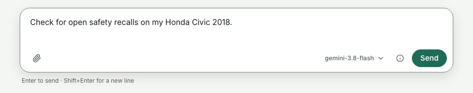
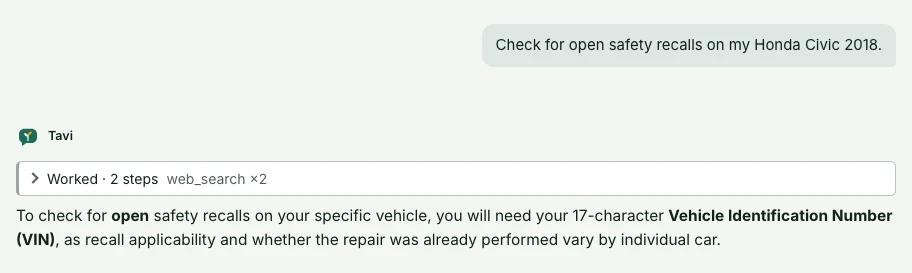
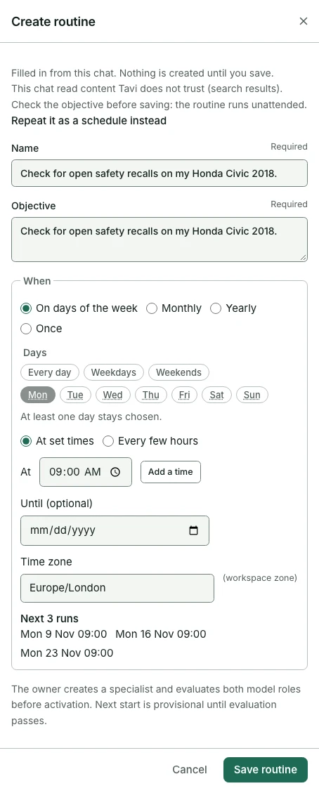

# Watch for safety recalls on your car

Tavi looks for open safety recalls on your car, and a weekly routine keeps looking for you.

> **Uses:** Web · Routines
> **Asks first:** Nothing — it only reads and suggests
> **Runs:** Weekly
> **Idea card:** "Watch car recalls" (`travel.recalls`)
> **Before you start:** a model connected ([Connect your first model](../../get-started/first-model.md)) · the canvas open ([Open the web canvas and walk through Welcome](../../get-started/web-canvas-tour.md)) · web search set up ([Set up web search](../../web-and-browser/set-up-web-search.md)) · Tavi running in the background with `tavi serve` ([Keep Tavi running in the background](../../get-started/keep-tavi-running.md)), for the routine ([Follow a topic with a research routine](../../automation/research-routine.md))

## 1. Ask for it

Choose **New chat** above the chats to open a chat of its own and send the prompt with your car in it: `Check for open safety recalls on my Honda Civic 2018.` Once Tavi knows this is something you do, **Ideas** may offer it as a card in its own words; **Try it** there starts the same chat.

## 2. Read the result

Tavi searches the web and tells you which recalls it found for that model and year, and where to check your own car. It may ask to open a recall site in the browser or run a lookup in the sandbox: allow it for a fuller answer, or deny it and Tavi answers from its search. Once it has opened a page, a further search asks first too ([Research a question with cited sources](../../web-and-browser/research-with-sources.md)).

The list of recalls that follows comes from the model reading search results, and a campaign number can be wrong. Only the official lookup with your VIN says what applies to your car.

Tavi finds what was published for the model, not what applies to your own car. Only the maker or your country's recall service can say that from your VIN, and they can say whether the work has been done. Don't take a clear answer here as proof that there is nothing open on your car.

## 3. Make it recurring

Point at your message and choose **Repeat this…**. A chat that only searched the web and read memory opens **Create routine**, and one that used anything else **Create schedule**, both filled in from the message. Under **When**, choose **On days of the week**, then one day and a time, and save. Tavi checks a new routine before it starts, which can take up to fifteen minutes, and either way it is listed in **Center → Schedule**.

<!-- cover -->

## Variations

- `Check for open safety recalls on my 2020 Volkswagen Golf in the UK.` Name your country: recalls are published country by country.
- Add your child's car seat or your e-bike to the routine's objective in **Edit routine**.

## Related

- [Follow a topic with a research routine](../../automation/research-routine.md)
- [Read a routine run's report and where it was delivered](../../automation/inspect-a-routine-run.md)
- [Turn a chat that worked into a schedule](../../automation/repeat-this.md)
- [Decode a warning code from your car](car-code.md)
