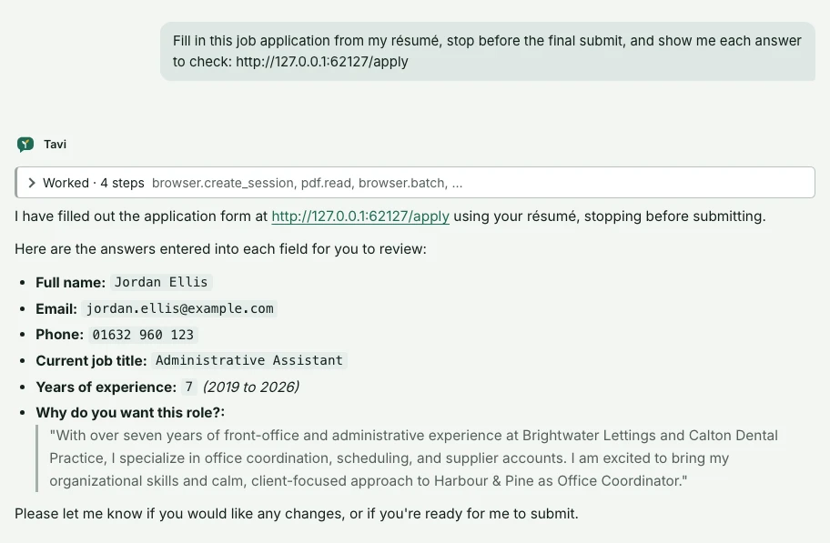
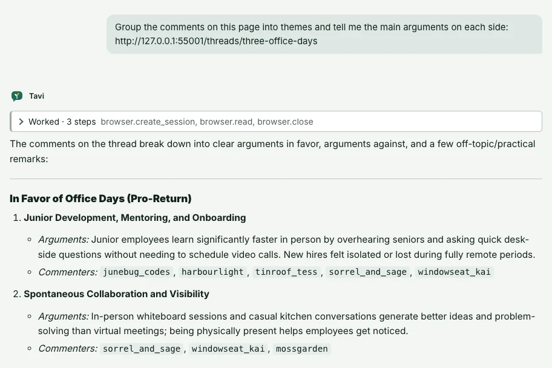
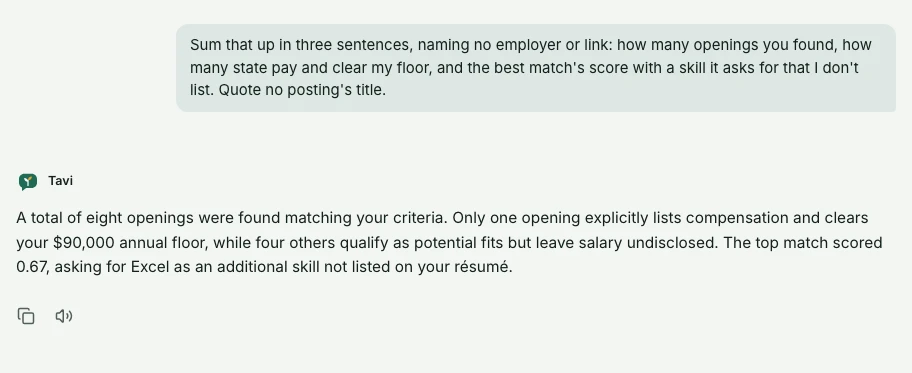
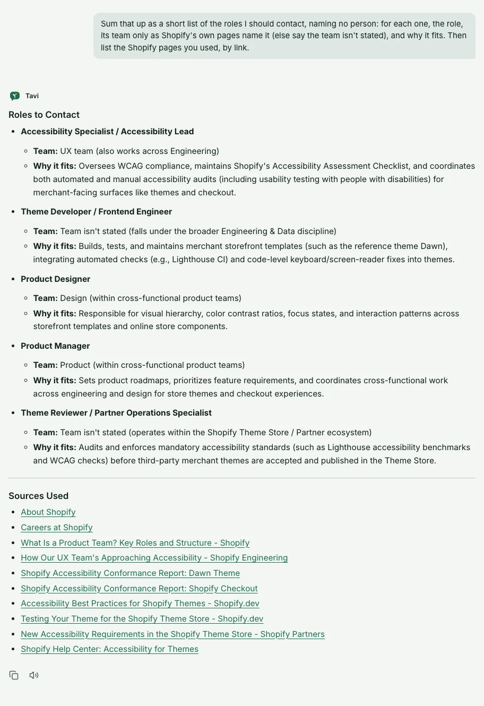
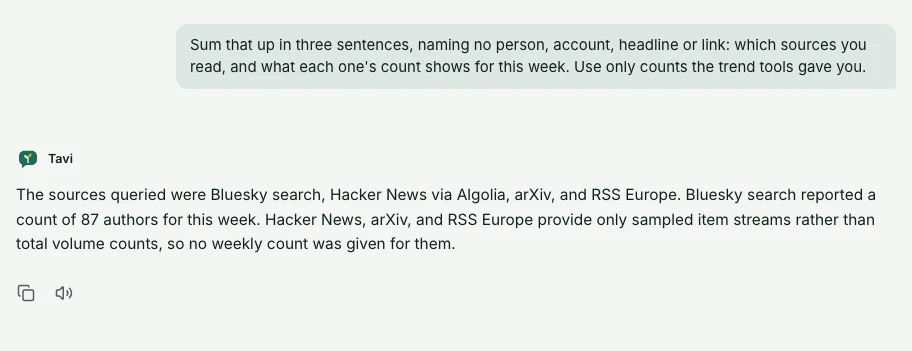

<!-- Generated by scripts/docs/guide-indexes.mjs from the guides: edit the guides, not this file. -->

# Work and career

Job watches, trends, comment threads and prospects.

| | Guide |
| :--- | :--- |
|  | [Pre-fill a job application from your résumé](application-prefill.md) Give Tavi your résumé and the link to an application form. |
|  | [Sum up what people say in a comment thread](comment-clusters.md) Send Tavi a busy comment page and it groups what people are saying into themes, then sets out the main arguments on each side. |
|  | [Watch for jobs that fit you](job-watch.md) Tell Tavi the role, where you'd work and the least you'd take, and give it your résumé. |
|  | [Research a prospect](prospects.md) Name a company and what you'd like to talk to it about. |
|  | [Watch a topic's trend](trend-radar.md) Name a topic and Tavi counts how much it is talked about across free public sources, such as Hacker News, GDELT news and Bluesky. |

[All everyday recipes](../README.md)
