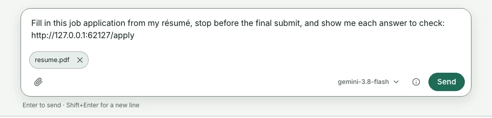
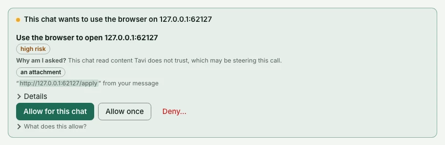
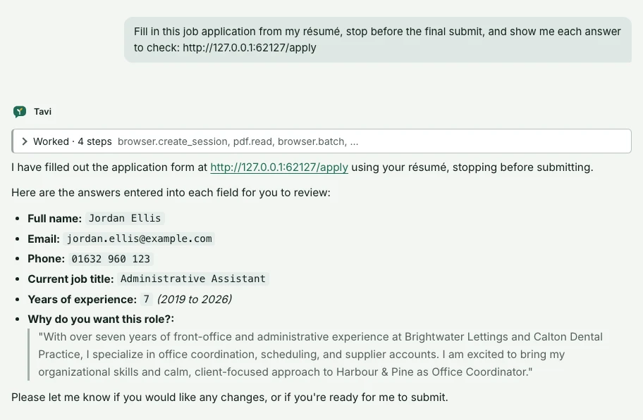

# Pre-fill a job application from your résumé

Give Tavi your résumé and the link to an application form. It fills each field from your résumé in its own browser, stops before the final submit, and lists every answer for you to check.

> **Uses:** Browser · PDFs
> **Asks first:** Browser
> **Runs:** When you ask
> **Idea card:** "Pre-fill an application" (`work.application-prefill`)
> **Before you start:** a model connected ([Connect your first model](../../get-started/first-model.md)) · the canvas open ([Open the web canvas and walk through Welcome](../../get-started/web-canvas-tour.md)) · the agent's browser working ([Let Tavi drive a browser while you watch, signed in or signed out](../../web-and-browser/browse-with-tavi.md)) · your résumé as a PDF ([Summarise a PDF and pull out tables](../../documents/read-a-pdf.md))

## 1. Ask for it

Choose **New chat** above the chats to open a chat of its own, attach your résumé with the paperclip ([Send a file or image with your message](../../chat/attach-files-to-chat.md)), and send the prompt with the form's link at its end: `Fill in this job application from my résumé, stop before the final submit, and show me each answer to check: https://careers.example.com/apply`. Once Tavi knows this is something you do, **Ideas** may offer it as a card in its own words; **Try it** there starts the same chat.

## 2. Allow the browser

Tavi asks before it opens the form's site in its browser, then reads your résumé: choose **Allow for this chat**, so the form's pages open without asking again. The typing still asks, each time with **Allow once**, since your résumé is a file Tavi doesn't trust: check what each card would type, and allow it. Watch it fill the fields in the live browser view if you like.

## 3. Check each answer

Tavi stops before **Submit application** and lists what it put in each field, and anything your résumé didn't answer. Read every one: a cover note in particular is a draft in your voice that you should rewrite. Then submit it yourself, in the form or by taking over the browser ([Take over for a login or a final checkout](../../web-and-browser/take-over-the-browser.md)).

<!-- cover -->

A form that needs a sign-in, a file upload or a CAPTCHA stops Tavi there: it asks you to do that part, and carries on when you hand the browser back.

## Variations

- `Fill in this application from my résumé, and leave the salary question blank for me.`
- Answer a question it couldn't: `Use "two weeks" for my notice period, then show me the answers again.`

## Related

- [Take over for a login or a final checkout](../../web-and-browser/take-over-the-browser.md)
- [Let Tavi drive a browser while you watch, signed in or signed out](../../web-and-browser/browse-with-tavi.md)
- [Watch for jobs that fit you](job-watch.md)
