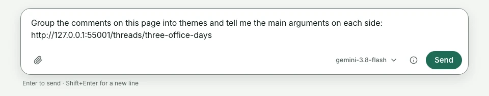
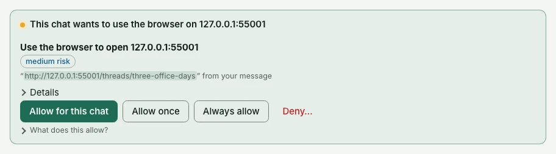
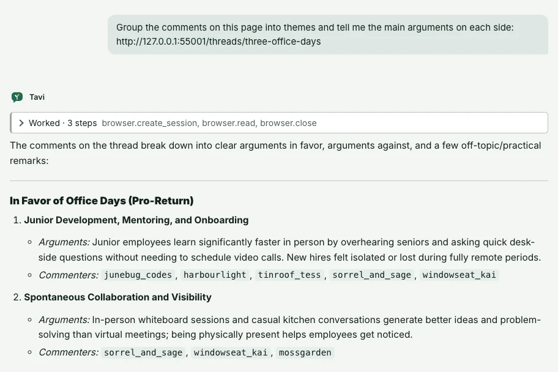

# Sum up what people say in a comment thread

Send Tavi a busy comment page and it groups what people are saying into themes, then sets out the main arguments on each side.

> **Uses:** Browser
> **Asks first:** Nothing — it only reads and suggests
> **Runs:** When you ask
> **Idea card:** "Cluster the comments" (`work.comment-clusters`)
> **Before you start:** a model connected ([Connect your first model](../../get-started/first-model.md)) · the canvas open ([Open the web canvas and walk through Welcome](../../get-started/web-canvas-tour.md)) · Tavi running in the background with `tavi serve` ([Keep Tavi running in the background](../../get-started/keep-tavi-running.md)) · the browser, which opens the page once you allow it ([Let Tavi drive a browser while you watch, signed in or signed out](../../web-and-browser/browse-with-tavi.md))

## 1. Ask for it

Copy the address of the comment page. Choose **New chat** above the chats to open a chat of its own and send the prompt with the link in it: `Group the comments on this page into themes and tell me the main arguments on each side: <the link>`. Once Tavi knows this is something you do, **Ideas** may offer it as a card in its own words; **Try it** there starts the same chat.

## 2. Let it open the page

To read the comments, Tavi asks to open the page: **This chat wants to use the browser on** the page's site. Choose **Allow for this chat**. The forum in this page's pictures is made up, every name on it is invented, and it is served on this computer: a page on your own computer or network opens only once you list its address, as in `tavi serve --browser-allow-host 127.0.0.1:8080`. A public page needs no such flag.

## 3. Read the result

Tavi reads the page in the browser, named on the **Worked** line above its answer. It groups the comments into themes, and may name who made each point by the name they post under, more often when the page sets the names apart, as the forum in the pictures does in bold. It then sets out the main arguments for and against, and may put the off-topic comments in a group of their own.

<!-- cover -->

The themes are Tavi's own reading of the comments the page loads, so a thread that loads more as you scroll, or hides replies, shows it only part.

## Variations

- `Group the comments on this page into themes, and tell me which points come up most and which only once: <the link>`
- Paste the comments into the chat if the page won't open: `Group these comments into themes and tell me the main arguments on each side.`

## Related

- [Let Tavi drive a browser while you watch, signed in or signed out](../../web-and-browser/browse-with-tavi.md)
- [Track a trend over weeks](../../automation/trend-routine.md)
- [Check a listing's reviews before you buy](../shopping-and-style/review-check.md)
