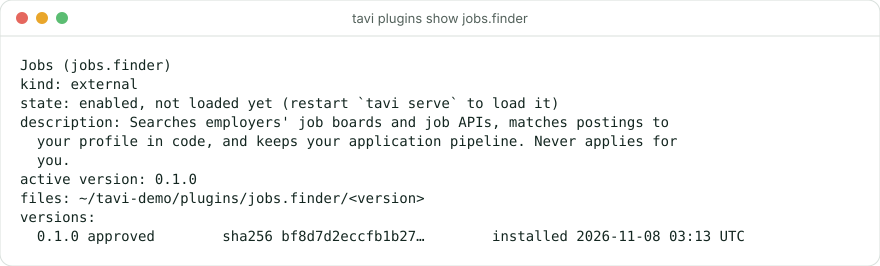
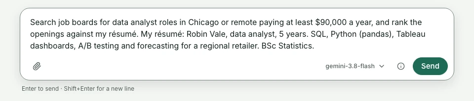
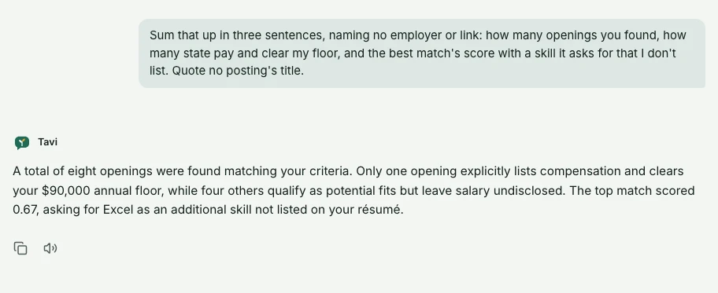
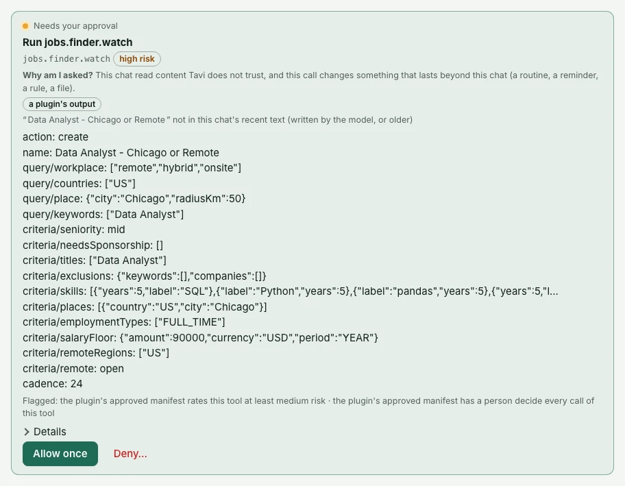

# Watch for jobs that fit you

Tell Tavi the role, where you'd work and the least you'd take, and give it your résumé. It searches job boards, ranks what it finds against your résumé in code, and a watch keeps looking for new openings every day.

> **Uses:** Job finder
> **Asks first:** Job finder
> **Runs:** Daily
> **Idea card:** "Watch for matching jobs" (`work.job-watch`)
> **Before you start:** a model connected ([Connect your first model](../../get-started/first-model.md)) · the canvas open ([Open the web canvas and walk through Welcome](../../get-started/web-canvas-tour.md)) · Tavi running in the background with `tavi serve` ([Keep Tavi running in the background](../../get-started/keep-tavi-running.md)) · the Jobs app built from the repository with `pnpm --filter @tavi/plugin-jobs build` ([Install and enable a plugin](../../extend/install-a-plugin.md), [Jobs](../../../JOBS.md#install)) · the heartbeat on, for the daily watch ([Tune the heartbeat](../../automation/heartbeat.md))

## 1. Add the Jobs app

Run `tavi plugins install packages/external/jobs/dist-plugin`, then `tavi plugins approve jobs.finder 0.1.1` and `tavi plugins enable jobs.finder`, and restart `tavi serve`: a plugin loads when Tavi starts. `tavi plugins show jobs.finder` shows what you added. It runs as a confined worker and never applies for you.

<picture>
  <source media="(prefers-color-scheme: dark)" srcset="../../../assets/use-cases/everyday/work-and-career/job-watch/01-add-the-jobs-app-dark.svg">
  
</picture>

## 2. Ask for it

Choose **New chat** above the chats to open a chat of its own and send the prompt with your role, place and floor in it, and your résumé after it: `Search job boards for data analyst roles in Chicago or remote paying at least $90,000 a year, and rank the openings against my résumé.` Paste a few lines of your résumé after it, as in `My résumé: Robin Vale, data analyst, 5 years. SQL, Python (pandas), Tableau dashboards, A/B testing and forecasting for a regional retailer. BSc Statistics.`, or attach the file ([Send a file or image with your message](../../chat/attach-files-to-chat.md)). Once Tavi knows this is something you do, **Ideas** may offer it as a card in its own words; **Try it** there starts the same chat.

## 3. Read the result

Tavi searches with `jobs.finder.search`, which sends only the job words and the place, never your résumé. Without any keys set up it reads Himalayas' remote jobs, Dice's US tech jobs and a few public boards, such as Sweden's JobTech and the US's Snagajob for hourly work. It then ranks the postings with `jobs.finder.match`, against a profile it takes from your résumé: your titles, skills and salary floor. Matching is code, so nothing a posting says can argue its way up the list. A posting that states pay under your floor is left out; one that states no pay stays in, marked as unknown.

Tavi lists the openings with their score, the skills each asks for that you don't list, and a link to the posting. The list names real employers, so ask for the short version in the same chat: `Sum that up in three sentences, naming no employer or link: how many openings you found, how many state pay and clear my floor, and the best match's score with a skill it asks for that I don't list. Quote no posting's title.` The picture shows that summary.

<!-- cover -->

Postings are other people's text, and can be old, closed or a scam: open the link and read the posting on the employer's own site before you apply. Tavi never applies for you.

## 4. Make it recurring

Ask in the same chat: `Keep watching for new roles like these every day, matched against my résumé and floor.` Tavi proposes a watch with `jobs.finder.watch`, and a watch always asks, since it lasts beyond this chat. The card shows its name, the search (`query`), the profile it matches against (`criteria`) and the hours between runs (`cadence`). Read the profile: Tavi fills in what your résumé suggests, such as full-time work or a seniority, and the watch leaves out postings that don't fit it. If it guessed wrong, choose **Deny…** and say what to change. Otherwise choose **Allow once**.

A watch runs without a model. When the heartbeat checks and a watch is due, once a day here, the Jobs app runs its search again and matches what it finds against the profile you approved. A new fit becomes a match the heartbeat hears of, `New match: <title> at <company> (0.86)`, and its own rules decide whether and where it tells you. The first check after you add a watch only notes what is already there, so the fits it finds that day aren't announced: ask `What has my watch found?` to see them, which Tavi answers from the watch's digest. The watch keeps a copy of the profile from the day you approved it: when your résumé or floor changes, ask Tavi to update the watch. To stop it, ask Tavi to pause or remove it.

## Variations

- `Search job boards for registered nurse roles in Stockholm paying at least 40,000 kr a month, and rank the openings against my résumé.`
- `Watch for new matches every day and send me a digest at 08:00`: the watch answers with a daily schedule to make, which asks first ([Create, change, pause and cancel schedules from a chat](../../automation/manage-schedules-by-chatting.md)).

## Related

- [Jobs](../../../JOBS.md)
- [Install and enable a plugin](../../extend/install-a-plugin.md)
- [Tune the heartbeat: quiet hours and nudges](../../automation/heartbeat.md)
- [Send a file or image with your message](../../chat/attach-files-to-chat.md)
