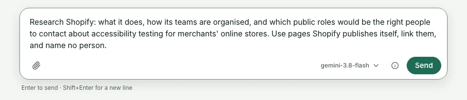
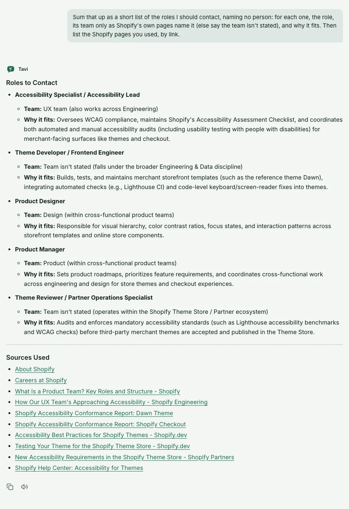

# Research a prospect

Name a company and what you'd like to talk to it about. Tavi searches the web for what the company does and how its teams are organised, and suggests the public roles worth contacting, linking the company's own pages.

> **Uses:** Web
> **Asks first:** Nothing — it only reads and suggests
> **Runs:** When you ask
> **Idea card:** "Research a prospect" (`productivity.prospects`)
> **Before you start:** a model connected ([Connect your first model](../../get-started/first-model.md)) · the canvas open ([Open the web canvas and walk through Welcome](../../get-started/web-canvas-tour.md)) · Tavi running in the background with `tavi serve` ([Keep Tavi running in the background](../../get-started/keep-tavi-running.md)) · web search set up ([Set up web search](../../web-and-browser/set-up-web-search.md))

## 1. Ask for it

Choose **New chat** above the chats to open a chat of its own and send the prompt with the company and your topic in it: `Research Shopify: what it does, how its teams are organised, and which public roles would be the right people to contact about accessibility testing for merchants' online stores. Use pages Shopify publishes itself, link them, and name no person.` Once Tavi knows this is something you do, **Ideas** may offer it as a card in its own words; **Try it** there starts the same chat.

## 2. Read the result

Tavi searches the web, then answers with what the company does, how its teams are organised as far as its own pages say, and the roles that suit your topic, with links to the company's pages it used. A chat that has read the web can stop on a card before its next search or page: check it and choose **Allow once**. Tavi doesn't need the browser here, so you can deny a card for it.

Ask for the short version in the same chat: `Sum that up as a short list of the roles I should contact, naming no person: for each one, the role, its team only as Shopify's own pages name it (else say the team isn't stated), and why it fits. Then list the Shopify pages you used, by link.` The picture shows that summary.

<!-- cover -->

Tavi reads what a search turns up, so a team or a role may have changed since the page was written, and how it groups the roles is its own reading. Check each team on the company's own pages before you reach out, and find the person through the channel the company gives, such as its partner or press contact. Tavi doesn't send anything.

## Variations

- `Research Atlassian: what it does, how its teams are organised, and which public roles would be the right people to contact about a developer tools partnership. Use pages Atlassian publishes itself, link them, and name no person.`
- Ask a follow-up: `Which of these roles would decide on a pilot, and which would only use it?`
- Ask where to reach them: `Which of these has a contact page or form Shopify publishes for partners or press? Link it.`

## Related

- [Research a question with cited sources](../../web-and-browser/research-with-sources.md)
- [Set up web search](../../web-and-browser/set-up-web-search.md)
- [Find a licensed specialist near you](../local-services/specialist.md)
