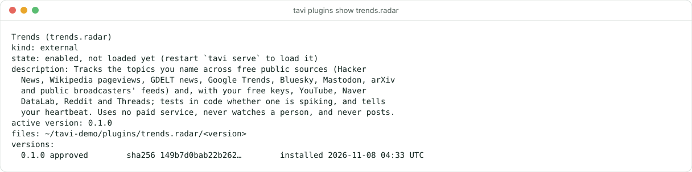
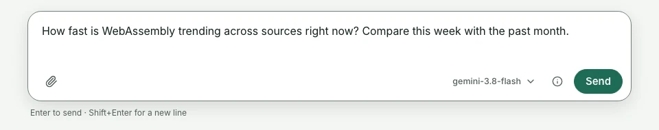
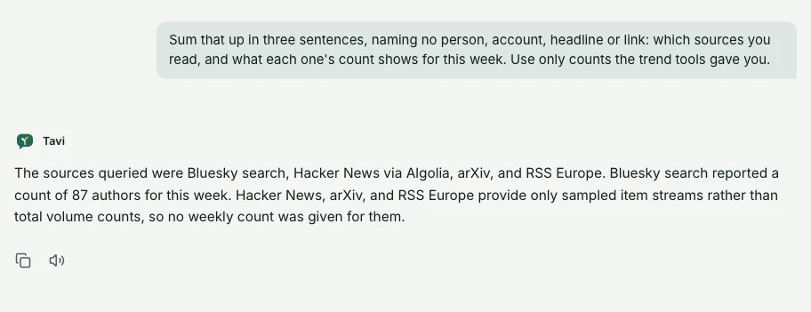
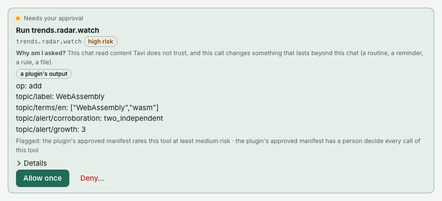

# Watch a topic's trend

Name a topic and Tavi counts how much it is talked about across free public sources, such as Hacker News, GDELT news and Bluesky. Then it can keep watching the topic against its usual level, and tell you when the talk speeds up.

> **Uses:** Trends
> **Asks first:** Trends
> **Runs:** Daily
> **Idea card:** "Watch a topic's trend" (`work.trend-radar`)
> **Before you start:** a model connected ([Connect your first model](../../get-started/first-model.md)) · the canvas open ([Open the web canvas and walk through Welcome](../../get-started/web-canvas-tour.md)) · Tavi running in the background with `tavi serve` ([Keep Tavi running in the background](../../get-started/keep-tavi-running.md)) · the Trends app built from the repository with `pnpm --filter @tavi/plugin-trends build` ([Install and enable a plugin](../../extend/install-a-plugin.md), [Trends](../../../TRENDS.md#install)) · the heartbeat on, for the alerts ([Tune the heartbeat](../../automation/heartbeat.md))

## 1. Add the Trends app

Run `tavi plugins install packages/external/trends/dist-plugin`, then `tavi plugins approve trends.radar 0.1.0` and `tavi plugins enable trends.radar`, and restart `tavi serve`: a plugin loads when Tavi starts. `tavi plugins show trends.radar` shows what you added. It runs as a confined worker, reads only free public sources and never posts.

<picture>
  <source media="(prefers-color-scheme: dark)" srcset="../../../assets/use-cases/everyday/work-and-career/trend-radar/01-add-the-trends-app-dark.svg">
  
</picture>

## 2. Ask for it

Choose **New chat** above the chats to open a chat of its own and send the prompt with your topic in it: `How fast is WebAssembly trending across sources right now? Compare this week with the past month.` Once Tavi knows this is something you do, **Ideas** may offer it as a card in its own words; **Try it** there starts the same chat.

## 3. Read the result

Tavi searches the trend sources for the topic with `trends.radar.search`, over the past week and the past month, and reads a sample of what they hold. It answers with the counts from the sources that count by the hour, such as stories on Hacker News. A source that can read only its newest posts, such as Bluesky when they fill its page, gives a sample of them and no count.

The answer can quote headlines and posts, which name real people. Ask for the short version in the same chat: `Sum that up in three sentences, naming no person, account, headline or link: which sources you read, and what each one's count shows for this week. Use only counts the trend tools gave you.` The picture shows that summary.

One search can't tell you whether the talk is speeding up: a week beside a month says little when most sources keep only recent posts. That takes a baseline, which the watch in step 4 builds and tests each topic against.

<!-- cover -->

A count is how many stories, articles or posts a source gave for the words you named, not how many people care. A source that is paused or out of its daily budget is skipped for that search. Read it as a rough signal, and open the sources for the detail ([Trends](../../../TRENDS.md#sources)).

## 4. Make it recurring

In the same chat, ask Tavi to keep watching: `Watch WebAssembly with the Trends app and tell me when it takes off.` Saving a topic always asks first: the card for `trends.radar.watch` shows the topic's label, the words it searches for, and its alert rule. Choose **Allow once**.

From then on, while the heartbeat is on, it sweeps your topics at most once an hour inside its hours, and tests each one against its usual level. A topic takes off, by default, when its last day is up more than 300% on its usual level on two kinds of source, such as news and community; the heartbeat hears of it, and its own rules decide whether and where it tells you. Nothing comes while the topic is quiet. The longer it watches, the more it has to compare: daily counts are kept 400 days. The heartbeat is off until you turn it on in **Center → Heartbeat**; without it, the topic is swept only when you ask, as in `How is WebAssembly trending since yesterday?`. To change the topic's words, or to stop, ask Tavi to update, pause or remove it, as in `Stop watching WebAssembly.`: each asks first, the same way.

## Variations

- `How fast is solid-state batteries trending across sources right now? Compare this week with the past month.`
- `Every morning at 8, give me the trends digest.` Tavi proposes a schedule that sweeps your watched topics and posts a short digest to Home, after you approve it ([Track a trend over weeks](../../automation/trend-routine.md#4-get-a-digest-every-morning)).

## Related

- [Track a trend over weeks](../../automation/trend-routine.md)
- [Tune the heartbeat: quiet hours and nudges](../../automation/heartbeat.md)
- [Install and enable a plugin](../../extend/install-a-plugin.md)
- [Trends](../../../TRENDS.md)
