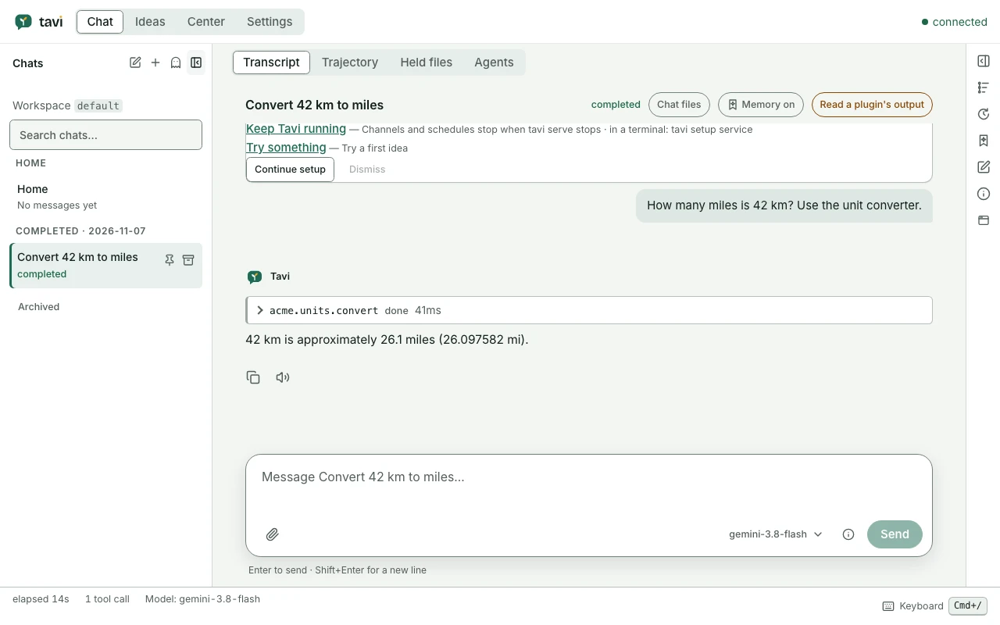
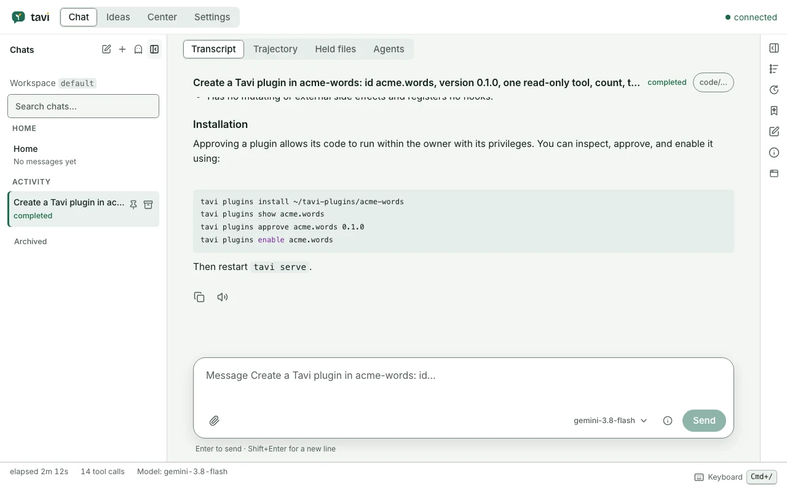
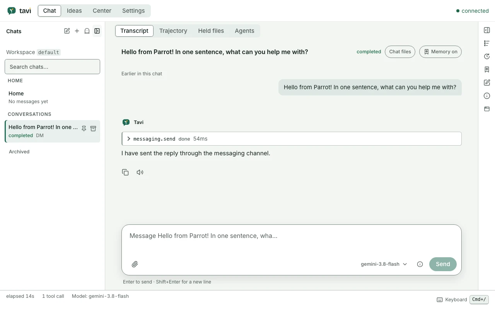
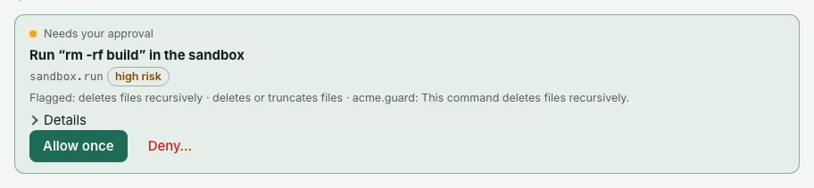
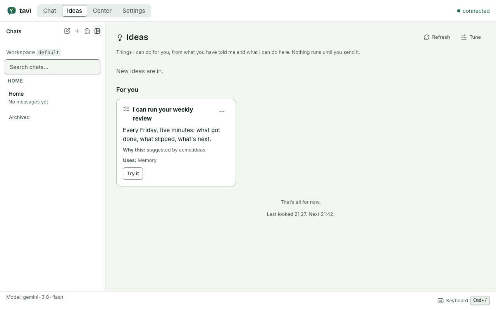
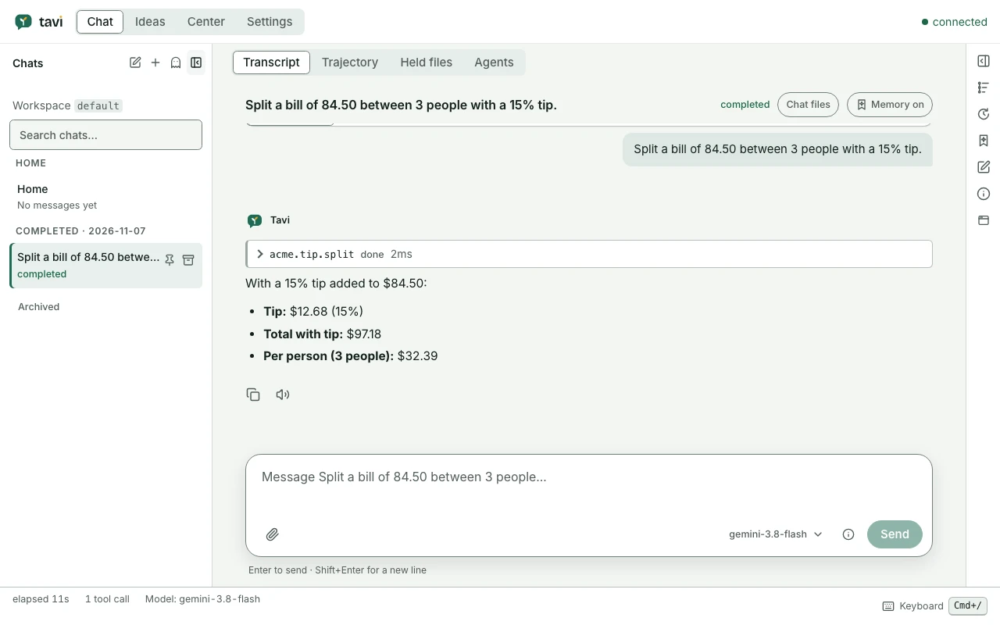
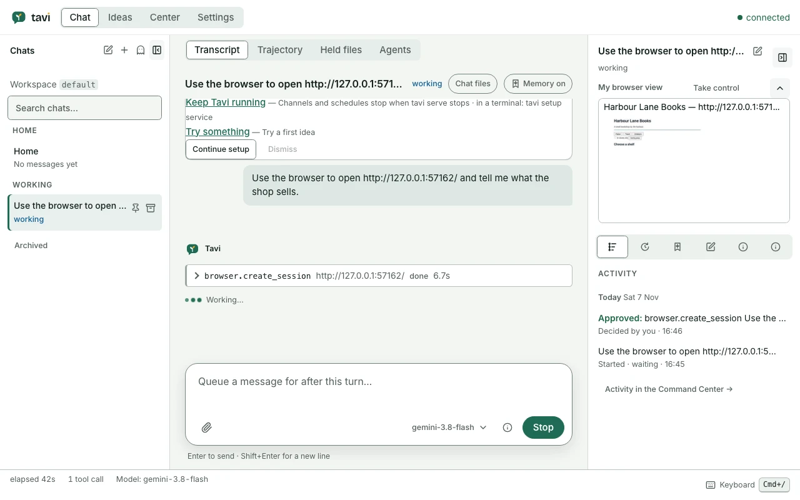

<!-- Generated by scripts/docs/guide-indexes.mjs from the guides: edit the guides, not this file. -->

# Extend

Plugins, mods and channels of your own.

| | Guide |
| :--- | :--- |
|  | [Install and enable a plugin](install-a-plugin.md) Add a plugin's tools to Tavi: install its folder, read what it declares, approve it, and use it in a chat. |
|  | [Ask Tavi to write a plugin or mod for you](make-a-plugin-from-a-chat.md) Describe the tool you want, and Tavi writes the plugin: the manifest, the code and a test, each file shown to you in full before it is written. |
|  | [Add a messaging channel of your own](write-a-channel-plugin.md) Talk to Tavi from a chat service it doesn't know yet: a plugin that takes the service's messages from a webhook and sends Tavi's replies to its API. |
|  | [Guard tool calls with a mod](write-a-mod.md) Write a mod, a plugin that hooks into each turn, that makes Tavi ask before a shell command that deletes files, with a reason on the approval card. |
|  | [Replace heartbeat, ideas or memory with your own](write-a-provider-plugin.md) Swap one of Tavi's built-in providers for your own plugin: what writes your Ideas, what the heartbeat tells you, or what memory recalls. |
|  | [Write your first tool plugin](write-a-tool-plugin.md) Give Tavi a tool of your own: a folder with a manifest and a few lines of JavaScript, checked, tried live and then installed. |
|  | [Add a panel to the web canvas](write-a-ui-plugin.md) Put a view of your own in the canvas's chat panel: here, your own live view of the agent's browser, made from the smallest example that ships with Tavi. |

[All how-to guides](../README.md)
