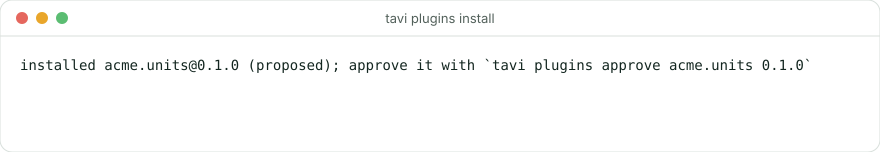
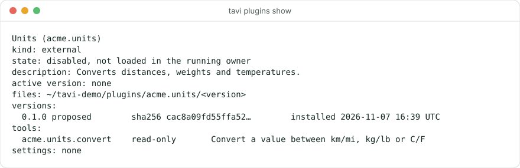
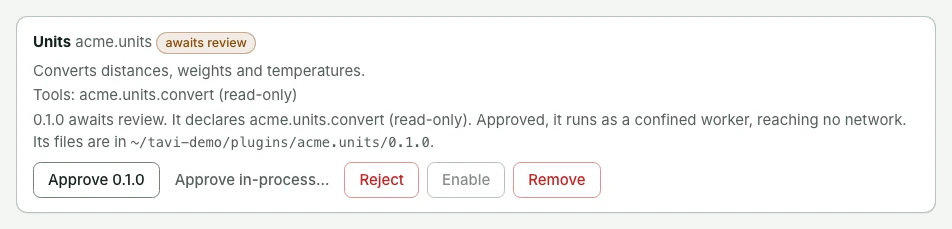
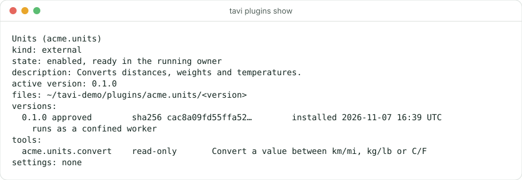
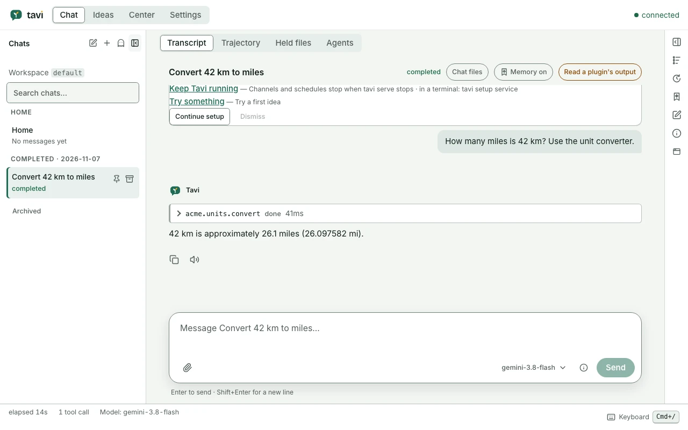
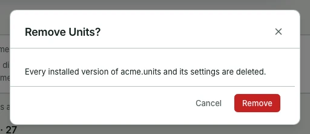

# Install and enable a plugin

Add a plugin's tools to Tavi: install its folder, read what it declares, approve it, and use it in a chat. The example is `acme-units`, a unit converter that ships with Tavi. About five minutes.

> **Uses:** plugins (`tavi plugins show <id>`, **Settings → Plugins**) · the plugin's own tool (`acme.units.convert`) · the web canvas and the terminal
> **Before you start:** a model connected ([Connect your first model](../get-started/first-model.md)) · Tavi running in the background with `tavi serve` ([Keep Tavi running in the background](../get-started/keep-tavi-running.md)) · the canvas open ([Open the web canvas and walk through Welcome](../get-started/web-canvas-tour.md)) · a copy of the Tavi repository, for its `examples/` folder

## 1. Install the folder

From your copy of the Tavi repository, run `tavi plugins install examples/plugins/acme-units`. Tavi copies the folder into its data directory and fingerprints every file, and the version waits for your review. No code from it runs yet.

<picture>
  <source media="(prefers-color-scheme: dark)" srcset="../../assets/use-cases/extend/install-a-plugin/01-install-the-folder-dark.svg">
  
</picture>

## 2. Read what it declares

Run `tavi plugins show acme.units` to see what you'd be trusting: its tools, each with its effect, its settings, and where its files are. A `read-only` tool runs without asking you; a `mutating` or `external` one asks first every time.

<picture>
  <source media="(prefers-color-scheme: dark)" srcset="../../assets/use-cases/extend/install-a-plugin/02-read-what-it-declares-dark.svg">
  
</picture>

## 3. Approve and enable it

Open **Settings → Plugins**. The plugin is listed under **Installed** as **awaits review**, with what the version declares. Choose **Approve 0.1.0**, then **Enable**. It runs as a confined worker that can only reach its own folder.

## 4. Restart Tavi

A plugin loads when the owner starts, so stop `tavi serve` and start it again. `tavi plugins show acme.units` then says it's **ready in the running owner**. If it says **failed**, the error after it says why.

<picture>
  <source media="(prefers-color-scheme: dark)" srcset="../../assets/use-cases/extend/install-a-plugin/04-restart-tavi-dark.svg">
  
</picture>

## 5. Use it in a chat

Start a new chat and ask something only the tool answers well, such as `How many miles is 42 km? Use the unit converter.` Tavi calls `acme.units.convert` straight away, without an approval card, because the tool is read-only. The header's **Read a plugin's output** says the chat now holds a plugin's answer, which Tavi treats like any outside content.

<!-- cover -->

## 6. Turn it off or remove it

Back in **Settings → Plugins**, **Disable** withdraws its tools at once. **Remove** then deletes every installed version and its settings; your own copy of the folder is untouched. From the terminal, it's `tavi plugins disable acme.units` and `tavi plugins remove acme.units`.

## What Tavi will and won't do

Installing runs nothing: a plugin's code runs only once you approve and enable it, and only the exact files you approved, which the owner checks again each time it starts. A chat or the model can never install, approve or enable a plugin; only you can, here or in the terminal. Each tool keeps the approval rule of the effect its manifest declares. The details are in [PLUGINS.md](../../PLUGINS.md#trust).

## Related

- [Write your first tool plugin](write-a-tool-plugin.md)
- [Guard tool calls with a mod](write-a-mod.md)
- [Approve, reject or always-allow a tool call](../chat/approve-tool-calls.md)
- Reference: [PLUGINS.md](../../PLUGINS.md), [MODS.md](../../MODS.md#part-c--installing-updating-and-uninstalling), [CLI.md](../../CLI.md#tavi-plugins)
