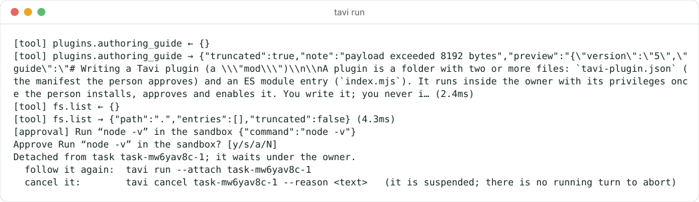
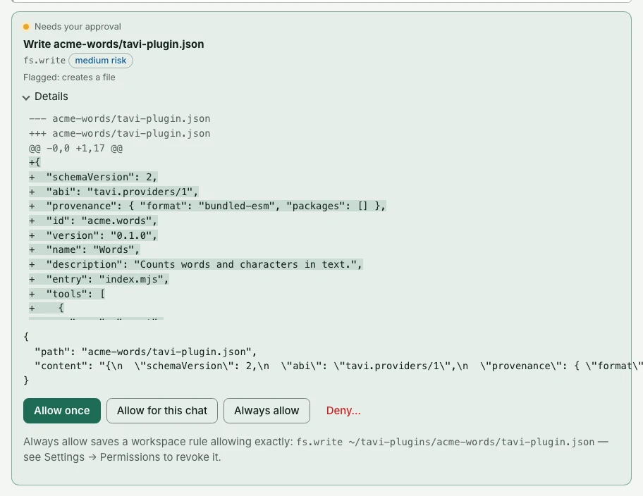
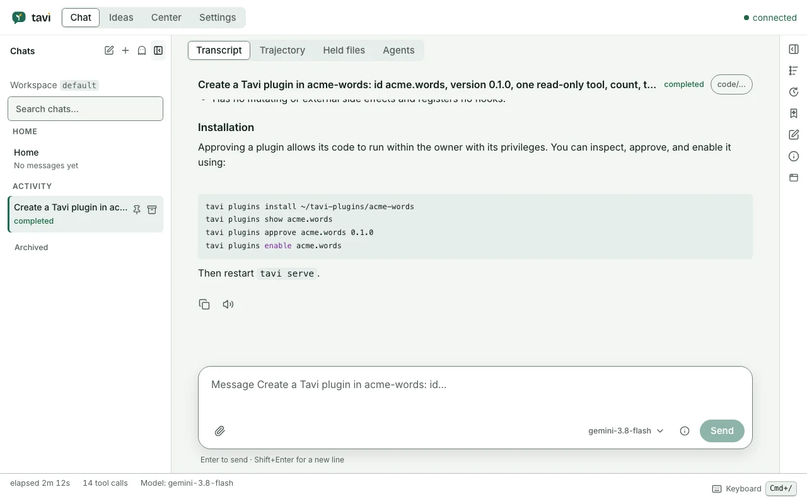
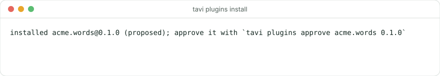
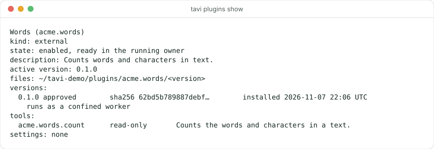
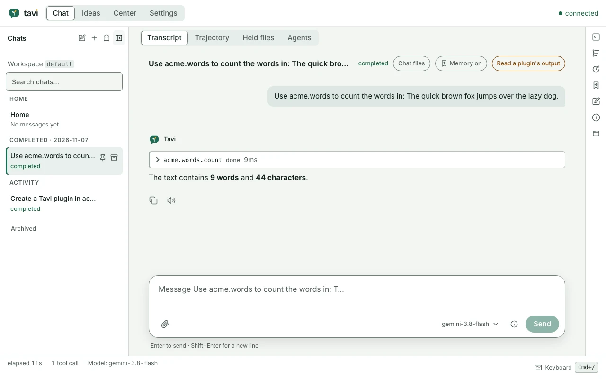

# Ask Tavi to write a plugin or mod for you

Describe the tool you want, and Tavi writes the plugin: the manifest, the code and a test, each file shown to you in full before it is written. You install it yourself. The example counts the words in a text. About fifteen minutes.

> **Uses:** the file tools (`fs.write`) · Tavi's plugin rules (`plugins.authoring_guide`, `plugins.validate`) · the shell sandbox (`sandbox.run`) · plugins (`tavi plugins list`)
> **Before you start:** a model connected ([Connect your first model](../get-started/first-model.md)) · a folder for your plugins, `~/tavi-plugins`, that Tavi may write in: `tavi serve --fs-root ~/tavi-plugins` ([Give Tavi a working folder](../files-and-code/attach-a-folder.md)) · the canvas open ([Open the web canvas and walk through Welcome](../get-started/web-canvas-tour.md)) · a plugin installed once, to see how it goes ([Install and enable a plugin](install-a-plugin.md))

## 1. Ask for the plugin

Start a chat in your plugins folder and say what the tool should do: `tavi run --folder ~/tavi-plugins "Create a Tavi plugin in acme-words: id acme.words, version 0.1.0, one read-only tool, count, that counts the words and characters in a text."` Tavi reads its own rules for plugins first, then asks before it writes the first file. Press Ctrl-C to leave it waiting and decide on the canvas, or answer here.

<picture>
  <source media="(prefers-color-scheme: dark)" srcset="../../assets/use-cases/extend/make-a-plugin-from-a-chat/01-ask-for-the-plugin-dark.svg">
  
</picture>

## 2. Read each file before you approve it

Open the chat on the canvas; it is at the top of the chats list. Each file is a card: open **Details** to read the whole file before you choose **Allow once**. Read the code with care: once you install and enable it, it runs inside Tavi.

## 3. Let it check what it wrote

Approve the code and its test the same way. Tavi checks the folder with `plugins.validate`, fixes what that reports, and may ask to run the test with `node --test` in the sandbox. It ends with the commands to install the plugin: it never installs, approves or enables anything itself.

<!-- cover -->

## 4. Install it yourself

Run `tavi plugins install ~/tavi-plugins/acme-words`. Tavi copies the folder and fingerprints every file; the version waits for your review, and no code from it runs yet.

<picture>
  <source media="(prefers-color-scheme: dark)" srcset="../../assets/use-cases/extend/make-a-plugin-from-a-chat/04-install-it-yourself-dark.svg">
  
</picture>

## 5. Approve, enable and restart

Run `tavi plugins approve acme.words 0.1.0` and `tavi plugins enable acme.words`, then restart `tavi serve`. `tavi plugins show acme.words` lists its tool with the effect you approved, and says it is ready.

<picture>
  <source media="(prefers-color-scheme: dark)" srcset="../../assets/use-cases/extend/make-a-plugin-from-a-chat/05-approve-enable-and-restart-dark.svg">
  
</picture>

## 6. Use it

In a new chat, ask for what it does, such as `Use acme.words to count the words in: The quick brown fox jumps over the lazy dog.` A read-only tool runs without asking. To change the plugin later, ask Tavi to change the files and raise `version`, then install and approve the new version.

## What Tavi will and won't do

Tavi writes only inside the folders you name with `--fs-root`, and asks before every file, showing it in full. It never installs, approves or enables a plugin: you do that, after reading what it declares. The same way works for a mod, a plugin that hooks into each turn, such as one that asks before destructive shell commands; [MODS.md](../../MODS.md#part-b--making-a-plugin-from-a-chat) has worked prompts for both.

## Related

- [Write your first tool plugin](write-a-tool-plugin.md)
- [Guard tool calls with a mod](write-a-mod.md)
- [Install and enable a plugin](install-a-plugin.md)
- Reference: [MODS.md](../../MODS.md#part-b--making-a-plugin-from-a-chat), [PLUGINS.md](../../PLUGINS.md)
