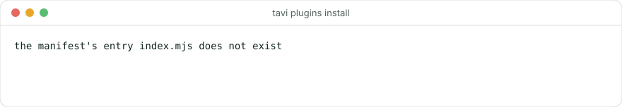
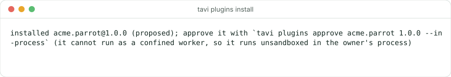
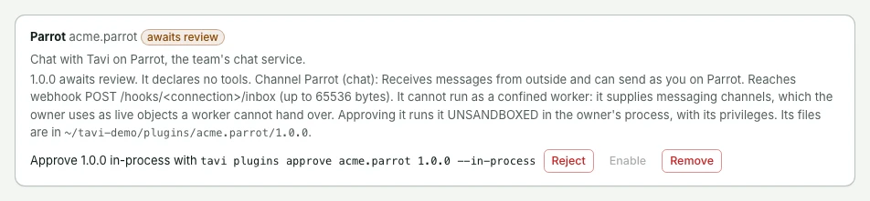
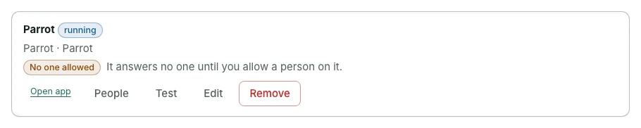
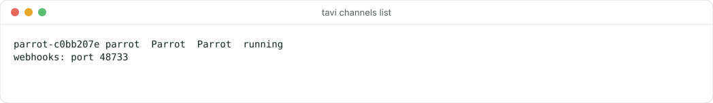
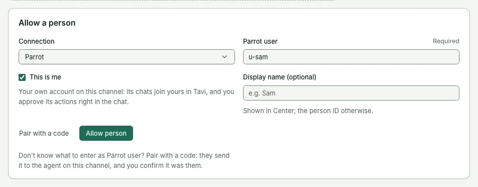
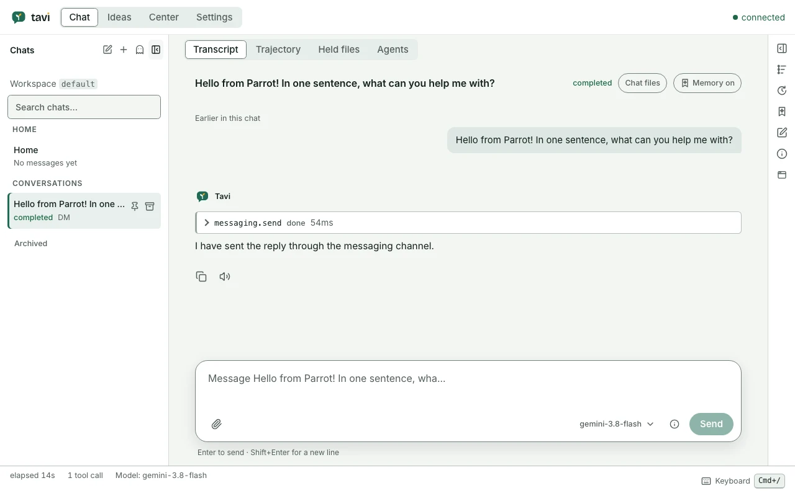

# Add a messaging channel of your own

Talk to Tavi from a chat service it doesn't know yet: a plugin that takes the service's messages from a webhook and sends Tavi's replies to its API. The example is Parrot, a made-up team chat. About thirty minutes.

> **Uses:** channel plugins (`tavi plugins list`) · channels (`tavi channels list`, **Settings → Channels**) · allowed people (**Settings → Allowed people**)
> **Before you start:** a model connected ([Connect your first model](../get-started/first-model.md)) · Tavi running in the background with `tavi serve` ([Keep Tavi running in the background](../get-started/keep-tavi-running.md)) · the canvas open ([Open the web canvas and walk through Welcome](../get-started/web-canvas-tour.md)) · a plugin installed once, to see how it goes ([Install and enable a plugin](install-a-plugin.md)) · a chat service with an official API that posts each new message to a webhook and takes replies over HTTP

## 1. Describe the channel

Make a folder `~/tavi-plugins/acme-parrot` and save this in it as `tavi-plugin.json`. It says what a connection needs (the API's address, a token and the webhook's secret), what a person's id looks like, and the webhook route Tavi mounts for each connection. Tavi draws the connection's form from it and shows it to you for review before any of the code runs.

```json
{
  "schemaVersion": 2,
  "abi": "tavi.providers/1",
  "provenance": { "format": "bundled-esm", "packages": [] },
  "id": "acme.parrot",
  "version": "1.0.0",
  "name": "Parrot",
  "description": "Chat with Tavi on Parrot, the team's chat service.",
  "entry": "index.mjs",
  "provides": ["channel"],
  "channelAbi": 1,
  "channels": [
    {
      "providerId": "parrot",
      "label": "Parrot",
      "kind": "chat",
      "description": "Parrot: messages arrive by webhook, replies go to its API.",
      "settings": [{ "key": "apiUrl", "label": "API address", "type": "string", "required": true }],
      "auth": {
        "kind": "secrets",
        "fields": [
          { "key": "apiToken", "label": "API token" },
          { "key": "webhookSecret", "label": "Webhook secret" }
        ]
      },
      "sender": { "label": "Parrot user", "placeholder": "u-sam", "pattern": "u-[a-z0-9-]{1,32}", "normalize": "none", "authentication": "provider" },
      "target": { "label": "Parrot user", "placeholder": "u-sam", "pattern": "u-[a-z0-9-]{1,32}", "normalize": "none" },
      "ingress": [{ "name": "inbox", "methods": ["POST"], "scope": "connection", "maxBodyBytes": 65536 }],
      "sendRate": { "perMinute": 60, "perTargetPerMinute": 20 },
      "setupHelp": "In Parrot's admin page, make an API token and point the outgoing webhook at the address under Webhooks."
    }
  ],
  "tools": [],
  "config": {}
}
```

Try `tavi plugins install ~/tavi-plugins/acme-parrot` now: it refuses the folder until the code the manifest names, `index.mjs`, exists.

<picture>
  <source media="(prefers-color-scheme: dark)" srcset="../../assets/use-cases/extend/write-a-channel-plugin/01-describe-the-channel-dark.svg">
  
</picture>

## 2. Write the connector

Save this beside it as `index.mjs`: `send` posts a reply to the API and says whether it went, `verify` checks each webhook call carries the secret, and `handle` turns a message into an event. Plain JavaScript with Node's own modules only; Tavi passes in `z` and `TaviError`. Then run `tavi plugins install ~/tavi-plugins/acme-parrot`.

```js
import { createHash, timingSafeEqual } from "node:crypto";

const same = (a, b) => a.length === b.length && timingSafeEqual(Buffer.from(a), Buffer.from(b));
const outcome = (status, more) => ({ status, retryable: false, parts: [{ index: 0, status, ...more }] });

export function register({ registerChannel, z, TaviError }) {
  registerChannel({
    providerId: "parrot",
    version: "1.0.0",
    configSchema: z.object({ apiUrl: z.string().url() }).passthrough(),
    capabilities: {
      receiveMode: "webhook", send: true, editOrProgress: false, formats: ["plain"], attachments: false, maxAttachmentBytes: 0,
      maxPartsPerMessage: 1, threads: false, interactions: false, deliveryReceipts: false, maxTextLength: 4000, approvals: "none",
    },
    createConnection: ({ config, credentials }) => {
      let running = false;
      let since = new Date().toISOString();
      return {
        async start() {
          if ((await credentials.get("apiToken")) === null) throw new Error("no API token");
          running = true;
          since = new Date().toISOString();
        },
        async stop() {
          running = false;
        },
        status: () => ({ state: running ? "running" : "stopped", since }),
        probe: async () => ({ ok: running }),
        async send(message) {
          if (!running) throw new TaviError("UNAVAILABLE", "the Parrot connection is not running");
          const part = message.parts[0];
          if (part === undefined || !("content" in part)) return outcome("rejected", { error: "Parrot carries text only" });
          try {
            const response = await fetch(`${config.apiUrl}/messages`, {
              method: "POST",
              headers: { "content-type": "application/json", authorization: `Bearer ${await credentials.get("apiToken")}` },
              body: JSON.stringify({ to: message.destination.to, text: part.content }),
              signal: AbortSignal.timeout(15_000),
            });
            const sent = await response.json().catch(() => ({}));
            if (response.ok && typeof sent.id === "string") return outcome("accepted", { providerMessageId: sent.id });
            return outcome("rejected", { error: `Parrot answered HTTP ${response.status}` });
          } catch {
            // It may have gone out: Tavi records it as uncertain and never sends it twice.
            return outcome("uncertain", { error: "no answer from Parrot" });
          }
        },
      };
    },
    destinationFor: (target) => ({ to: target.to }),
    destinationFromInbound: (replyTo) => ({ to: replyTo.externalSenderId }),
    ingress: {
      async verify(request, context) {
        const secret = await context.credentials.get("webhookSecret");
        if (secret === null || !same(String(request.headers.authorization ?? ""), `Bearer ${secret}`)) return { ok: false };
        return { ok: true, replayKey: createHash("sha256").update(request.rawBody).digest("hex"), replayTtlMs: 600_000 };
      },
      async handle(request, context) {
        let body;
        try {
          body = JSON.parse(Buffer.from(request.rawBody).toString("utf8"));
        } catch {
          body = undefined;
        }
        if (typeof body?.id !== "string" || typeof body.from !== "string" || typeof body.text !== "string")
          throw new TaviError("INVALID_INPUT", "not a Parrot message");
        const at = context.now();
        const event = {
          connectionId: context.connection.connectionId, providerEventId: body.id, kind: "message", content: body.text,
          externalSenderId: body.from, externalConversationId: body.from, conversationKind: "direct", externalMessageId: body.id,
          occurredAt: at, receivedAt: at,
        };
        return { events: [event] };
      },
    },
  });
}
```

<picture>
  <source media="(prefers-color-scheme: dark)" srcset="../../assets/use-cases/extend/write-a-channel-plugin/02-write-the-connector-dark.svg">
  
</picture>

## 3. Review what it reaches

Open **Settings → Plugins**. Before any of its code runs, the plugin says it **receives messages from outside and can send as you on Parrot**, and lists its webhook route with its size limit. A channel runs inside Tavi's own process, never as a confined worker, so the only way to approve it is **Approve 1.0.0 in-process…**: approve only code you have read.



## 4. Approve it, enable it and add a connection

Choose **Approve 1.0.0 in-process…**, confirm with **Approve in-process (unsandboxed)**, and choose **Enable** (or `tavi plugins approve acme.parrot 1.0.0 --in-process` and `tavi plugins enable acme.parrot`), and restart `tavi serve`. Then add a connection with your API's address and the two secrets, each read from a file: `tavi channels add parrot --apiUrl https://parrot.example/api --secret-file apiToken=./parrot-token --secret-file webhookSecret=./parrot-webhook-secret`. **Settings → Channels** offers the same form, drawn from your manifest, and shows the connection running, with **No one allowed** until you allow someone.



## 5. Point the service at Tavi

Choose a port for Tavi's webhook listener, `tavi channels ingress --port 48733`, and set Parrot's outgoing webhook to `http://127.0.0.1:48733/hooks/<connection id>/inbox`, the id `tavi channels list` shows first, sending the webhook secret as `Authorization: Bearer <secret>`. The listener answers on this computer only: for a service on the internet, put a reverse proxy or tunnel in front of it and give its https address with `--public-url`.

<picture>
  <source media="(prefers-color-scheme: dark)" srcset="../../assets/use-cases/extend/write-a-channel-plugin/05-point-the-service-at-tavi-dark.svg">
  
</picture>

## 6. Allow yourself

Nobody reaches Tavi until you allow them. Open **Settings → Allowed people**, choose the Parrot connection, enter your own Parrot user, `u-sam`, tick **This is me**, and choose **Allow person**. Someone else gets a person ID of their own instead, with their own memory, and you decide their approvals.



## 7. Say hello

Send a message on Parrot. Tavi answers it in a chat of its own, which the canvas lists under **Conversations**, and your connector's `send` posts the reply to Parrot's API.

<!-- cover -->


## What Tavi will and won't do

A message from anyone you haven't allowed is held, never answered, and a webhook call without the secret is refused before the plugin's `handle` sees it. Tavi caps each call's size, refuses a delivery it has seen before, and paces your sends to the rate the manifest gives. Your code never sees another channel's secrets. The whole contract, with webhooks signed by the provider, OAuth sign-ins and group chats, is in [CHANNEL-PLUGINS.md](../../CHANNEL-PLUGINS.md).

## Related

- [Write your first tool plugin](write-a-tool-plugin.md)
- [Install and enable a plugin](install-a-plugin.md)
- Reference: [CHANNEL-PLUGINS.md](../../CHANNEL-PLUGINS.md), [CHANNELS.md](../../CHANNELS.md), [PLUGINS.md](../../PLUGINS.md#channel-plugins)
