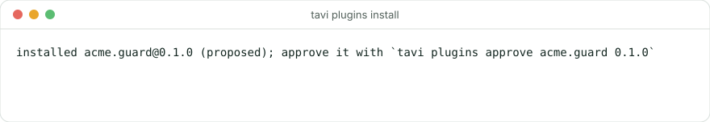
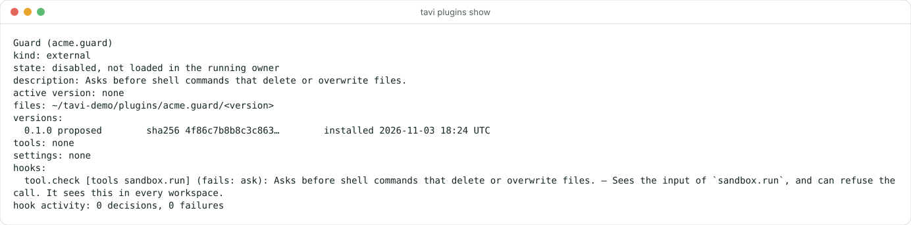
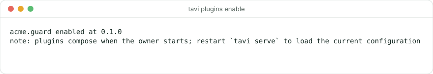
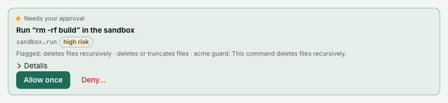
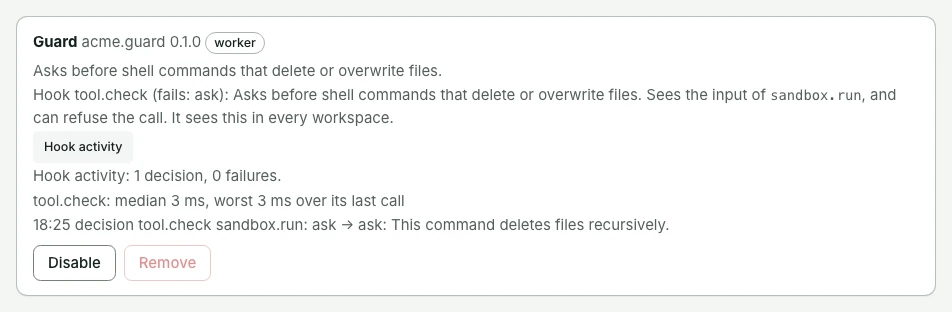

# Guard tool calls with a mod

Write a mod, a plugin that hooks into each turn, that makes Tavi ask before a shell command that deletes files, with a reason on the approval card. About fifteen minutes.

> **Uses:** mods (a `tool.check` hook) · the shell (`sandbox.run`) · approvals · plugins (`tavi plugins show <id>`, **Settings → Plugins**)
> **Before you start:** a model connected ([Connect your first model](../get-started/first-model.md)) · Tavi running in the background with `tavi serve` ([Keep Tavi running in the background](../get-started/keep-tavi-running.md)) · a plugin installed once, to see how it goes ([Install and enable a plugin](install-a-plugin.md))

## 1. Write the mod

Save these two files in a folder `~/tavi-plugins/acme-guard` and install it with `tavi plugins install ~/tavi-plugins/acme-guard`. The `mods` block declares the hook: its event (`tool.check`, just before Tavi decides whether a call asks), the tools it watches, and a sentence you'll read when you approve it; the code asks about a command that matches one of its patterns, and refuses it where nobody could answer, such as in a schedule.

```json
{
  "schemaVersion": 2,
  "abi": "tavi.providers/1",
  "provenance": { "format": "bundled-esm", "packages": [] },
  "id": "acme.guard",
  "version": "0.1.0",
  "name": "Guard",
  "description": "Asks before shell commands that delete or overwrite files.",
  "entry": "index.mjs",
  "mods": {
    "abi": "tavi.mods/1",
    "hooks": [
      {
        "event": "tool.check",
        "match": { "tools": ["sandbox.run"] },
        "onFailure": "ask",
        "disclosure": "Asks before shell commands that delete or overwrite files."
      }
    ]
  }
}
```

```js
const DANGEROUS = [
  [/\brm\s+-[a-z]*r[a-z]*f|\brm\s+-[a-z]*f[a-z]*r/i, "deletes files recursively"],
  [/\bgit\s+reset\s+--hard\b/i, "discards uncommitted work"],
  [/\bgit\s+clean\s+-[a-z]*f/i, "deletes untracked files"],
];

export default {
  register({ hooks }) {
    hooks.on("tool.check", { tools: ["sandbox.run"] }, async (e, next) => {
      const verdict = await next(e);
      const command = [e.input?.command, ...(e.input?.args ?? [])].join(" ");
      const hit = DANGEROUS.find(([pattern]) => pattern.test(command));
      if (hit === undefined) return verdict;
      if (!e.envelope.attended) return { decision: "deny", reason: `This command ${hit[1]}, and nobody can approve it in this run.` };
      return { decision: "ask", reason: `This command ${hit[1]}.` };
    });
  },
};
```

<picture>
  <source media="(prefers-color-scheme: dark)" srcset="../../assets/use-cases/extend/write-a-mod/01-write-the-mod-dark.svg">
  
</picture>

## 2. Read what it can see

Run `tavi plugins show acme.guard`. Beside your sentence, Tavi says in its own words what the hook can read: the input of every `sandbox.run` call, in every workspace, with the power to refuse it. That's what you trust when you approve.

<picture>
  <source media="(prefers-color-scheme: dark)" srcset="../../assets/use-cases/extend/write-a-mod/02-read-what-it-can-see-dark.svg">
  
</picture>

## 3. Approve and enable it

Run `tavi plugins approve acme.guard 0.1.0`, then `tavi plugins enable acme.guard`, and restart `tavi serve` so the hook loads.

<picture>
  <source media="(prefers-color-scheme: dark)" srcset="../../assets/use-cases/extend/write-a-mod/03-approve-and-enable-it-dark.svg">
  
</picture>

## 4. Ask for a destructive command

Start a new chat and ask for something the guard catches, such as `Use the shell to run: rm -rf build`. The approval card lists Tavi's own reasons, then the mod's, named for it: **acme.guard: This command deletes files recursively.** Since a mod asked, it offers **Allow once** but nothing longer. Tavi would ask about this command anyway; for one it would let through, the mod's ask makes it wait for you.

<!-- cover -->


## 5. See what the mod decided

Choose **Deny…**, give a reason and **Deny**. Then open **Settings → Plugins** and choose **Hook activity** under **Guard**: each decision the hook made is listed with its tool, the verdict before and after it (here **ask → ask**), and its reason.



## What Tavi will and won't do

A mod can make a call stricter, mask a tool's output or add context to a prompt, but it can never approve a call, change a call's input or touch the system prompt. If your hook throws, the call is asked about anyway, and a hook that keeps failing is suspended until the owner restarts. Tavi also ships a fuller guard, `tavi.guard`, off until you run `tavi plugins enable tavi.guard`. Every hook event and its answers are in [MODS.md](../../MODS.md#a4-how-mods-fit).

## Related

- [Write your first tool plugin](write-a-tool-plugin.md)
- [Install and enable a plugin](install-a-plugin.md)
- [Approve, reject or always-allow a tool call](../chat/approve-tool-calls.md)
- Reference: [MODS.md](../../MODS.md#b4-example-3--a-guard-that-asks-before-destructive-shell-commands), [PLUGINS.md](../../PLUGINS.md#mods-hooks-into-the-turn)
