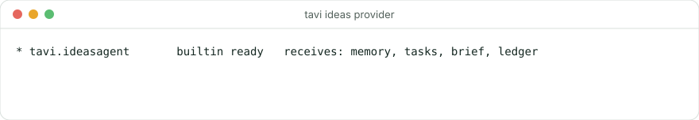
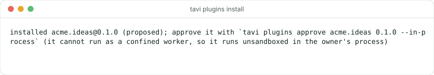
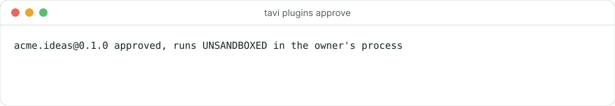
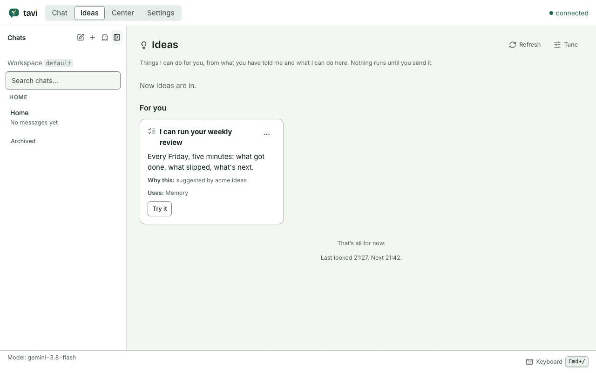

# Replace heartbeat, ideas or memory with your own

Swap one of Tavi's built-in providers for your own plugin: what writes your Ideas, what the heartbeat tells you, or what memory recalls. The walk-through replaces Ideas with a fixed list of your own; heartbeat and memory go the same way. About fifteen minutes.

> **Uses:** provider plugins (`provides`) · Ideas (`tavi ideas provider`, the **Ideas** tab) · plugins (`tavi plugins install <folder>`, `tavi plugins approve <id> <version> --in-process`)
> **Before you start:** Tavi running in the background with `tavi serve` ([Keep Tavi running in the background](../get-started/keep-tavi-running.md)) · the canvas open ([Open the web canvas and walk through Welcome](../get-started/web-canvas-tour.md)) · a tool plugin written once ([Write your first tool plugin](write-a-tool-plugin.md))

## 1. See which provider is in use

Run `tavi ideas provider`. It lists every ideas provider installed, marks the one in use with `*`, and says what each is given. Out of the box that's the built-in `tavi.ideasagent`, which ranks Tavi's catalogue of use cases by what you've mentioned.

<picture>
  <source media="(prefers-color-scheme: dark)" srcset="../../assets/use-cases/extend/write-a-provider-plugin/01-see-which-provider-is-in-use-dark.svg">
  
</picture>

## 2. Write the provider

Save these two files in `~/tavi-plugins/acme-ideas` and install the folder with `tavi plugins install ~/tavi-plugins/acme-ideas`. The manifest's `provides` and `ideas` blocks say it writes ideas, and `receives` asks only for the ledger: which of its ideas you dismissed or snoozed, none of your memory or chats. The code proposes; Tavi checks, stores and shows each idea, and drops any that breaks the rules: `tavi ideas list` then says which rule under *Last run*.

```json
{
  "schemaVersion": 2,
  "abi": "tavi.providers/1",
  "provenance": { "format": "bundled-esm", "packages": [] },
  "id": "acme.ideas",
  "version": "0.1.0",
  "name": "ACME ideas",
  "description": "Offers ACME's weekly review in place of the built-in catalogue.",
  "entry": "index.mjs",
  "isolation": "in-process",
  "provides": ["ideas"],
  "ideas": {
    "abi": "tavi.ideas/1",
    "receives": ["ledger"],
    "maxRunSeconds": 30,
    "disclosure": "Reads none of your memory or chats; it sees which of its ideas you dismissed, snoozed or muted."
  }
}
```

```js
const REVIEW = {
  key: "productivity.acme-weekly-review",
  category: "productivity",
  icon: "📋",
  title: "I can run your weekly review",
  label: "Weekly review",
  pitch: "Every Friday, five minutes: what got done, what slipped, what's next.",
  prompt: "Run my weekly review: what got done, what slipped, what's next.",
  templateId: "acme-weekly-review",
  basis: [{ kind: "general", ref: "acme-weekly-review" }],
  uses: [{ capability: "memory", approval: false }],
  recurring: { cadence: "weekly" },
};

export default {
  register({ provideIdeas }) {
    provideIdeas({
      async generate({ capabilities, ledger, signal }) {
        signal.throwIfAborted();
        const ruledOut = [...(ledger?.dismissedKeys ?? []), ...(ledger?.snoozedKeys ?? [])];
        if (!capabilities.includes("memory") || ruledOut.includes(REVIEW.key)) return { ideas: [] };
        return { ideas: [{ idea: REVIEW, score: 0.7 }] };
      },
      status: () => ({ ready: true }),
    });
  },
};
```

<picture>
  <source media="(prefers-color-scheme: dark)" srcset="../../assets/use-cases/extend/write-a-provider-plugin/02-write-the-provider-dark.svg">
  
</picture>

## 3. Approve it to run in Tavi's own process

A provider is a live object Tavi calls, so it can't run as a confined worker: approve it with `tavi plugins approve acme.ideas 0.1.0 --in-process`, which says so plainly. Then `tavi plugins enable acme.ideas` and restart `tavi serve`.

<picture>
  <source media="(prefers-color-scheme: dark)" srcset="../../assets/use-cases/extend/write-a-provider-plugin/03-approve-it-to-run-in-tavi-s-own-process-dark.svg">
  
</picture>

## 4. Select it

Run `tavi ideas provider acme.ideas`. From now on this workspace's ideas come from your plugin, and the built-in's ideas you hadn't pinned are retired.

<picture>
  <source media="(prefers-color-scheme: dark)" srcset="../../assets/use-cases/extend/write-a-provider-plugin/04-select-it-dark.svg">
  
</picture>

## 5. See its ideas

Open the **Ideas** tab and choose **Refresh**. Your idea shows like any other, with **Try it** and its **…** menu; its *Why this* reads *suggested by acme.ideas*, since it rests on nothing of yours. To go back to the built-in, run `tavi ideas provider tavi.ideasagent`.

<!-- cover -->


## Heartbeat and memory

The same steps replace the others: declare the service in `provides`, give its block, approve `--in-process`, then select it.

| Replace | Manifest | Select it with |
| :--- | :--- | :--- |
| What the heartbeat tells you | `"provides": ["heartbeat"]` and a `heartbeat` block | `tavi heartbeat set-provider <id>`, then `tavi heartbeat egress signals on` (and `instructions`) for what it receives |
| What memory recalls and proposes | `"provides": ["memory"]` and a `memory` block | `tavi memory set-provider <id> --yes`, then `tavi memory egress records on --yes` (and `conversation`) for what it receives; each shows what the provider gets and switches only with `--yes` |

Working examples are `examples/plugins/acme-heartbeat-rules` and `examples/plugins/acme-memory-keywords`, explained in [HEARTBEAT-PLUGINS.md](../../HEARTBEAT-PLUGINS.md) and [MEMORY-PLUGINS.md](../../MEMORY-PLUGINS.md).

## What Tavi will and won't do

A provider gets only what its manifest asks for and your switches allow, and you see that list when you approve it. It proposes and never stores, sends or runs anything itself: Tavi checks every answer and drops what breaks the rules. Because it runs in Tavi's own process with Tavi's privileges, approve only code you've read. If it stops, Ideas runs are skipped until it's back or you switch to the built-in. The details are in [IDEAS-PLUGINS.md](../../IDEAS-PLUGINS.md) and [PLUGINS.md](../../PLUGINS.md#trust).

## Related

- [Pin an idea, make it recurring, or try it](../automation/ideas-tab.md)
- [Write your first tool plugin](write-a-tool-plugin.md)
- [Install and enable a plugin](install-a-plugin.md)
- Reference: [IDEAS-PLUGINS.md](../../IDEAS-PLUGINS.md), [HEARTBEAT-PLUGINS.md](../../HEARTBEAT-PLUGINS.md), [MEMORY-PLUGINS.md](../../MEMORY-PLUGINS.md), [PLUGINS.md](../../PLUGINS.md#reference-replacements)
