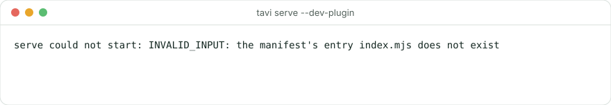
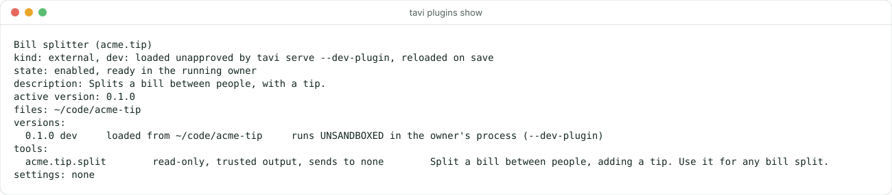
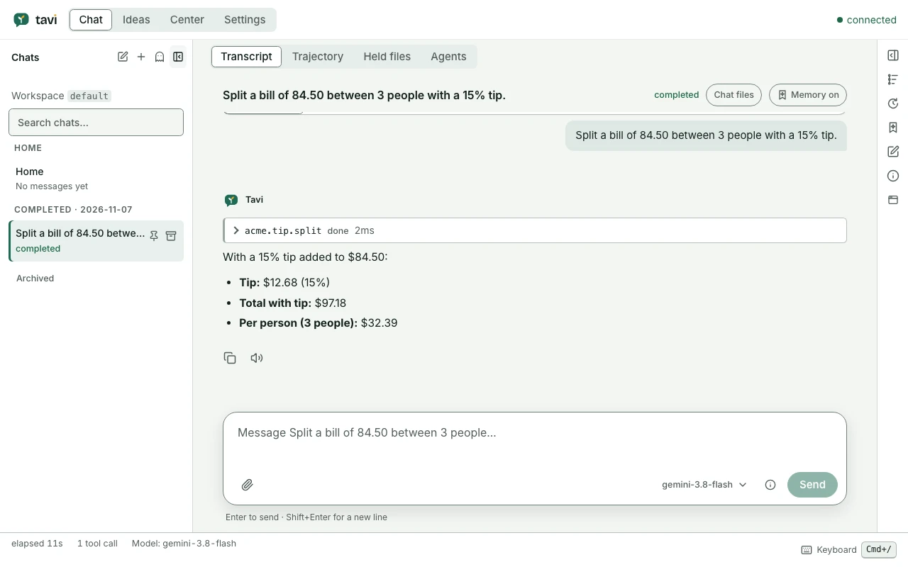
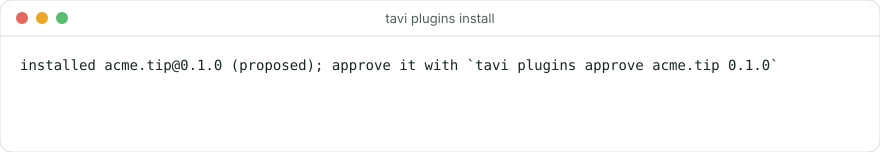

# Write your first tool plugin

Give Tavi a tool of your own: a folder with a manifest and a few lines of JavaScript, checked, tried live and then installed. The example splits a bill. About fifteen minutes.

> **Uses:** plugins (`tavi serve --dev-plugin <folder>`, `tavi plugins validate <folder>`, `tavi plugins install <folder>`) · your plugin's tool (`acme.tip.split`) · the web canvas
> **Before you start:** a model connected ([Connect your first model](../get-started/first-model.md)) · Tavi running in the background with `tavi serve` ([Keep Tavi running in the background](../get-started/keep-tavi-running.md)) · Node.js, to run your code · a plugin installed once, to see how it goes ([Install and enable a plugin](install-a-plugin.md))

## 1. Describe the tool

Make a folder `~/tavi-plugins/acme-tip` and save this in it as `tavi-plugin.json`. Stop `tavi serve` and start it with your folder: `tavi serve --dev-plugin ~/tavi-plugins/acme-tip`. It reads the manifest and won't start until the code it names exists.

```json
{
  "schemaVersion": 2,
  "abi": "tavi.providers/1",
  "provenance": { "format": "bundled-esm", "packages": [] },
  "id": "acme.tip",
  "version": "0.1.0",
  "name": "Bill splitter",
  "description": "Splits a bill between people, with a tip.",
  "entry": "index.mjs",
  "tools": [
    {
      "name": "split",
      "effect": "read-only",
      "untrustedOutput": false,
      "sink": "none",
      "description": "Split a bill between people, adding a tip. Use it for any bill split."
    }
  ]
}
```

<picture>
  <source media="(prefers-color-scheme: dark)" srcset="../../assets/use-cases/extend/write-a-tool-plugin/01-describe-the-tool-dark.svg">
  
</picture>

## 2. Write the handler

Save this beside it as `index.mjs`, describing the input with the `z` Tavi hands you: a plugin imports no packages. Start `tavi serve --dev-plugin ~/tavi-plugins/acme-tip` again, and the plugin runs from the folder, unapproved and only for this run, reloading each time you save. `tavi plugins show acme.tip` marks it as loaded by `--dev-plugin`, and `tavi plugins validate ~/tavi-plugins/acme-tip` makes the same checks without an owner.

```js
export default {
  register({ z, registerTool }) {
    registerTool({
      name: "split",
      inputSchema: z.object({
        total: z.number().positive(),
        people: z.number().int().min(1),
        tipPercent: z.number().min(0).max(100),
      }),
      handler: async ({ total, people, tipPercent }) => {
        const withTip = total * (1 + tipPercent / 100);
        const cents = (value) => Math.round(value * 100) / 100;
        return { withTip: cents(withTip), each: cents(withTip / people) };
      },
    });
  },
};
```

<picture>
  <source media="(prefers-color-scheme: dark)" srcset="../../assets/use-cases/extend/write-a-tool-plugin/02-write-the-handler-dark.svg">
  
</picture>

## 3. Ask for it in a chat

Start a new chat and ask, for example, `Split a bill of 84.50 between 3 people with a 15% tip.` Tavi calls `acme.tip.split` without asking, because it is read-only, and answers from its result. If it never calls the tool, make the tool's `description` say plainly when to use it.

<!-- cover -->


## 4. Install it for good

When it works, restart `tavi serve` without `--dev-plugin` and install the folder: `tavi plugins install ~/tavi-plugins/acme-tip`. Then approve and enable it as any plugin ([Install and enable a plugin](install-a-plugin.md)). An installed version never changes, so to change the plugin later, raise its `version` and install it again.

<picture>
  <source media="(prefers-color-scheme: dark)" srcset="../../assets/use-cases/extend/write-a-tool-plugin/04-install-it-for-good-dark.svg">
  
</picture>

## What Tavi will and won't do

Tavi registers only the tools your manifest declares, with the manifest's `effect`, never what the code claims: a `mutating` or `external` tool asks before every call. An approved plugin runs as a confined worker that reaches only its own folder and the hosts its manifest lists, while `--dev-plugin` runs your folder unapproved, so use it only for code you're writing. Mark a tool `"untrustedOutput": false` only when it returns nothing from outside, as here. The manifest fields and the module API are in [PLUGINS.md](../../PLUGINS.md#external-plugins).

## Related

- [Install and enable a plugin](install-a-plugin.md)
- [Guard tool calls with a mod](write-a-mod.md)
- [Replace heartbeat, ideas or memory with your own](write-a-provider-plugin.md)
- Reference: [PLUGINS.md](../../PLUGINS.md#module-api), [MODS.md](../../MODS.md#b2-example-1--a-read-only-tool), [CLI.md](../../CLI.md#tavi-plugins)
