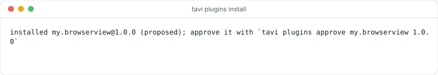
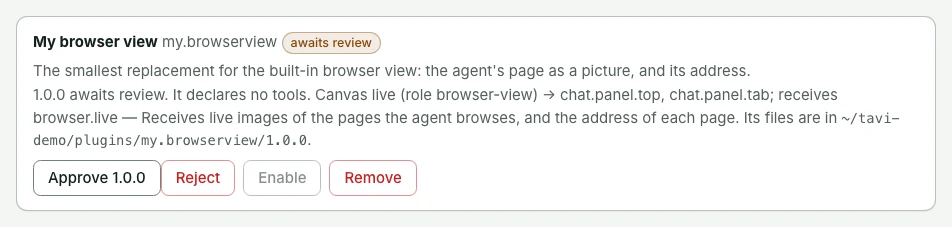
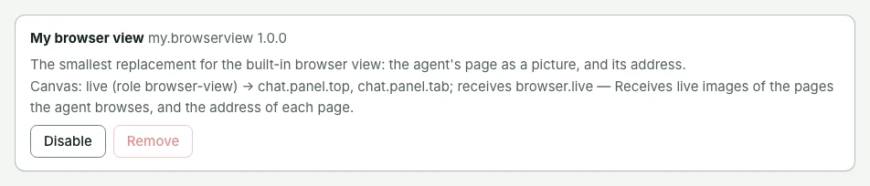
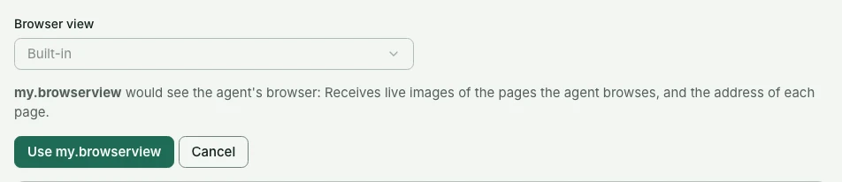
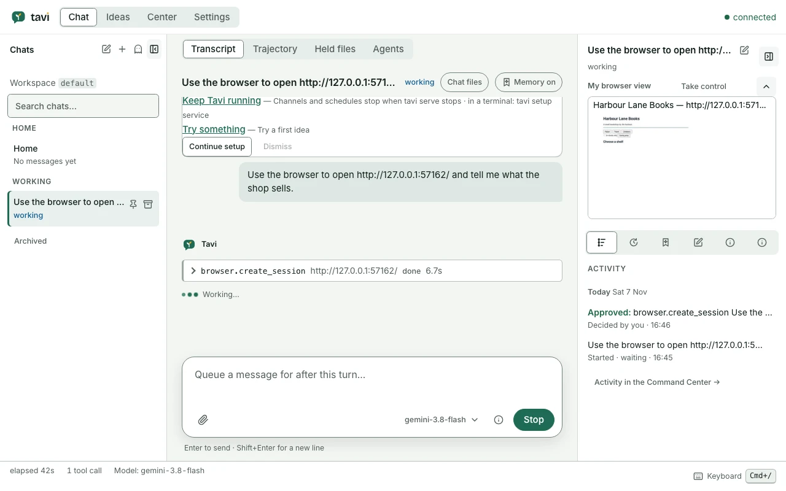
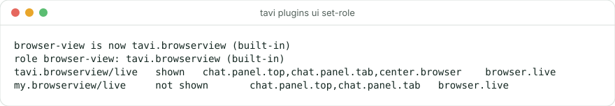

# Add a panel to the web canvas

Put a view of your own in the canvas's chat panel: here, your own live view of the agent's browser, made from the smallest example that ships with Tavi. A plugin that only adds to the canvas runs no code in Tavi itself, and sees only what its manifest says it receives. About fifteen minutes.

> **Uses:** plugins (`tavi plugins ui list`, **Settings → Plugins**) · the canvas's live browser view (`browser.live`) · the agent's browser
> **Before you start:** a model connected ([Connect your first model](../get-started/first-model.md)) · Tavi running in the background with `tavi serve` ([Keep Tavi running in the background](../get-started/keep-tavi-running.md)) · the canvas open ([Open the web canvas and walk through Welcome](../get-started/web-canvas-tour.md)) · a plugin installed once, to see how it goes ([Install and enable a plugin](install-a-plugin.md)) · a copy of the Tavi repository, for its `examples/` folder

## 1. Copy the example and install it

Copy `examples/ui-plugins/minimal-browser-view` to a folder of your own, `~/tavi-plugins/my-browser-view`. In its `tavi-plugin.json`, give it your own `id`, `my.browserview`, and `name`, and give its one contribution your own `title`, `My browser view`. Then run `tavi plugins install ~/tavi-plugins/my-browser-view`.

<picture>
  <source media="(prefers-color-scheme: dark)" srcset="../../assets/use-cases/extend/write-a-ui-plugin/01-copy-the-example-and-install-it-dark.svg">
  
</picture>

## 2. Review what it receives

Open **Settings → Plugins**. Under **Installed**, the plugin says what it adds: its contribution, the places it shows (`chat.panel.top`, `chat.panel.tab`), and the one channel it receives, `browser.live`, with the manifest's own words for what that carries. It has no tools and no code that runs in Tavi.

## 3. Approve and enable it

Choose **Approve 1.0.0**, then **Enable**. A plugin that only adds to the canvas needs no restart, so its row shows no restart badge. Approving it doesn't yet let it see the browser: that is the next step.

## 4. Choose it as the browser view

Under **Canvas**, set **Browser view** to `my.browserview`. Tavi says what the plugin would see and asks you to confirm: choose **Use my.browserview**. In the terminal, `tavi plugins ui set-role browser-view my.browserview` prints the same and needs `--yes`.

## 5. Watch a page in it

In a new chat, ask Tavi to open a page, for example `Use the browser to open <a site's address> and tell me what the shop sells.`, allow it, and open **Show this chat's panel**. Your view shows above the panel's tabs while the browser works: the page's picture and its address. Every open canvas picks the change up at once.

<!-- cover -->

## 6. Go back to the built-in view

Run `tavi plugins ui set-role browser-view builtin`, or set **Browser view** back to **Built-in**. Your plugin stays installed and enabled; change its files, give it a new `version`, and install and approve that to try again.

<picture>
  <source media="(prefers-color-scheme: dark)" srcset="../../assets/use-cases/extend/write-a-ui-plugin/06-go-back-to-the-built-in-view-dark.svg">
  
</picture>

## What Tavi will and won't do

A canvas plugin runs in a frame of its own: it can't reach the network, the canvas, your session or the browser, and it gets only the channels its manifest declares, after you have approved it and, for the browser's pages, confirmed again. A sensitive page is never sent to it, only word that it is hidden, and taking the browser over always uses Tavi's own view. The full contract is in [PLUGINS.md](../../PLUGINS.md#ui-plugins).

## Related

- [Install and enable a plugin](install-a-plugin.md)
- [Let Tavi drive a browser while you watch](../web-and-browser/browse-with-tavi.md)
- Reference: [PLUGINS.md](../../PLUGINS.md#ui-plugins), [the example's README](../../../examples/ui-plugins/minimal-browser-view/README.md), [CLI.md](../../CLI.md#tavi-plugins-ui)
