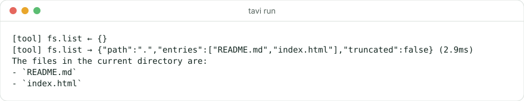
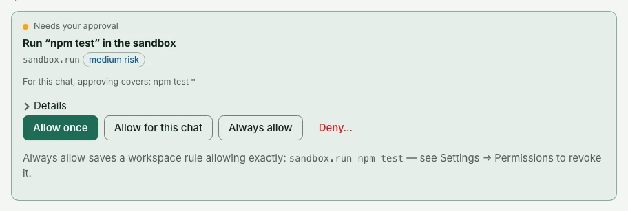
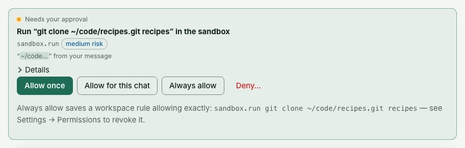
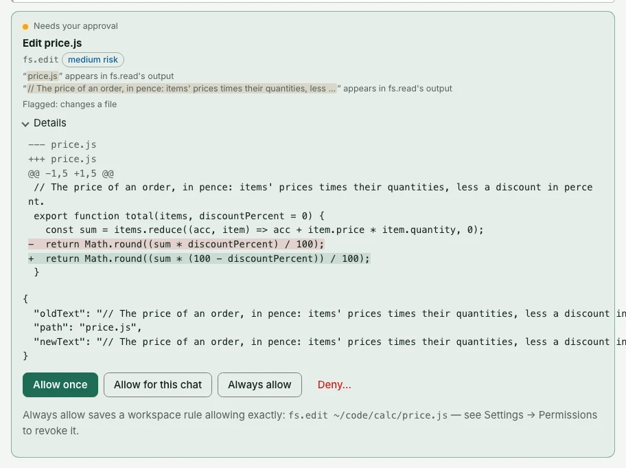
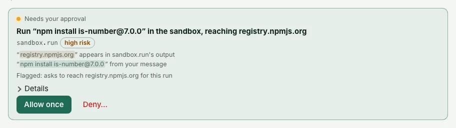
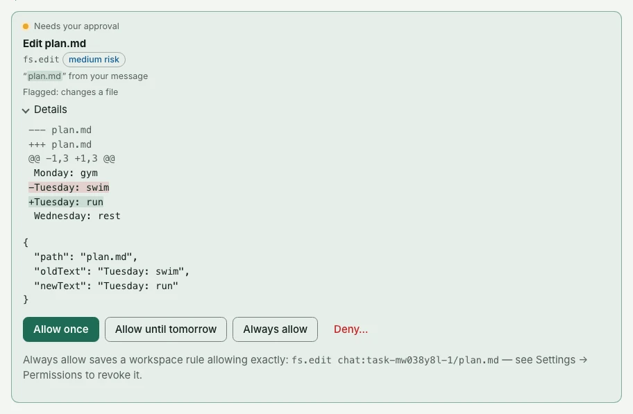
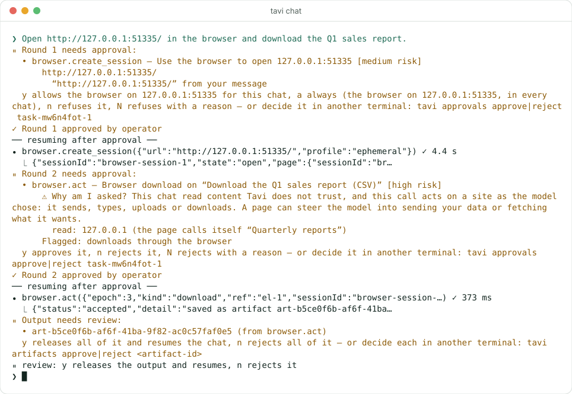

<!-- Generated by scripts/docs/guide-indexes.mjs from the guides: edit the guides, not this file. -->

# Files and code

Working folders, file changes and the sandbox.

| | Guide |
| :--- | :--- |
|  | [Give Tavi a working folder](attach-a-folder.md) Let a chat work in a project folder on your computer instead of its own, attach other folders read-only or read-write, and go back when you're done. |
|  | [Build and test a real project in the sandbox](build-a-real-project.md) Let Tavi build and test a project of yours in its shell sandbox: it looks around without asking, runs your build and tests with your own toolchain, and asks once for a test command and its variants. |
|  | [Clone or start a git repository in a chat's folder](clone-a-repo.md) Have Tavi clone a repository, read its history, commit a change and start a new repository, all inside a chat's own folder. |
|  | [Fix a failing test in the sandbox](fix-a-failing-test.md) Point Tavi at a project with a failing test: it runs the tests in its sandbox, reads the failure, changes the code with your approval and runs the tests again. |
|  | [Let a build download packages](let-a-build-reach-the-network.md) The shell Tavi runs commands in has no network, so `npm install` or `pip install` fails until you say which hosts it may reach. |
|  | [Review a file change before it's written](review-a-diff.md) See exactly what Tavi wants to change in a file before anything is written: the lines it removes and adds, a reason to send back when the change is wrong, and the change it made afterwards. |
|  | [Review files Tavi held back](review-held-files.md) When Tavi downloads a file with its browser, the file is kept but held back: nothing in the chat reads it until you look and keep it. |

[All how-to guides](../README.md)
