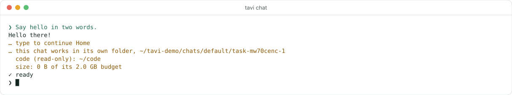
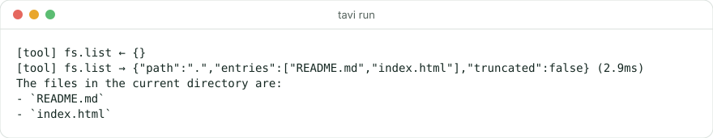
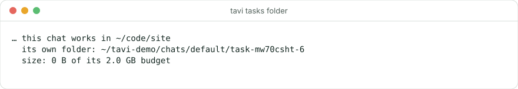
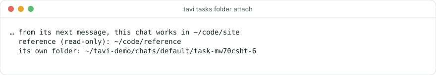
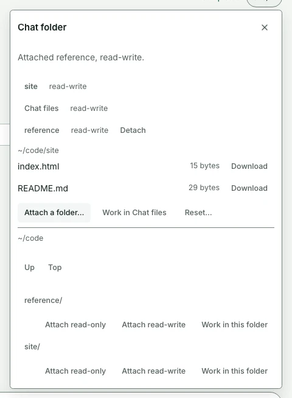
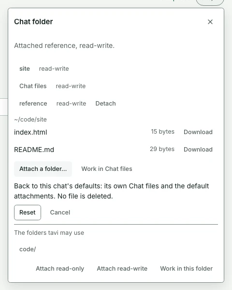

# Give Tavi a working folder

Let a chat work in a project folder on your computer instead of its own, attach other folders read-only or read-write, and go back when you're done. About five minutes.

> **Uses:** working folders (the owner's `--fs-root` folders, `/folder`, `tavi tasks folder <task-id>`, `tavi run --folder <folder> <prompt>`) · the canvas's **Chat folder** panel · the file tools (`fs.list`, `fs.read`, `fs.write`)
> **Before you start:** a model connected ([Connect your first model](../get-started/first-model.md)) · Tavi running in the background with `tavi serve` ([Keep Tavi running in the background](../get-started/keep-tavi-running.md)) · a folder of projects, such as `~/code`

## 1. Name the folders Tavi may use

Stop `tavi serve` and start it again with the folder that holds your projects, by its full path: `tavi serve --fs-root /Users/you/code` (repeat `--fs-root` for more). That grants no chat anything by itself: each new chat still works in its own folder, with `~/code` attached read-only, as `/folder` in `tavi chat` shows.

<picture>
  <source media="(prefers-color-scheme: dark)" srcset="../../assets/use-cases/files-and-code/attach-a-folder/01-name-the-folders-tavi-may-use-dark.svg">
  
</picture>

## 2. Start a chat in your project

From inside the project, run `tavi run "List the files here."`, or name the folder from anywhere: `tavi run --folder ~/code/site "List the files here."` The new chat works in that folder: relative paths and the shell start there.

<!-- cover -->
<picture>
  <source media="(prefers-color-scheme: dark)" srcset="../../assets/use-cases/files-and-code/attach-a-folder/02-start-a-chat-in-your-project-dark.svg">
  
</picture>

## 3. See where a chat works

Run `tavi tasks folder <task-id>` with the chat's id (from `tavi tasks`). It prints the folder the chat works in, its own folder under Tavi's data directory, and how much of its budget that uses.

<picture>
  <source media="(prefers-color-scheme: dark)" srcset="../../assets/use-cases/files-and-code/attach-a-folder/03-see-where-a-chat-works-dark.svg">
  
</picture>

## 4. Attach a second folder

Give the chat another folder to read: `tavi tasks folder <task-id> attach ~/code/reference`, or `/folder add ~/code/reference` in `tavi chat` for the chat on screen. Attached folders are read-only unless you add `--rw`, and the change applies from the chat's next message.

<picture>
  <source media="(prefers-color-scheme: dark)" srcset="../../assets/use-cases/files-and-code/attach-a-folder/04-attach-a-second-folder-dark.svg">
  
</picture>

## 5. Change folders on the canvas

Open the chat in `tavi ui` and choose the folder chip in its header (**site/…** here; **Chat files** for a chat's own folder). The **Chat folder** panel lists the folders with their modes and files. **Detach** a folder, or choose **Attach a folder…**, open one of your folders and pick **Attach read-only**, **Attach read-write** or **Work in this folder**. On a new chat, before its first message, the chip offers the attach part only: the folders you pick go with that message, and the chat starts with them (a reload drops them).

## 6. Go back to Chat files

When you're done, choose **Reset…** in the panel and confirm, or type `/folder reset` in `tavi chat`. The chat goes back to its own folder and default attachments; no file is deleted.

## What Tavi will and won't do

A chat reads and writes only its working folder, its own folder and the folders you attached, and writes an attached folder only when it is read-write; the model never picks its folder. A folder outside your `--fs-root` folders, your home folder itself, Tavi's data directory and credential folders such as `~/.ssh` are refused. Every file write still asks you first, with the change shown. The details are in [WORKING-FOLDERS.md](../../WORKING-FOLDERS.md).

## Related

- [Have your first conversation in the terminal](../get-started/first-chat.md)
- [Open the web canvas and walk through Welcome](../get-started/web-canvas-tour.md)
- Reference: [WORKING-FOLDERS.md](../../WORKING-FOLDERS.md), [CLI.md](../../CLI.md), [WEB-UI.md](../../WEB-UI.md)
