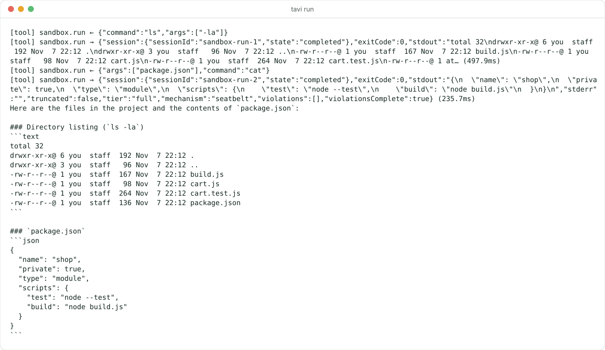
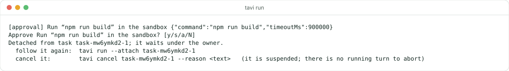
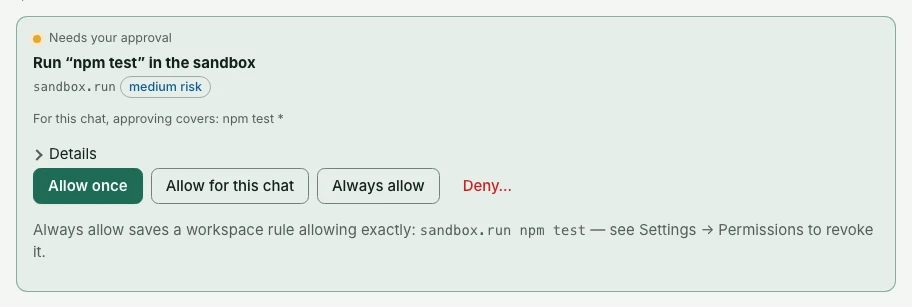
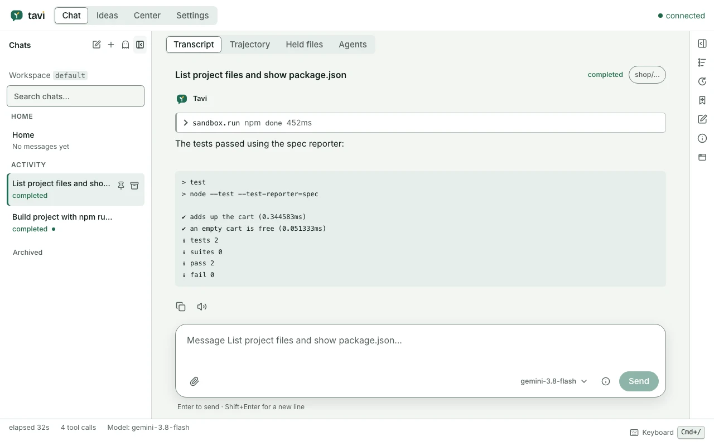
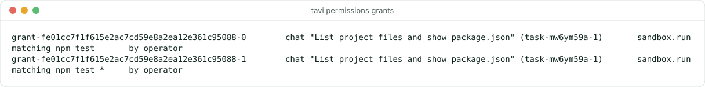
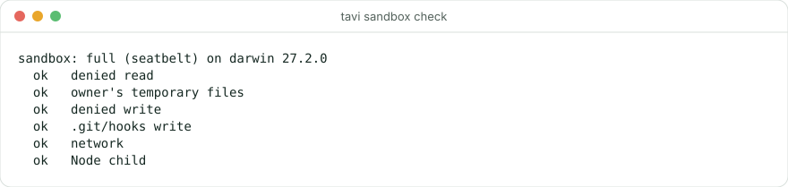

# Build and test a real project in the sandbox

Let Tavi build and test a project of yours in its shell sandbox: it looks around without asking, runs your build and tests with your own toolchain, and asks once for a test command and its variants. About ten minutes.

> **Uses:** the shell sandbox (`sandbox.run`, `tavi sandbox check`) · approvals and chat grants (`tavi permissions grants`) · working folders (`tavi run --folder <folder> <prompt>`)
> **Before you start:** a model connected ([Connect your first model](../get-started/first-model.md)) · a project folder Tavi may use ([Give Tavi a working folder](attach-a-folder.md)) · the canvas open ([Open the web canvas and walk through Welcome](../get-started/web-canvas-tour.md))

## 1. Let Tavi look around

Start a chat in the project: `tavi run --folder ~/code/shop "Look around this project: list the files and show package.json."` Commands that only read inside the folder and print, such as `ls`, `cat`, `rg`, `git status` and `git log`, run in the sandbox without asking.

<picture>
  <source media="(prefers-color-scheme: dark)" srcset="../../assets/use-cases/files-and-code/build-a-real-project/01-let-tavi-look-around-dark.svg">
  
</picture>

## 2. Give a long build more time

A command runs for at most 120 seconds unless the call asks for longer, up to 10 minutes. For bigger builds, start the owner with a longer default and ceiling, such as `tavi serve --fs-root /Users/you/code --sandbox-timeout 300 --sandbox-max-timeout 1200`, and say how long the build may take: `tavi run --folder ~/code/shop "Build the project with npm run build, allowing it 15 minutes."` The approval shows the time it asked for: answer `y` to run it, or press Ctrl-C to leave it waiting and approve it later with `tavi approvals approve <task-id>`.

<picture>
  <source media="(prefers-color-scheme: dark)" srcset="../../assets/use-cases/files-and-code/build-a-real-project/02-give-a-long-build-more-time-dark.svg">
  
</picture>

## 3. Run the tests

Open the first chat on the canvas and ask `Run the tests with npm test.` Tavi stops at **Needs your approval**. For a build or test command (`npm test`, `pnpm run <script>`, `cargo test`, `pytest`, `go test`, …) the card says what **Allow for this chat** covers: that command with any arguments.

<!-- cover -->

## 4. Allow the tests for this chat

Choose **Allow for this chat**. The tests run, and the next time you ask for them another way, such as `Run the tests again with npm test -- --test-reporter=spec.`, they run without asking. Any other command, `npm run build` included, still asks.

## 5. See what you allowed

Run `tavi permissions grants`. Each line is a grant for one chat: here `npm test` and `npm test *`, by you. They end with the chat; **Settings → Permissions** lists them too and can revoke one.

<picture>
  <source media="(prefers-color-scheme: dark)" srcset="../../assets/use-cases/files-and-code/build-a-real-project/05-see-what-you-allowed-dark.svg">
  
</picture>

## 6. Check the sandbox

Run `tavi sandbox check` to see that the sandbox works on this computer and which kind it is. A command gets a quarter of the computer's memory (between 256 MiB and 2 GiB), 1024 processes and two cores; Linux enforces these, macOS treats them as advisory. `tavi doctor` lists them under `sandbox.limits`, and the owner's `--sandbox-memory`, `--sandbox-pids` and `--sandbox-cpu` flags change them.

<picture>
  <source media="(prefers-color-scheme: dark)" srcset="../../assets/use-cases/files-and-code/build-a-real-project/06-check-the-sandbox-dark.svg">
  
</picture>

## What Tavi will and won't do

The shell writes only the chat's folders, reads none of the rest of your home folder, and has no network unless you grant hosts. It uses the toolchains on your `PATH` (version managers' installs included, read-only), and keeps caches such as npm's in the chat's own `.home/`, kept between turns. Every command but a read-only one asks you first, and **Allow for this chat** widens only to a build or test command's own variants. The details are in [SANDBOX.md](../../SANDBOX.md) and [SECURITY-MODEL.md](../../SECURITY-MODEL.md).

## Related

- [Give Tavi a working folder](attach-a-folder.md)
- [Have your first conversation in the terminal](../get-started/first-chat.md)
- Reference: [SANDBOX.md](../../SANDBOX.md), [SECURITY-MODEL.md](../../SECURITY-MODEL.md), [CLI.md](../../CLI.md)
