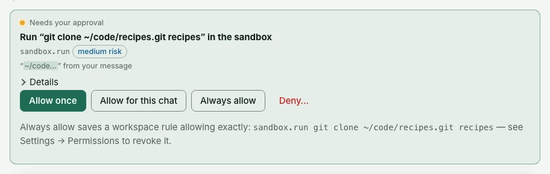
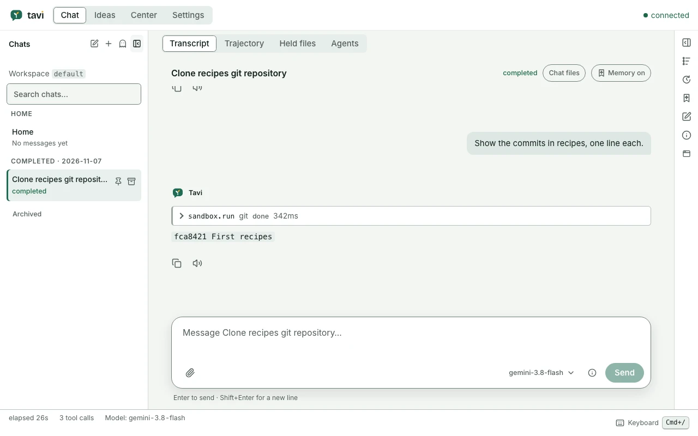
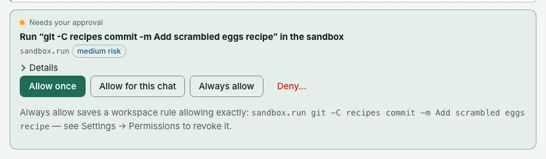
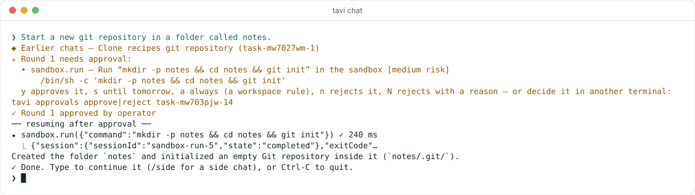
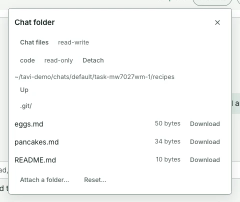

# Clone or start a git repository in a chat's folder

Have Tavi clone a repository, read its history, commit a change and start a new repository, all inside a chat's own folder. About five minutes.

> **Uses:** the shell (`sandbox.run`) with `git` · the chat's own folder (**Chat files**) · approvals
> **Before you start:** a model connected ([Connect your first model](../get-started/first-model.md)) · the canvas open ([Open the web canvas and walk through Welcome](../get-started/web-canvas-tour.md)) · a repository Tavi can read: one on your computer under a folder you gave Tavi ([Give Tavi a working folder](attach-a-folder.md)), or an HTTPS one on a host the shell may reach

## 1. Ask Tavi to clone a repository

Start a new chat with **+** and ask, for example, `Clone the git repository at ~/code/recipes.git into a folder called recipes.` Tavi stops at **Needs your approval** with the exact `git clone` command it will run in the sandbox; choose **Allow once**.

<!-- cover -->

## 2. Look at its history

Ask `Show the commits in recipes, one line each.` At the top of the chat's folder, commands that only read and print, such as `git log` and `git status`, run without asking. `recipes` is a repository in a subfolder, though, and a repository's own settings could make git run a program, so Tavi asks before any `git` command there, even `git log`: read the card and choose **Allow once**.

## 3. Change a file and commit it

Ask `Add a recipe for scrambled eggs in recipes/eggs.md and commit it.` Tavi asks before it writes the file and before each `git` command that changes the repository; read each card and allow it. The commit carries the author name and email from your own git settings.

## 4. Start a new repository

In `tavi chat`, ask `Start a new git repository in a folder called notes.` and press `y` at the card. A new repository goes in a folder of its own inside the chat's folder: at the folder's top, `git init .` is refused.

<picture>
  <source media="(prefers-color-scheme: dark)" srcset="../../assets/use-cases/files-and-code/clone-a-repo/04-start-a-new-repository-dark.svg">
  
</picture>

## 5. Find the files

On the canvas, choose the chat's **Chat files** chip. The **Chat folder** panel lists the repository's folder; open it to see its files, each with **Download**.

## What Tavi will and won't do

Every `git` command that changes something asks you first; one that only reads runs without asking at the top of the chat's folder, and asks too inside a repository in a subfolder. No git hook a repository holds ever runs in the sandbox, so husky or lint-staged checks don't run on a commit there, and the shell can't write a repository's `.git/hooks` or `.git/config`. The shell has no network unless you grant hosts, and never your SSH keys: clone over HTTPS from a granted host, or push from your own terminal. The details are in [SANDBOX.md](../../SANDBOX.md).

## Related

- [Give Tavi a working folder](attach-a-folder.md)
- Reference: [SANDBOX.md](../../SANDBOX.md), [WORKING-FOLDERS.md](../../WORKING-FOLDERS.md)
