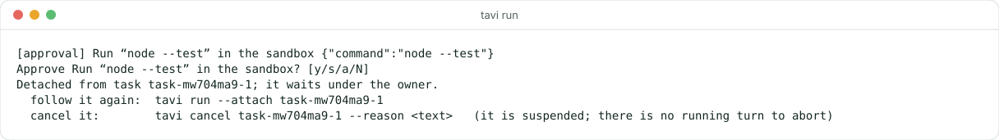
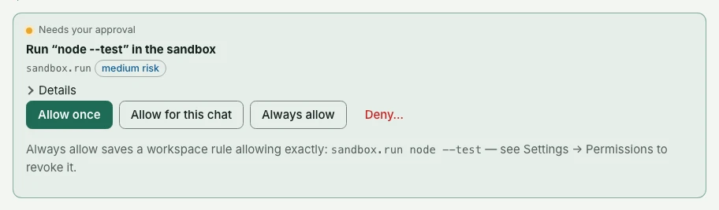
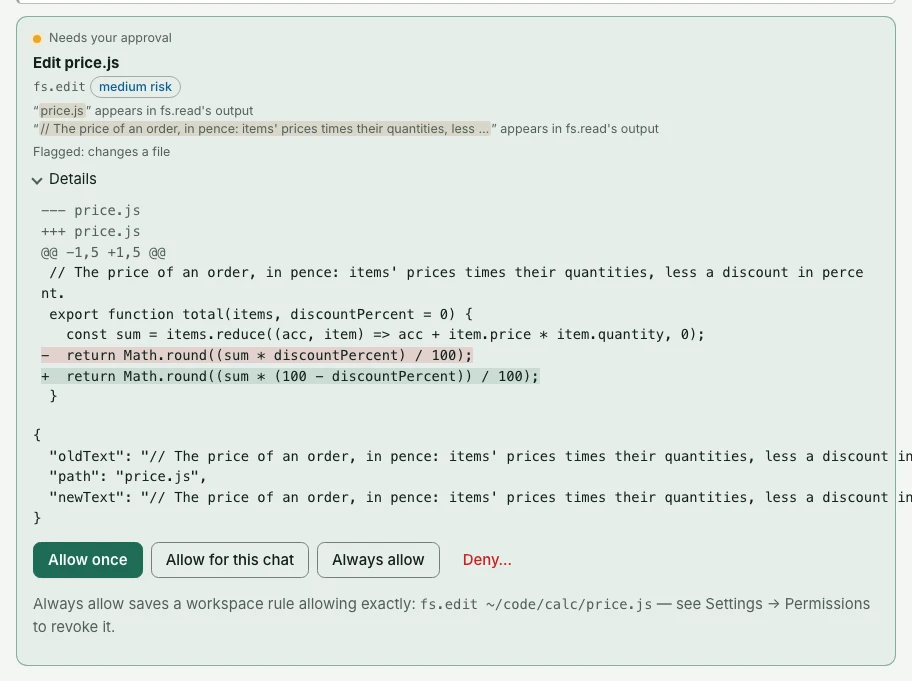
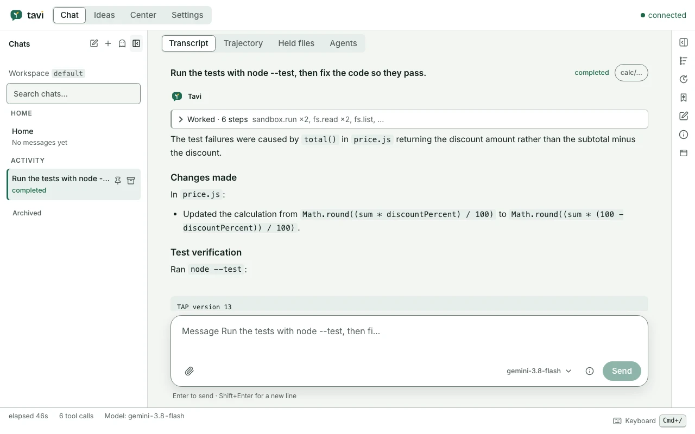

# Fix a failing test in the sandbox

Point Tavi at a project with a failing test: it runs the tests in its sandbox, reads the failure, changes the code with your approval and runs the tests again. About five minutes.

> **Uses:** the shell sandbox (`sandbox.run`) · the file tools (`fs.read`, `fs.edit`) · approvals · a working folder (`tavi run --folder <folder> <prompt>`)
> **Before you start:** a model connected ([Connect your first model](../get-started/first-model.md)) · your projects folder named with `--fs-root` ([Give Tavi a working folder](attach-a-folder.md)) · a project whose tests run with `node --test`, `npm test` or similar

## 1. Ask Tavi to fix the test

Start a chat in the project and say what to do: `tavi run --folder ~/code/calc "Run the tests with node --test, then fix the code so they pass."` A test command isn't read-only, so Tavi asks before it runs it: you can answer here (`y` once, `s` for the rest of the chat), or press Ctrl-C to leave it waiting and decide on the canvas, as below.

<picture>
  <source media="(prefers-color-scheme: dark)" srcset="../../assets/use-cases/files-and-code/fix-a-failing-test/01-ask-tavi-to-fix-the-test-dark.svg">
  
</picture>

## 2. Let it run the tests

Open the chat in `tavi ui` (it is at the top of the chats list). The card says **Run `node --test` in the sandbox**. Choose **Allow for this chat**, so the same test command can run again in this chat without asking. It runs in the project folder, with no network and none of your keys.

## 3. Check the fix before it's written

Tavi reads the failure and the code, then asks to change the file. Open **Details** on the card to see the diff: the lines it removes and adds. If it's right, choose **Allow once**; if not, choose **Deny…** and say why.

<!-- cover -->

## 4. See the tests pass

Tavi runs the tests again, which your **Allow for this chat** covers, and says what it changed and that they pass. The fixed file is in your project, ready to review and commit.

## What Tavi will and won't do

Commands run in a sandbox that writes only the chat's folders, has no network unless you grant it, and never sees your provider keys or SSH keys. A command that only reads and prints (`ls`, `git status`) runs without asking; anything else, and every file change, waits for you with the command or the diff on the card. The details are in [SANDBOX.md](../../SANDBOX.md) and [SECURITY-MODEL.md](../../SECURITY-MODEL.md).

## Related

- [Give Tavi a working folder](attach-a-folder.md)
- [Have your first conversation in the terminal](../get-started/first-chat.md)
- Reference: [SANDBOX.md](../../SANDBOX.md), [WORKING-FOLDERS.md](../../WORKING-FOLDERS.md)
