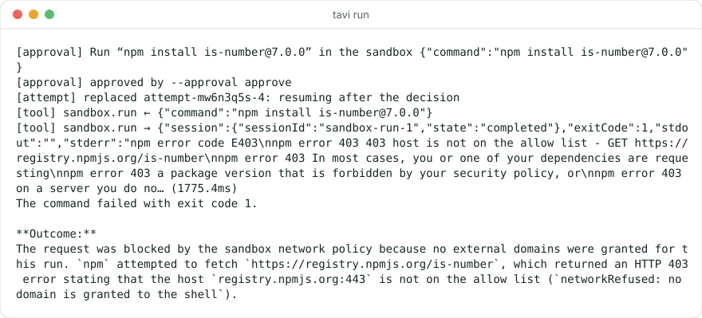
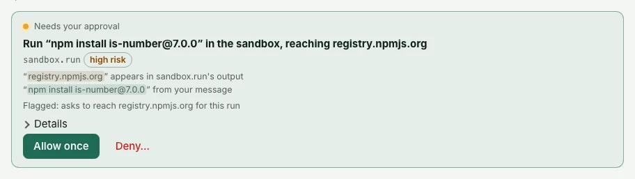
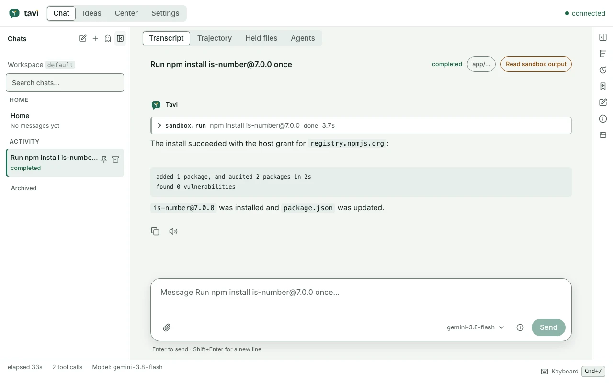
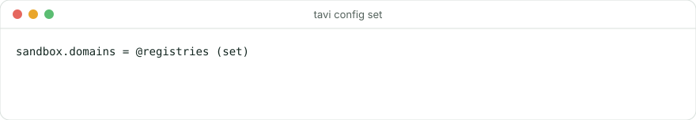
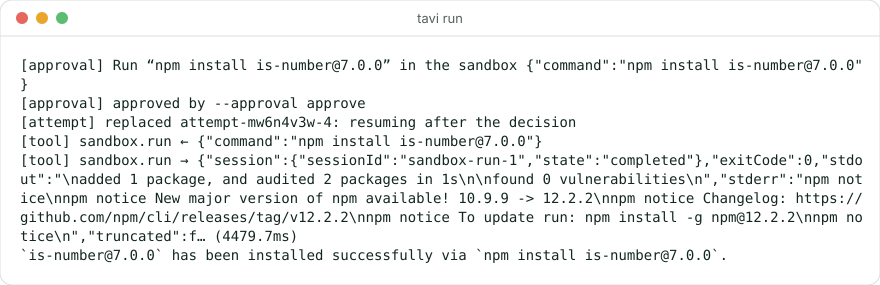
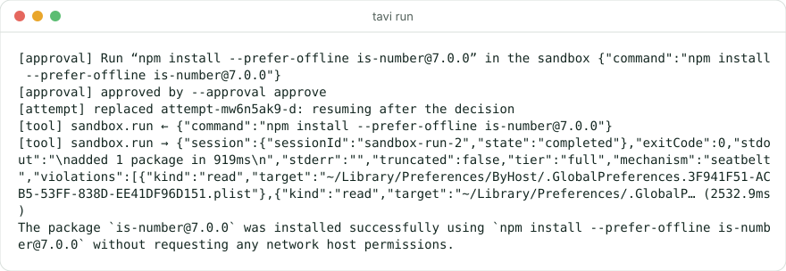

# Let a build download packages

The shell Tavi runs commands in has no network, so `npm install` or `pip install` fails until you say which hosts it may reach. Let one run ask you for a host, grant the package registries for good, and share one package cache between chats. About ten minutes.

> **Uses:** the shell (`sandbox.run`) · its network settings (the `sandbox.network` and `sandbox.domains` settings) · the shared package cache (`tavi serve --sandbox-cache`) · approvals
> **Before you start:** a model connected ([Connect your first model](../get-started/first-model.md)) · a project folder Tavi may use, such as `~/code/app` with a `package.json`, in a folder named with `--fs-root` ([Give Tavi a working folder](attach-a-folder.md)) · the canvas open ([Open the web canvas and walk through Welcome](../get-started/web-canvas-tour.md))

## 1. See the install blocked

Ask for an install: `tavi run --folder ~/code/app "Run npm install is-number@7.0.0 here once, asking for no hosts, and tell me what happened. Try nothing else."` and allow the command when asked (`--approval approve` answers for you). It runs, but the registry is refused: by default the shell reaches no host at all.

<picture>
  <source media="(prefers-color-scheme: dark)" srcset="../../assets/use-cases/files-and-code/let-a-build-reach-the-network/01-see-the-install-blocked-dark.svg">
  
</picture>

## 2. Let a run ask for a host

Run `tavi config set sandbox.network ask`, then open the chat on the canvas and ask again: `Try the install again, and ask me for the host it needs.` This time the run names the host it needs, and the card says so: **Run `npm install …` in the sandbox, reaching registry.npmjs.org**, rated high risk, with only **Allow once** and **Deny…**.

<!-- cover -->

## 3. Allow it once

Choose **Allow once**. That run alone reaches the registry, and the package is installed. What came back from the internet now marks the chat (**Read sandbox output** in its header): its later commands get no network, so start a new chat for the next install.

## 4. Grant the package registries

To stop asking about the usual places, grant them for this workspace: `tavi config set sandbox.domains @registries` covers npm, PyPI, crates.io, Go's proxy, RubyGems, Maven Central and a few more. Add other hosts the same way, separated by commas; `tavi config set sandbox.network granted` turns the asking off again.

<picture>
  <source media="(prefers-color-scheme: dark)" srcset="../../assets/use-cases/files-and-code/let-a-build-reach-the-network/04-grant-the-package-registries-dark.svg">
  
</picture>

## 5. Share one package cache

Restart the owner with `tavi serve --sandbox-cache`. Your chats then share one npm and pnpm cache, in `~/.cache/tavi-sandbox/<workspace>`, instead of each downloading the same packages into its own folder. Install in a new chat (asking for no hosts, since the registry is granted), and the package lands in the cache too.

<picture>
  <source media="(prefers-color-scheme: dark)" srcset="../../assets/use-cases/files-and-code/let-a-build-reach-the-network/05-share-one-package-cache-dark.svg">
  
</picture>

## 6. Install from the cache offline

A package one chat fetched installs in another without the network. Even with the grant removed (`tavi config unset sandbox.domains`), asking a new chat to install it with `npm install --prefer-offline` installs it from the shared cache.

<picture>
  <source media="(prefers-color-scheme: dark)" srcset="../../assets/use-cases/files-and-code/let-a-build-reach-the-network/06-install-from-the-cache-offline-dark.svg">
  
</picture>

## What Tavi will and won't do

The model never chooses what the shell may reach: only your grants and, with `ask`, the host you approve for that one run, which no rule, chat grant or unattended run can approve for you. Paste sites, this computer and private addresses are never reached, and a chat that has read anything from the internet gets no network at all, nor the shared cache. The details are in [SANDBOX.md](../../SANDBOX.md#network).

## Related

- [Give Tavi a working folder](attach-a-folder.md)
- Reference: [SANDBOX.md](../../SANDBOX.md), [SECURITY-MODEL.md](../../SECURITY-MODEL.md), [CLI.md](../../CLI.md)
