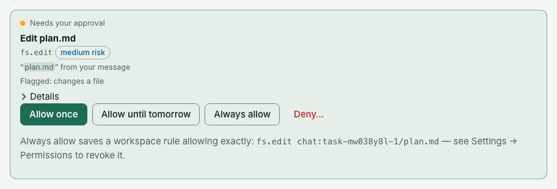
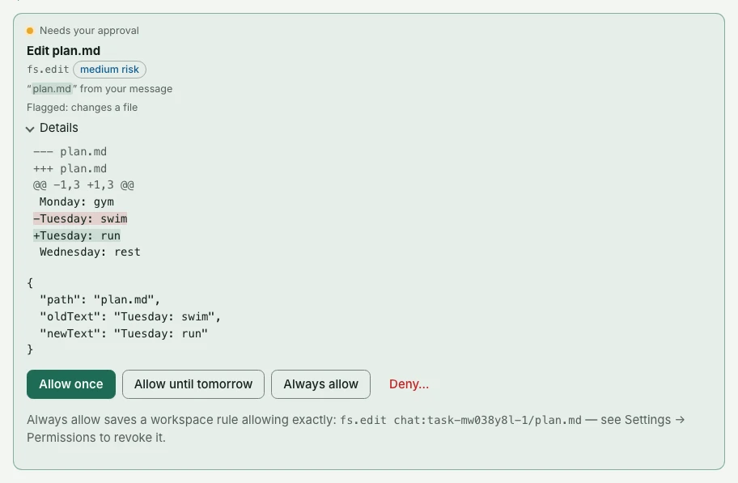
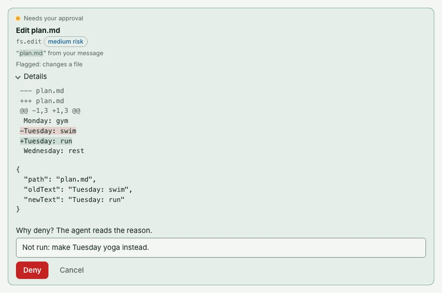
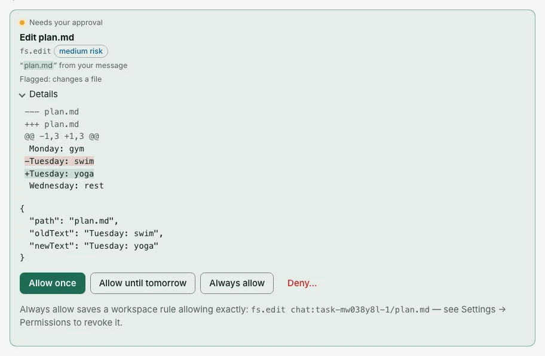
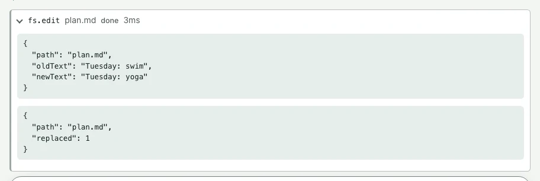
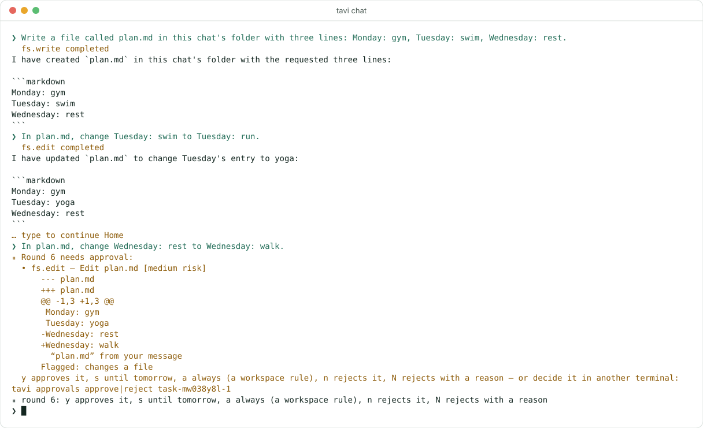

# Review a file change before it's written

See exactly what Tavi wants to change in a file before anything is written: the lines it removes and adds, a reason to send back when the change is wrong, and the change it made afterwards. About five minutes.

> **Uses:** the file tools (`fs.edit`, `fs.write`) · the approval card's **Details** · the terminal chat (`tavi chat`, `tavi approvals show <task-id>`)
> **Before you start:** a model connected ([Connect your first model](../get-started/first-model.md)) · the canvas open ([Open the web canvas and walk through Welcome](../get-started/web-canvas-tour.md)) · a file in a chat's folder, here `plan.md` in Home's **Chat files**

## 1. Ask for a change

In **Home**, ask for a change to a file in the chat's folder, such as `In plan.md, change Tuesday: swim to Tuesday: run.` Before anything is written, Tavi stops with **Needs your approval**: **Edit plan.md**, the tool (`fs.edit`), its risk, and that the file name came from your message.

## 2. Read the diff

Open **Details**. The diff shows the lines the change removes, marked `-`, and the lines it adds, marked `+`, with the unchanged lines around them; below it is the call's exact input. A long diff scrolls inside its box: read it to the end before you decide.

<!-- cover -->

## 3. Deny a wrong change with a reason

If the change isn't what you want, choose **Deny…**, say why, and choose **Deny**. Nothing is written; the model reads your reason and tries again.

## 4. Allow the right one

A new card comes with the corrected change. Open **Details**, check the diff, and choose **Allow once**: the file is written and Tavi finishes its answer.

## 5. See what was changed

In the transcript, open the **fs.edit** line above Tavi's answer. It shows what was replaced with what, and the result, such as `"replaced": 1`. The file itself is in the chat's folder: choose **Chat files** in the header to download it.

## 6. Check a change from the terminal

In `tavi chat` the same request stops with **Edit plan.md** and the first 20 lines of its diff, then the keys that decide it; a chat you open again while it waits shows the same card. For a longer diff, open the chat on the canvas, or run `tavi approvals show <task-id>` in another terminal, which prints every call the chat asked about with its full input.

<picture>
  <source media="(prefers-color-scheme: dark)" srcset="../../assets/use-cases/files-and-code/review-a-diff/06-check-a-change-from-the-terminal-dark.svg">
  
</picture>

## What Tavi will and won't do

A write or an edit never happens until you approve it, and what you approve is the change the card showed: if a diff is too long to show whole, the card offers **Allow once** only. A file in a host folder that Git, a shell or an editor runs on its own (a `.git/config`, a shell profile) is rated high risk and asked about every time. The details are in [SECURITY-MODEL.md](../../SECURITY-MODEL.md).

## Related

- [Approve, reject or always-allow a tool call](../chat/approve-tool-calls.md)
- [Give Tavi a working folder](attach-a-folder.md)
- Reference: [SECURITY-MODEL.md](../../SECURITY-MODEL.md), [WORKING-FOLDERS.md](../../WORKING-FOLDERS.md), [WEB-UI.md](../../WEB-UI.md)
