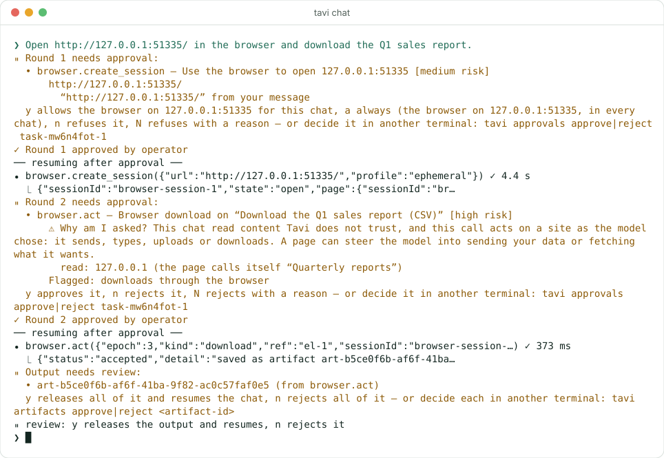
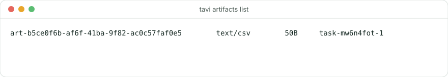
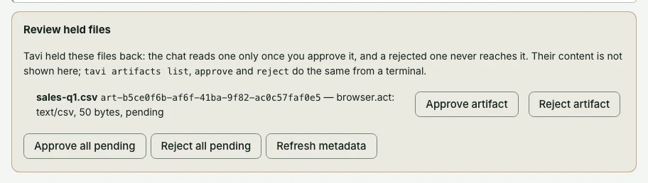
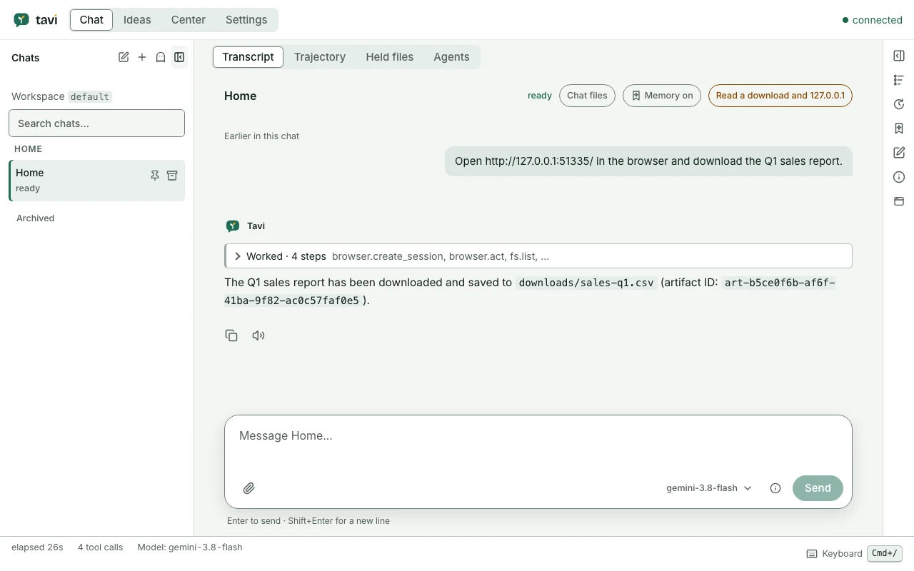
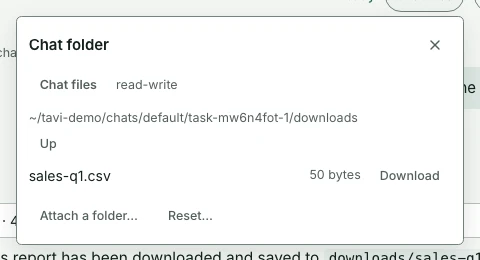

# Review files Tavi held back

When Tavi downloads a file with its browser, the file is kept but held back: nothing in the chat reads it until you look and keep it. Find what is waiting, keep or reject it, and pick the file up from the chat's folder. About five minutes.

> **Uses:** held files (`tavi artifacts list`, `tavi artifacts approve <artifact-id>`, `tavi artifacts reject <artifact-id>`) · the browser (`browser.act` downloads) · the chat's review card on the canvas and in `tavi chat` · the **Chat folder** panel
> **Before you start:** a model connected ([Connect your first model](../get-started/first-model.md)) · Tavi running in the background with `tavi serve` ([Keep Tavi running in the background](../get-started/keep-tavi-running.md))

## 1. Ask for a download

In `tavi chat`, ask Tavi to fetch a file from a site, such as `Open http://127.0.0.1:8080/ in the browser and download the Q1 sales report.`, and press `y` to let the browser open the site and again to allow the download. The file is stored, then held: **Output needs review**, and the chat waits for you. (A site on this computer, as here, also needs `tavi serve --browser-allow-host 127.0.0.1:8080`.)

<!-- cover -->
<picture>
  <source media="(prefers-color-scheme: dark)" srcset="../../assets/use-cases/files-and-code/review-held-files/01-ask-for-a-download-dark.svg">
  
</picture>

## 2. List what is held

Run `tavi artifacts list`. Each held file is one line: its id, its type, its size and the chat that made it. `tavi needs` lists it too, as a result to review.

<picture>
  <source media="(prefers-color-scheme: dark)" srcset="../../assets/use-cases/files-and-code/review-held-files/02-list-what-is-held-dark.svg">
  
</picture>

## 3. Find it on the canvas

Open the chat in `tavi ui`. Its **Review held files** card lists each held file with **Approve artifact** and **Reject artifact**; **Center → Approvals** lists it under **Reviews** with the other things waiting on you.

## 4. Keep it or reject it

Choose **Approve artifact** (or `y` in `tavi chat`, or `tavi artifacts approve <artifact-id>`). The chat picks up where it stopped and reads the file. **Reject artifact** (or `tavi artifacts reject <artifact-id>`) keeps its content out of the chat for good.

## 5. Pick up the file

A kept download is copied into `downloads/` in the chat's own folder. Choose the folder chip (**Chat files**), open **downloads/**, and choose **Download** beside the file to save it.

## What Tavi will and won't do

A browser download or screenshot is stored pending: the model cannot read it, and it is never copied into a folder, until a person keeps it, and a rejected file stays out of the chat. Opening a site and downloading from it each ask you first, and a chat that has read a web page is marked as holding untrusted content. The details are in [SECURITY-MODEL.md](../../SECURITY-MODEL.md) and [BROWSER.md](../../BROWSER.md).

## Related

- [Give Tavi a working folder](attach-a-folder.md)
- [Have your first conversation in the terminal](../get-started/first-chat.md)
- Reference: [CLI.md](../../CLI.md), [BROWSER.md](../../BROWSER.md), [WORKING-FOLDERS.md](../../WORKING-FOLDERS.md)
