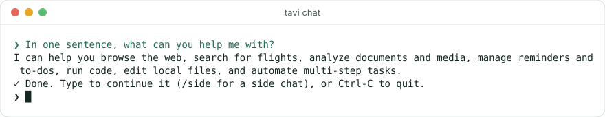
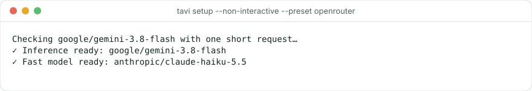
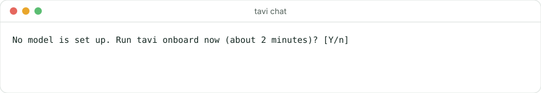
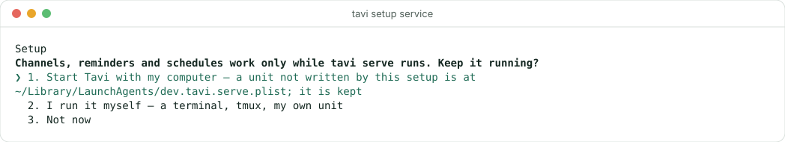
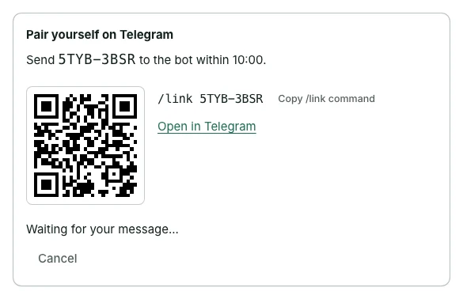
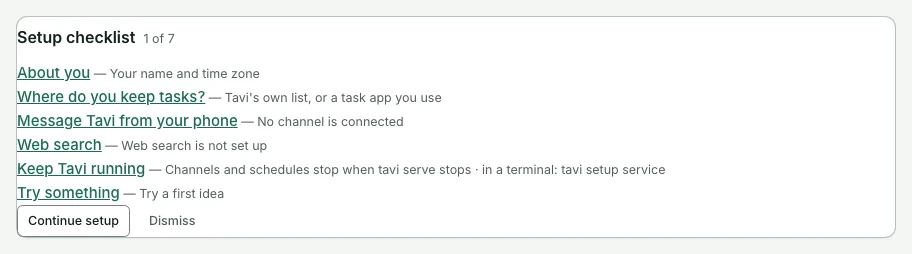
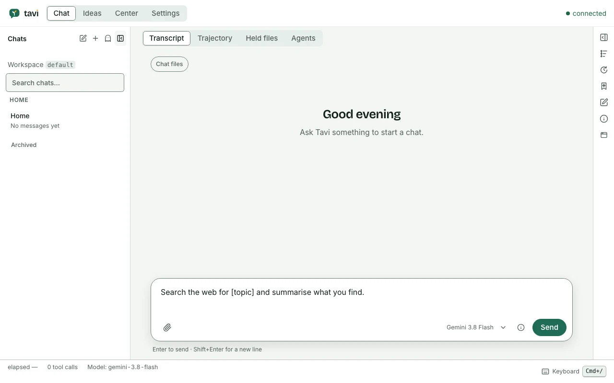
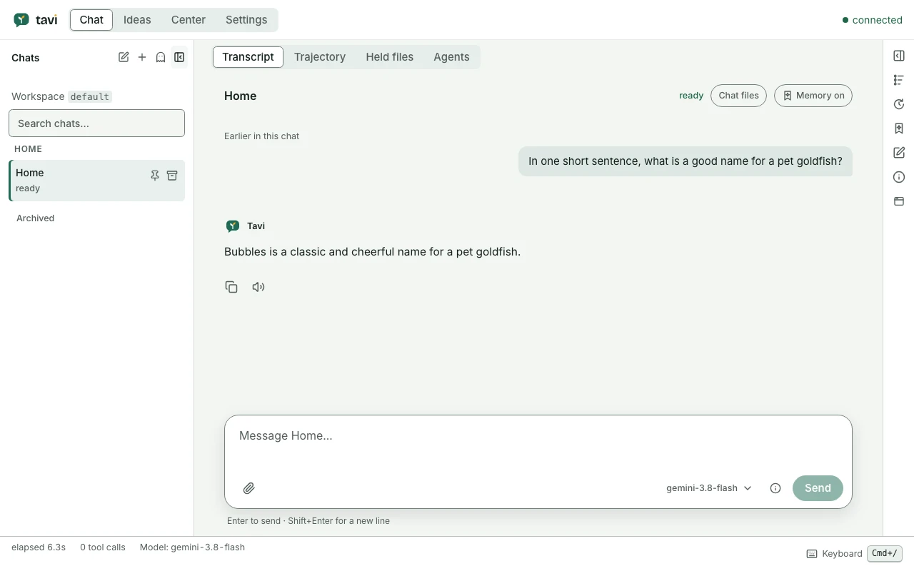

<!-- Generated by scripts/docs/guide-indexes.mjs from the guides: edit the guides, not this file. -->

# Get started

Install Tavi, connect a model and meet each way of talking to it.

| | Guide |
| :--- | :--- |
|  | [Have your first conversation in the terminal](first-chat.md) Talk to Tavi from your terminal: ask something, see the commands you can type, and pick up where you left off next time. |
|  | [Connect your first model, OpenAI-compatible or Anthropic](first-model.md) Give Tavi the one thing it needs to answer you: a model. |
|  | [Install Tavi and put it on your PATH](install.md) Get Tavi from its repository, build it, and make `tavi` a command you can run from any folder. |
|  | [Keep Tavi running in the background](keep-tavi-running.md) Reminders, schedules and phone channels only work while `tavi serve` runs. |
|  | [Pair your phone in two minutes (QR code)](pair-your-phone.md) Reach Tavi from Telegram on your phone: add your own bot in Welcome, scan a QR code, and confirm it was you. |
|  | [Finish setup with the onboarding checklist](setup-checklist.md) Only the model is required; everything else in setup can wait. |
|  | [Open the web canvas and walk through Welcome](web-canvas-tour.md) Open Tavi in your browser and set it up in a few steps: a model, your name, where you keep tasks, web search and a first thing to try. |
|  | [Terminal, web, CLI or phone: which to use when](which-surface.md) Tavi is one assistant with several ways in: the terminal chat, the web canvas, one-off commands for scripts, and your phone. |

[All how-to guides](../README.md)
