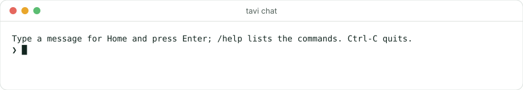
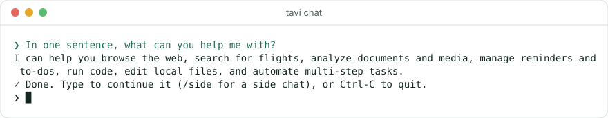
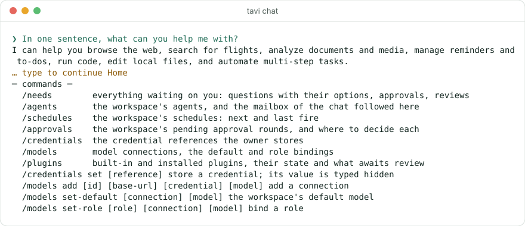
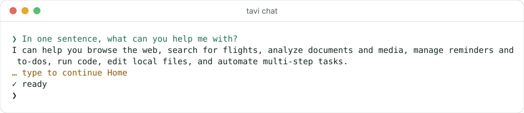

# Have your first conversation in the terminal

Talk to Tavi from your terminal: ask something, see the commands you can type, and pick up where you left off next time. About two minutes.

> **Uses:** the terminal chat (`tavi chat`) · your Home conversation
> **Before you start:** a model connected ([Connect your first model](first-model.md)) · Tavi running in the background with `tavi serve` ([Keep Tavi running in the background](keep-tavi-running.md))

## 1. Open the chat

Run `tavi chat`. It opens **Home**, your one continuous conversation with Tavi, and waits for you to type.

<picture>
  <source media="(prefers-color-scheme: dark)" srcset="../../assets/use-cases/get-started/first-chat/01-open-the-chat-dark.svg">
  
</picture>

## 2. Ask something

Type a question and press Enter. The answer streams in under it, and the prompt comes back when Tavi is done.

<!-- cover -->
<picture>
  <source media="(prefers-color-scheme: dark)" srcset="../../assets/use-cases/get-started/first-chat/02-ask-something-dark.svg">
  
</picture>

## 3. See what you can type

Type `/help` and press Enter for the commands: `/side` starts a side chat, `/needs` shows what is waiting on you, `/remember` saves something to memory, and more.

<picture>
  <source media="(prefers-color-scheme: dark)" srcset="../../assets/use-cases/get-started/first-chat/03-see-what-you-can-type-dark.svg">
  
</picture>

## 4. Come back later

Press Ctrl-C to leave. Run `tavi chat` again, here or on another terminal, and Home picks up where you left it: the last turns are on screen, ready for your next message.

<picture>
  <source media="(prefers-color-scheme: dark)" srcset="../../assets/use-cases/get-started/first-chat/04-come-back-later-dark.svg">
  
</picture>

## What Tavi will and won't do

Anything that changes something outside the chat, such as writing a file or sending a message, stops and asks you first, right in the transcript. Leaving with Ctrl-C never loses a conversation: Home and every chat are kept by `tavi serve`.

## Related

- [Open the web canvas and walk through Welcome](web-canvas-tour.md)
- Reference: [TERMINAL-UI.md](../../TERMINAL-UI.md)
