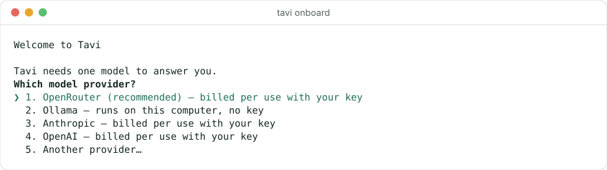
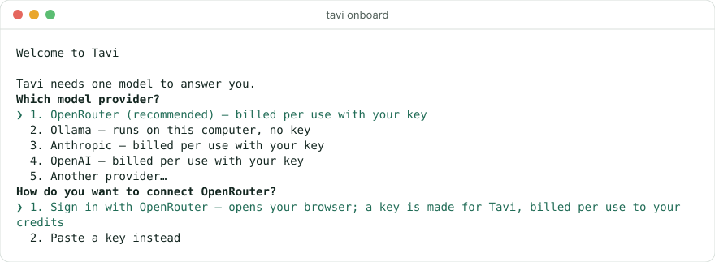
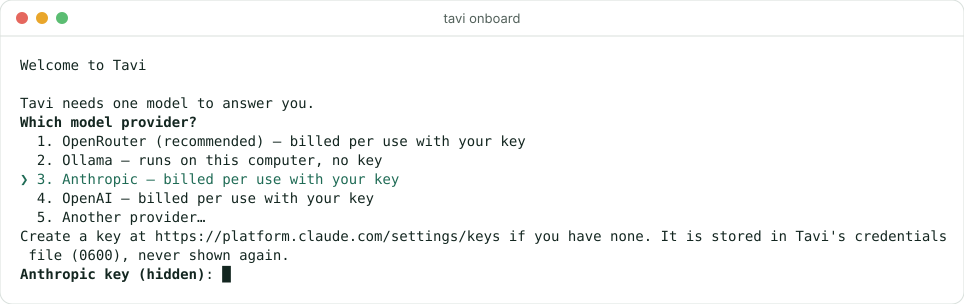
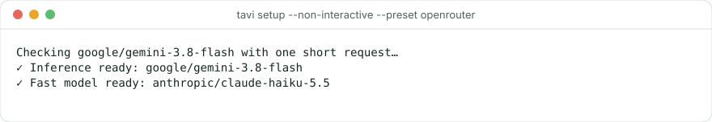
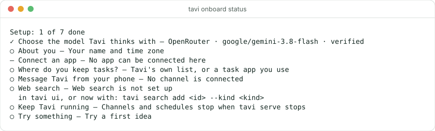
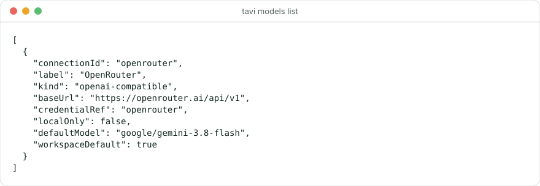

# Connect your first model, OpenAI-compatible or Anthropic

Give Tavi the one thing it needs to answer you: a model. Pick a provider, give it a key once, and Tavi checks the model with a short request before it uses it. About two minutes.

> **Uses:** setup (`tavi onboard`, `tavi setup`) · model connections (`tavi models list`) · Tavi's credentials file
> **Before you start:** Tavi installed ([Install Tavi and put it on your PATH](install.md)) · a key from a model provider such as OpenRouter or Anthropic, or Ollama running on this computer

## 1. Start setup

Run `tavi onboard`. It opens on the model, the only step Tavi needs, and lists the providers: **OpenRouter** (one key for many models), **Ollama** on this computer, **Anthropic**, **OpenAI**, or **Another provider…** for any OpenAI-compatible endpoint.

<picture>
  <source media="(prefers-color-scheme: dark)" srcset="../../assets/use-cases/get-started/first-model/01-start-setup-dark.svg">
  
</picture>

## 2. Choose OpenRouter

Press Enter on **OpenRouter**. **Sign in with OpenRouter** opens your browser and OpenRouter makes a key for Tavi; **Paste a key instead** asks for one you already have. OpenRouter, OpenAI, Ollama and most other providers speak the OpenAI-compatible API.

<picture>
  <source media="(prefers-color-scheme: dark)" srcset="../../assets/use-cases/get-started/first-model/02-choose-openrouter-dark.svg">
  
</picture>

## 3. Or choose Anthropic

Choose **Anthropic** to use Claude with Anthropic's own key. Tavi says where to create one and asks for it, hidden as you type. This connection speaks Anthropic's own Messages API, which caches your prompts and keeps the model's thinking across tool calls.

<picture>
  <source media="(prefers-color-scheme: dark)" srcset="../../assets/use-cases/get-started/first-model/03-or-choose-anthropic-dark.svg">
  
</picture>

## 4. Or connect from a key file

On a server, or to script it, skip the questions: save the key in a file only you can read and run `tavi setup --non-interactive --preset openrouter --key-file ~/.config/tavi/openrouter.key`. Use `--preset anthropic` for Anthropic, and `--model` to choose the model. Either way Tavi checks the main and the fast model with one short request each.

<!-- cover -->
<picture>
  <source media="(prefers-color-scheme: dark)" srcset="../../assets/use-cases/get-started/first-model/04-or-connect-from-a-key-file-dark.svg">
  
</picture>

## 5. Check that it is set up

Run `tavi onboard status`. The **Choose the model Tavi thinks with** line is ticked, with the provider, the model and **verified**; the other steps are optional and can wait.

<picture>
  <source media="(prefers-color-scheme: dark)" srcset="../../assets/use-cases/get-started/first-model/05-check-that-it-is-set-up-dark.svg">
  
</picture>

## 6. See the connection

Run `tavi models list` to see the connection setup made: its name, its **kind** (`openai-compatible`, or `anthropic-messages` for Anthropic), its address and the credential it uses. The key itself is never shown.

<picture>
  <source media="(prefers-color-scheme: dark)" srcset="../../assets/use-cases/get-started/first-model/06-see-the-connection-dark.svg">
  
</picture>

## What Tavi will and won't do

Your key goes into Tavi's credentials file (`0600`), never into a command line, a log or a chat, and it is never shown again. A model becomes Tavi's only once it passes its check, so a wrong key or a model that cannot call tools is caught here, not in your first chat. To change the model later, run `tavi setup model`.

## Related

- [Install Tavi and put it on your PATH](install.md)
- [Have your first conversation in the terminal](first-chat.md)
- [Open the web canvas and walk through Welcome](web-canvas-tour.md)
- Reference: [ONBOARDING.md](../../ONBOARDING.md), [CLI.md](../../CLI.md#tavi-models)
