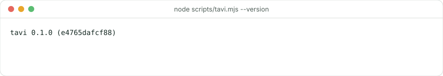
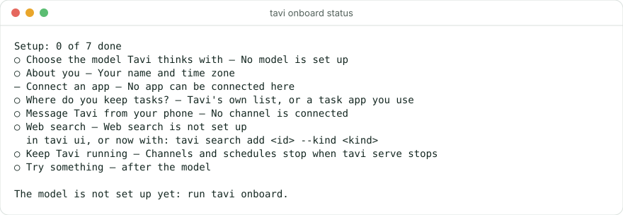
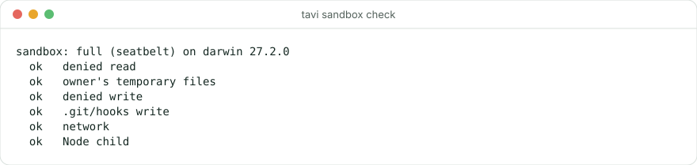
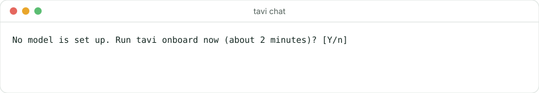

# Install Tavi and put it on your PATH

Get Tavi from its repository, build it, and make `tavi` a command you can run from any folder. About ten minutes, most of it the build.

> **Uses:** the repository's build (`pnpm`) · the `tavi` command · the sandbox check (`tavi sandbox check`)
> **Before you start:** macOS, Linux or WSL2 (on Windows, see [Tavi on Windows](../../WINDOWS.md)) · Node.js 22.21 or later ([nodejs.org](https://nodejs.org)) · pnpm, through `corepack enable` · Git

## 1. Clone and build

Tavi runs from a clone of its repository. Clone it, install its packages and build it (on WSL2, from your Linux home folder, `cd ~`, not from a Windows drive under `/mnt`):

```bash
git clone https://github.com/atanasster/tavi.git
cd tavi
pnpm install
pnpm run build
```

When the build is done, `node scripts/tavi.mjs --version` prints the version and the commit your checkout is at.

<picture>
  <source media="(prefers-color-scheme: dark)" srcset="../../assets/use-cases/get-started/install/01-clone-and-build-dark.svg">
  
</picture>

## 2. Put tavi on your PATH

From the repository's folder, add an alias to your shell's startup file, then open a new terminal. On macOS, whose shell is zsh:

```bash
echo "alias tavi=\"node $(pwd)/scripts/tavi.mjs\"" >> ~/.zshrc
```

On Linux and WSL2, whose shell is usually bash:

```bash
echo "alias tavi=\"node $(pwd)/scripts/tavi.mjs\"" >> ~/.bashrc
```

`tavi` now works from any folder: `tavi onboard status` lists what is left to set up, and on a new install that is everything, the model first.

<picture>
  <source media="(prefers-color-scheme: dark)" srcset="../../assets/use-cases/get-started/install/02-put-tavi-on-your-path-dark.svg">
  
</picture>

## 3. Check the sandbox

Run `tavi sandbox check`. Shell commands, local MCP servers and PDF processing run in a sandbox, and this checks it works on this computer. On macOS it is built in, and every check says **ok**.

**On Linux** the sandbox needs bubblewrap, socat and ripgrep from your package manager. `tavi sandbox check` names what is missing, and `tavi sandbox setup` prints the one-time root step some distributions need. Tavi keeps its data in `~/.local/share/tavi` on Linux, and in `~/Library/Application Support/tavi` on macOS.

**On WSL2** it is the Linux sandbox, with the same packages. Your Windows drives under `/mnt` are closed to it; [the sandbox page](../../SANDBOX.md#wsl2) says what else differs.

<picture>
  <source media="(prefers-color-scheme: dark)" srcset="../../assets/use-cases/get-started/install/03-check-the-sandbox-dark.svg">
  
</picture>

## 4. Start Tavi and open the chat

Run `tavi serve` in one terminal and leave it running: it is the owner, the background process every other command talks to. In a second terminal run `tavi chat`. With no model yet it offers to set one up: press Enter to run `tavi onboard`.

<!-- cover -->
<picture>
  <source media="(prefers-color-scheme: dark)" srcset="../../assets/use-cases/get-started/install/04-start-tavi-and-open-the-chat-dark.svg">
  
</picture>

## What Tavi will and won't do

Nothing is installed outside the folder you cloned and your shell's startup file: there is no global package and no `sudo`. Before `tavi serve`, `tavi chat`, `tavi ui`, `tavi onboard` and `tavi setup`, `scripts/tavi.mjs` rebuilds whatever changed in your checkout since the last build (`TAVI_NO_REBUILD=1` skips that check). Tavi's data stays in its own data directory on this computer.

## Related

- [Connect your first model, OpenAI-compatible or Anthropic](first-model.md)
- [Have your first conversation in the terminal](first-chat.md)
- Reference: [README.md](../../../README.md#quick-install), [OPERATIONS.md](../../OPERATIONS.md#the-data-directory), [SANDBOX.md](../../SANDBOX.md)
