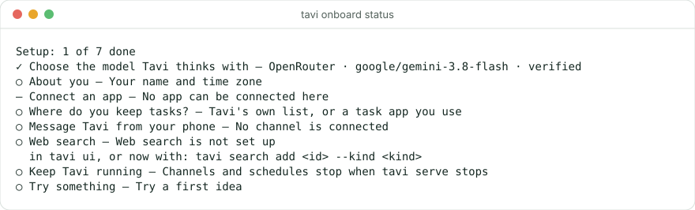
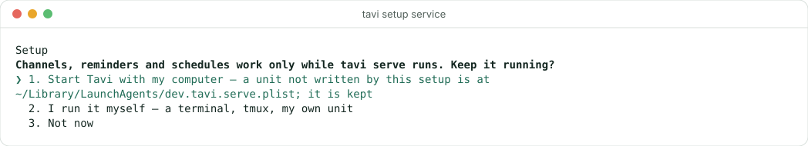
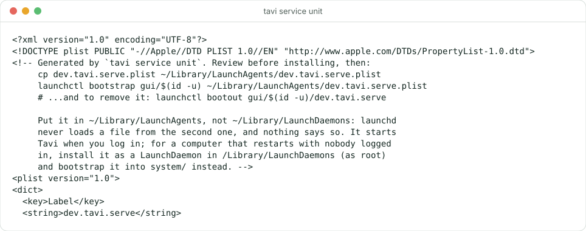
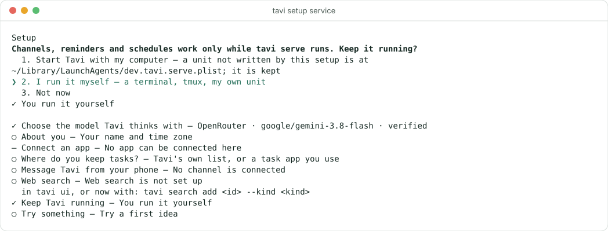

# Keep Tavi running in the background

Reminders, schedules and phone channels only work while `tavi serve` runs. Start it in a terminal to try Tavi out, then let your computer start it at login so nothing stops when you close that terminal. About five minutes.

> **Uses:** the owner (`tavi serve`) · service units (`tavi service unit`) · setup's **Keep Tavi running** step (`tavi setup service`)
> **Before you start:** Tavi installed ([Install Tavi and put it on your PATH](install.md)) · a model connected ([Connect your first model](first-model.md))

## 1. Start Tavi in a terminal

Run `tavi serve` and leave it running: it prints `"serving": true` and keeps going until you press Ctrl-C. Every other `tavi` command talks to it. While it runs only in a terminal, `tavi onboard status` keeps **Keep it running** open: channels and schedules stop when `tavi serve` stops.

<picture>
  <source media="(prefers-color-scheme: dark)" srcset="../../assets/use-cases/get-started/keep-tavi-running/01-start-tavi-in-a-terminal-dark.svg">
  
</picture>

## 2. Let setup start it with your computer

Run `tavi setup service` and choose **Start Tavi with my computer**. It writes a launchd agent to `~/Library/LaunchAgents`, as your user, never with `sudo`, and starts it. If `tavi serve` is still running in a terminal, it writes the unit and asks you to stop that one first (Ctrl-C), then prints the `launchctl` command that starts the service.

<!-- cover -->
<picture>
  <source media="(prefers-color-scheme: dark)" srcset="../../assets/use-cases/get-started/keep-tavi-running/02-let-setup-start-it-with-your-computer-dark.svg">
  
</picture>

## 3. Or write the unit yourself

To review the unit or change it first, run `tavi service unit`: it prints the launchd agent, with the commands that install it at the top. Add the `tavi serve` flags your setup needs with `--serve-arg`, then save it with `--out`:

```bash
tavi service unit --log-dir ~/Library/Logs/tavi --out ~/Library/LaunchAgents/dev.tavi.serve.plist
launchctl bootstrap gui/$(id -u) ~/Library/LaunchAgents/dev.tavi.serve.plist
```

**On Linux** the unit is a systemd one. `tavi service unit --scope user` prints a `systemctl --user` unit with its install commands:

```bash
mkdir -p ~/.config/systemd/user && tavi service unit --scope user --out ~/.config/systemd/user/dev.tavi.serve.service
systemctl --user daemon-reload && systemctl --user enable --now dev.tavi.serve
loginctl enable-linger "$USER"
```

**On WSL2** WSL stops the distribution, and the service with it, soon after its last terminal closes. In `%USERPROFILE%\.wslconfig` on Windows, set `vmIdleTimeout=-1` under `[wsl2]` and `instanceIdleTimeout=-1` under `[general]` (WSL 2.5 or later), then run `wsl --shutdown` once. `systemctl --user` also needs systemd on in the distribution (`systemd=true` under `[boot]` in `/etc/wsl.conf`). [SANDBOX](../../SANDBOX.md#wsl2) has the details.

**On native Windows** `tavi serve` does not run yet, so there is nothing to keep running there: run Tavi in WSL2 ([Tavi on Windows](../../WINDOWS.md)).

<picture>
  <source media="(prefers-color-scheme: dark)" srcset="../../assets/use-cases/get-started/keep-tavi-running/03-or-write-the-unit-yourself-dark.svg">
  
</picture>

## 4. Or say you run it yourself

If you keep `tavi serve` running your own way, in tmux or under a service manager of your own, run `tavi setup service` and choose **I run it myself**. The **Keep it running** step is then done, and setup stops asking about it.

<picture>
  <source media="(prefers-color-scheme: dark)" srcset="../../assets/use-cases/get-started/keep-tavi-running/04-or-say-you-run-it-yourself-dark.svg">
  
</picture>

## What Tavi will and won't do

Setup writes a unit only as your user and only where it says, never over a unit it did not write, and never with `sudo`; `tavi setup service` can remove the one it wrote. `tavi service unit` installs nothing: it prints the unit, or writes it where `--out` says, for you to review and load. Only one `tavi serve` can own a data directory at a time, so stop the one in your terminal before the service starts.

## Related

- [Install Tavi and put it on your PATH](install.md)
- [Finish setup with the onboarding checklist](setup-checklist.md)
- Reference: [OPERATIONS.md](../../OPERATIONS.md#running-the-owner), [CLI.md](../../CLI.md#tavi-service)
