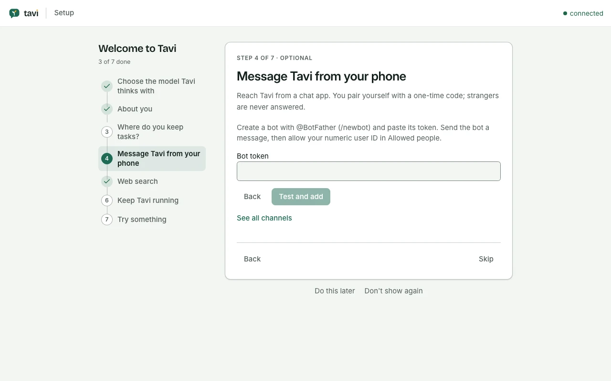
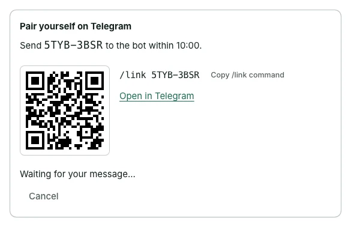
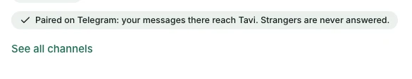

# Pair your phone in two minutes (QR code)

Reach Tavi from Telegram on your phone: add your own bot in Welcome, scan a QR code, and confirm it was you. About two minutes once you have a bot.

> **Uses:** channels (Telegram) · pairing with a one-time code · the web canvas's Welcome
> **Before you start:** Tavi running in the background with `tavi serve` ([Keep Tavi running in the background](keep-tavi-running.md)) · the canvas open ([Open the web canvas and walk through Welcome](web-canvas-tour.md)) · Telegram on your phone, and a bot: in Telegram, send `/newbot` to @BotFather and keep the token it gives you

## 1. Open Message Tavi from your phone

In the canvas, open **Welcome** (or **Settings → General → Run setup again**), go to **Message Tavi from your phone** and choose **Telegram**. Tavi asks for one thing, your bot's token, and says where to get it.

## 2. Add your bot

Paste the token into **Bot token** and choose **Test and add**. Tavi saves it in its credential store, checks that Telegram answers, and moves on to pairing you; a token Telegram refuses is removed again.

## 3. Scan the code with your phone

Choose **Get a code**. Point your phone's camera at the QR code and open the link: Telegram opens your bot, and **Start** sends it the code. You can also tap **Open in Telegram**, or send `/link` and the code to the bot yourself, within ten minutes.

<!-- cover -->

## 4. Confirm it was you

Welcome shows who sent the code and asks **Is this you?** Choose **Yes, it's me** if it was. Your Telegram account is now linked to you, and what you send the bot reaches Tavi.

## What Tavi will and won't do

Your bot answers only the people you pair or allow: anyone else's message is kept, not answered ([Let in a message Tavi held back](../channels/held-messages.md)). The code works once, for ten minutes, and nobody is linked until you confirm who sent it. Anything Tavi wants to change or send from a Telegram chat still asks you first, in that chat. The details are in [CHANNELS.md](../../CHANNELS.md#pairing-from-onboarding).

## Related

- [Connect a Telegram bot](../channels/pair-telegram.md)
- [Approve actions from your phone](../channels/approve-from-your-phone.md)
- [Continue a Home conversation on your phone](../channels/continue-on-your-phone.md)
- Reference: [ONBOARDING.md](../../ONBOARDING.md), [CHANNELS.md](../../CHANNELS.md)
