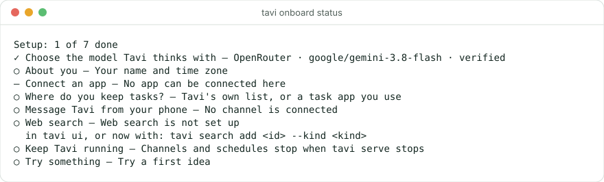
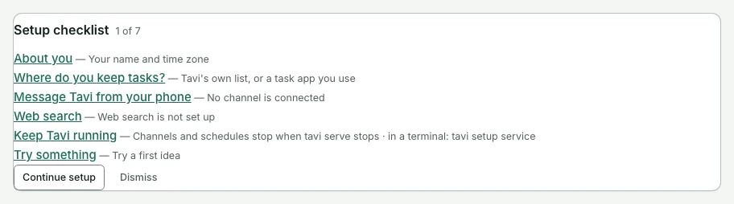
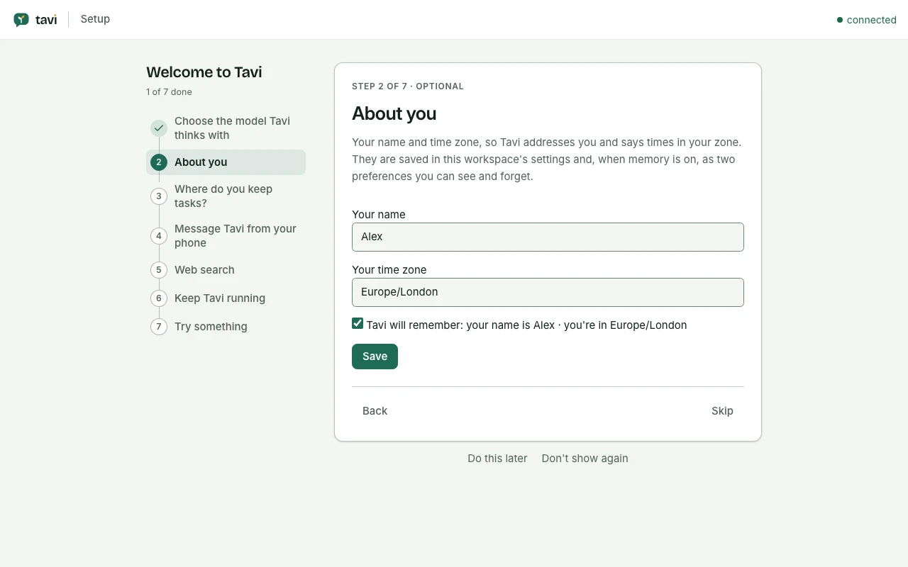
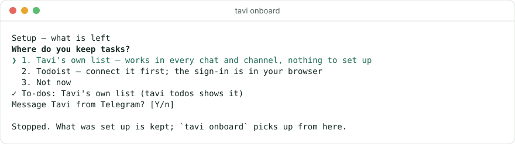
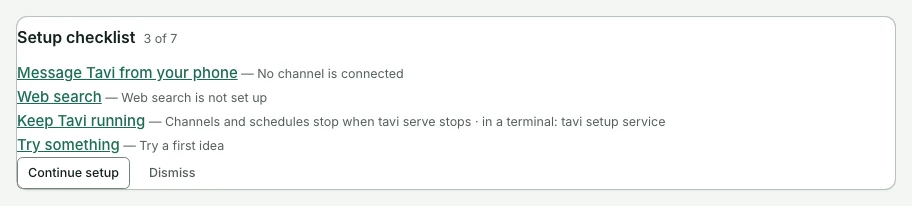

# Finish setup with the onboarding checklist

Only the model is required; everything else in setup can wait. The checklist shows what is still open, in the terminal and on **Home** in the web canvas, so you can finish a step whenever it suits you. About five minutes.

> **Uses:** setup's checklist (`tavi onboard status`) · the **Setup checklist** on Home · Welcome (`tavi ui`) · `tavi onboard`
> **Before you start:** a model connected ([Connect your first model](first-model.md)) · Tavi running with `tavi serve` ([Keep Tavi running in the background](keep-tavi-running.md))

## 1. See what is left

Run `tavi onboard status`. Each step has a line: a tick for what is done, a circle for what is open, and a few words on where it stands. It exits `0` once the model is set up, so a script can check it.

<picture>
  <source media="(prefers-color-scheme: dark)" srcset="../../assets/use-cases/get-started/setup-checklist/01-see-what-is-left-dark.svg">
  
</picture>

## 2. Open the checklist on Home

Run `tavi ui`. Above **Home** a **Setup checklist** card lists the open steps, one link each, with how many are done, **Continue setup** and **Dismiss**. While Tavi runs in a terminal rather than as a service, it also says that channels and schedules stop with `tavi serve`.

<!-- cover -->

## 3. Finish a step from the card

Choose a step, such as **About you**. Welcome opens on it: type your name, check your time zone and choose **Save**. Welcome then moves on to the next open step; choose **Do this later** to go back to Home.

## 4. Or finish it in the terminal

Run `tavi onboard`. It asks only about the steps still open, starting with the next one, here **Where do you keep tasks?**. Answer it, or press Ctrl-C to stop: what you set up is kept, and `tavi onboard` picks up from there next time.

<picture>
  <source media="(prefers-color-scheme: dark)" srcset="../../assets/use-cases/get-started/setup-checklist/04-or-finish-it-in-the-terminal-dark.svg">
  
</picture>

## 5. Dismiss the card

Back on **Home**, the card lists only what is still open. Choose **Dismiss** when you are done with it: it goes for good, and the steps stay in `tavi onboard` for when you want them. A later release that adds a step shows the card once more, with just that step.

## What Tavi will and won't do

Every step but the model can be skipped; nothing is set up unless you choose it, and a skipped step only stays on the list. Dismissing the card changes nothing you set up. `tavi onboard reset` brings the card back and forgets skips, keeping every model, key and connection, and `tavi setup about`, or any other step by name, changes a step that is already done (on the canvas: **Settings → General → Run setup again**).

## Related

- [Connect your first model, OpenAI-compatible or Anthropic](first-model.md)
- [Keep Tavi running in the background](keep-tavi-running.md)
- [Open the web canvas and walk through Welcome](web-canvas-tour.md)
- Reference: [ONBOARDING.md](../../ONBOARDING.md#the-checklist)
