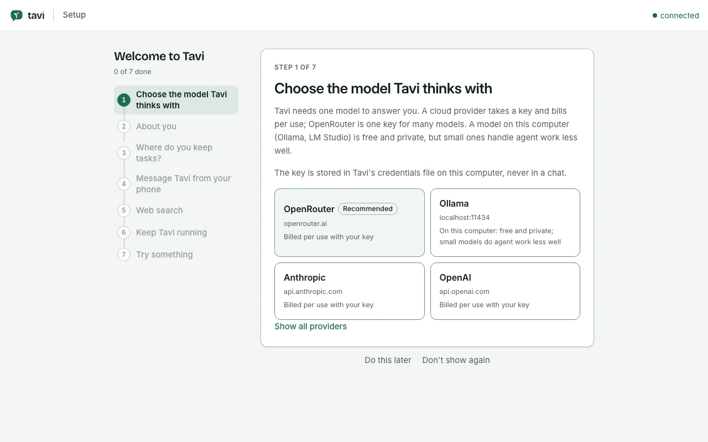
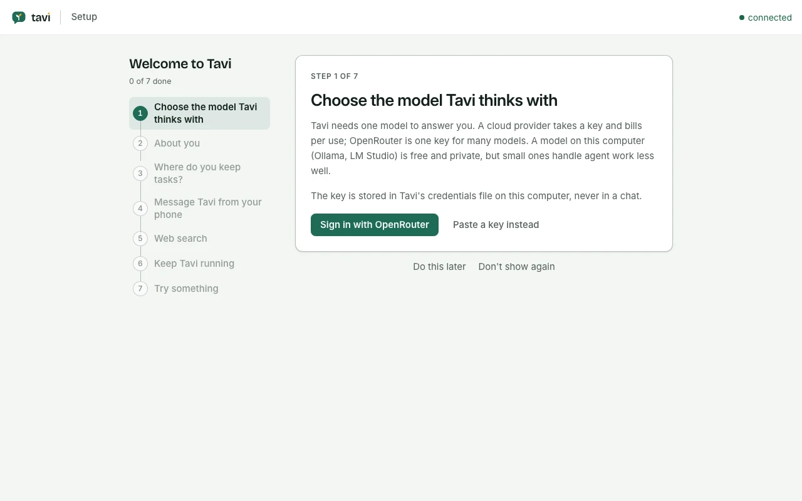
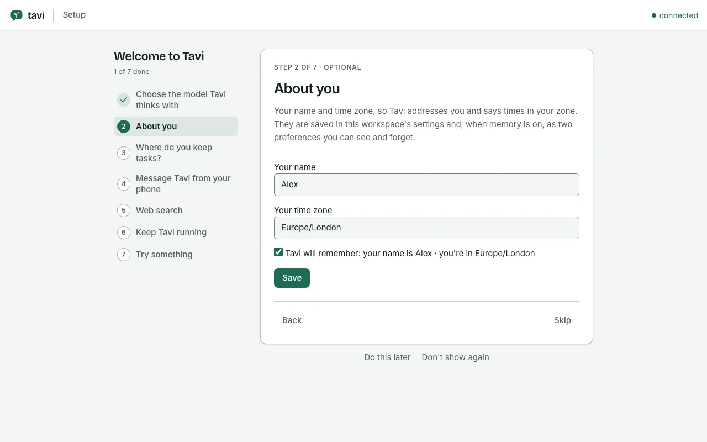
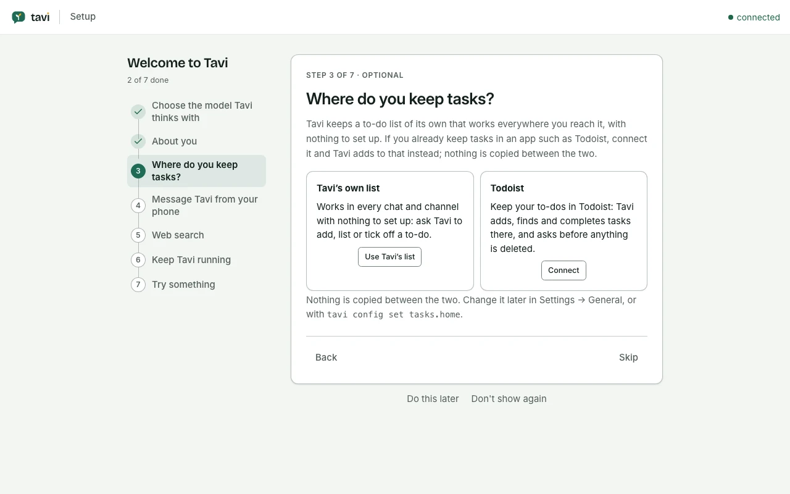
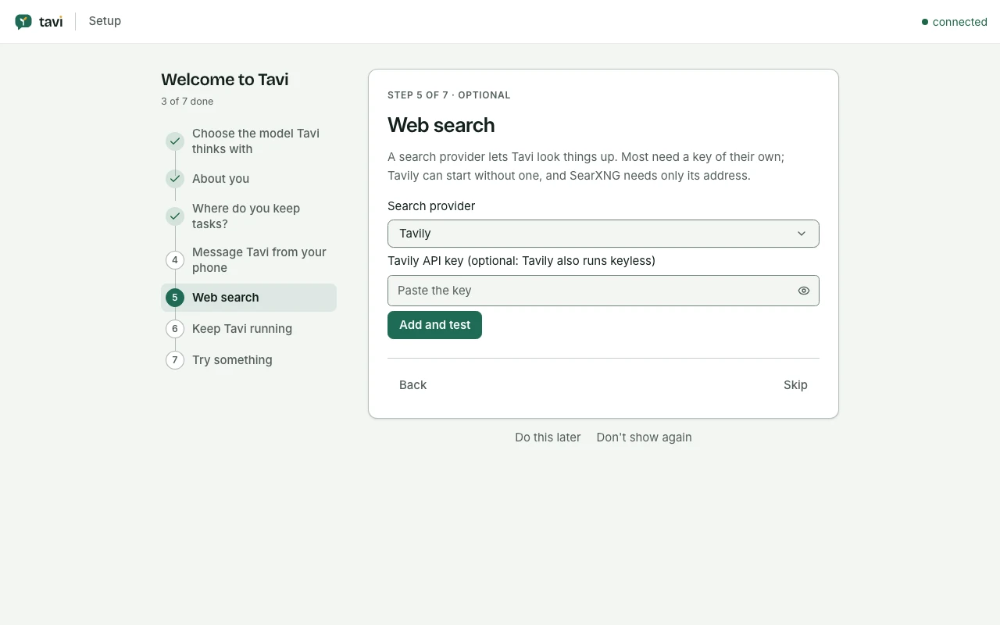
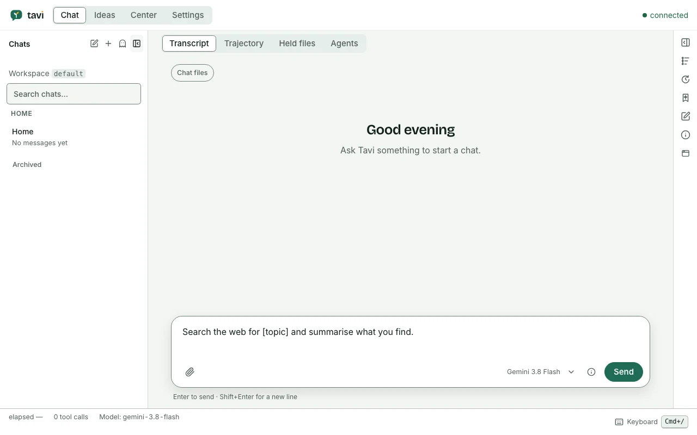

# Open the web canvas and walk through Welcome

Open Tavi in your browser and set it up in a few steps: a model, your name, where you keep tasks, web search and a first thing to try. About five minutes; only the model is required.

> **Uses:** the web canvas (`tavi ui`) · setup (Welcome)
> **Before you start:** Tavi running in the background with `tavi serve` ([Keep Tavi running in the background](keep-tavi-running.md)) · a key from a model provider such as OpenRouter, or a model on this computer

## 1. Open the canvas

Run `tavi ui`. Your browser opens on **Welcome** the first time, with its steps down the left and the model first.

## 2. Connect a model

Choose a provider. For **OpenRouter** (one key for many models), choose **Sign in with OpenRouter**, or **Paste a key instead**, paste your key and choose **Connect**. Tavi checks the connection with one short call before it moves on.

## 3. Tell Tavi about you

Type your name, check your time zone, and choose **Save**. Tavi uses them to address you and to say times in your zone, and Welcome moves on to the next step.

## 4. Choose where you keep tasks

Choose **Use Tavi's list** to keep to-dos in Tavi, with nothing to set up, or **Connect** your task app. Skip **Message Tavi from your phone** for now: pairing a phone has a guide of its own.

## 5. Turn on web search

Choose a **Search provider**. Tavily works without a key to start with; choose **Add and test**, and Tavi runs one search to check it. If Tavi is not installed as a service yet, Welcome then shows **Keep Tavi running** with the command to run in a terminal; choose **Skip** to go on, and see [Keep Tavi running in the background](keep-tavi-running.md).

## 6. Try something

Choose **Try it** on one of the first ideas. It opens a chat with the request written for you; fill in the parts in brackets and send it.

<!-- cover -->

## What Tavi will and won't do

Every step but the model can be skipped and done later: skipped steps stay on the checklist on **Home** and in `tavi onboard`. Your key is stored in Tavi's credentials file and is never shown again or sent into a chat. The canvas only listens on this computer (`127.0.0.1`).

## Related

- [Have your first conversation in the terminal](first-chat.md)
- Reference: [ONBOARDING.md](../../ONBOARDING.md), [WEB-UI.md](../../WEB-UI.md)
