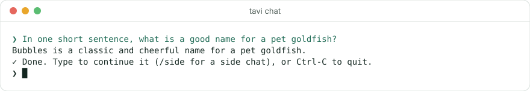
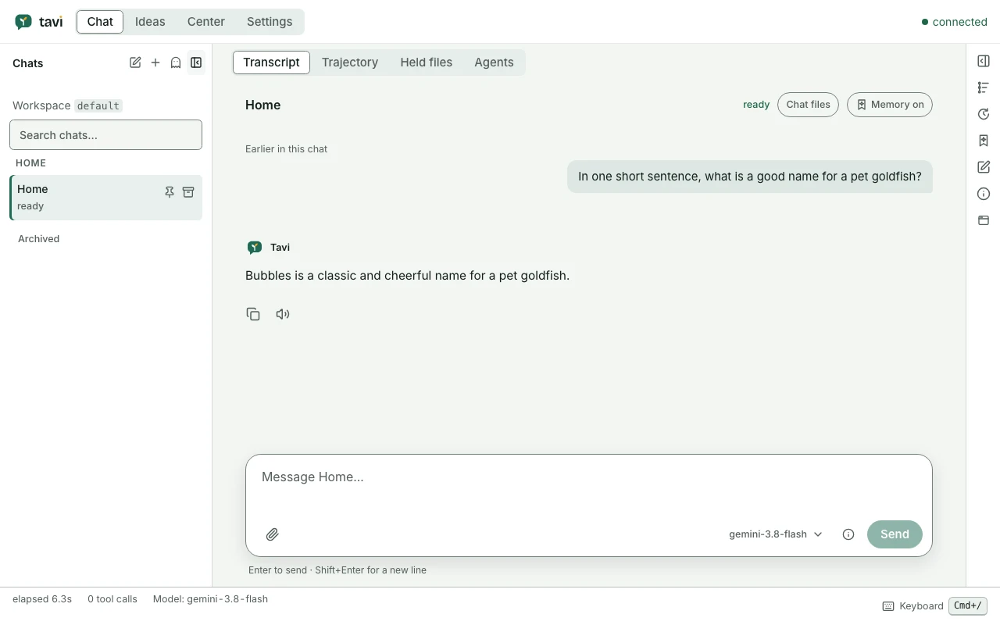
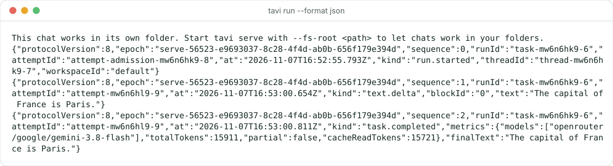
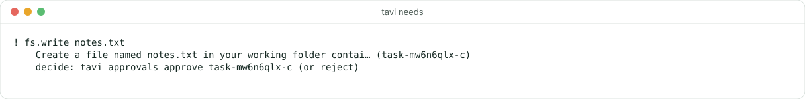

# Terminal, web, CLI or phone: which to use when

Tavi is one assistant with several ways in: the terminal chat, the web canvas, one-off commands for scripts, and your phone. They share the same Home conversation, memory and approvals, so you can start in one and carry on in another. This page shows each and says when to pick it. About five minutes.

> **Uses:** the terminal chat (`tavi chat`) · the web canvas (`tavi ui`) · one-off tasks (`tavi run "<prompt>"`) · what is waiting on you (`tavi needs`)
> **Before you start:** a model connected ([Connect your first model](first-model.md)) · Tavi running with `tavi serve` ([Keep Tavi running in the background](keep-tavi-running.md))

## 1. Chat in the terminal

Run `tavi chat` to talk to Tavi in **Home**, your one ongoing conversation, without leaving the terminal. Pick it when you are already at a keyboard and want quick back-and-forth: it is fast, works over SSH, and every command is a `/` away.

<picture>
  <source media="(prefers-color-scheme: dark)" srcset="../../assets/use-cases/get-started/which-surface/01-chat-in-the-terminal-dark.svg">
  
</picture>

## 2. Open the web canvas

Run `tavi ui` and your browser opens on the same **Home**, with the turn you just had in the terminal. Pick the canvas for longer answers, files and pictures, side chats, **Ideas** and **Settings**, and anything easier to read than to type.

<!-- cover -->

## 3. Script it with tavi run

Run `tavi run "<what you want>"` for a task of its own that answers and exits; add `--format json` for one JSON event per line that a script can read, ending in `task.completed` with the final text. Pick it for shell scripts, cron jobs and pipelines.

<picture>
  <source media="(prefers-color-scheme: dark)" srcset="../../assets/use-cases/get-started/which-surface/03-script-it-with-tavi-run-dark.svg">
  
</picture>

## 4. See what is waiting on you

A task that wants to change something, such as writing a file, stops and asks first. `tavi needs` lists everything waiting on you, from every chat and run, in one queue: approvals, questions and reviews. Answer in whichever surface is at hand, or from your phone once it is paired (see [CHANNELS.md](../../CHANNELS.md)).

<picture>
  <source media="(prefers-color-scheme: dark)" srcset="../../assets/use-cases/get-started/which-surface/04-see-what-is-waiting-on-you-dark.svg">
  
</picture>

## Which to pick

| You want to | Use |
| :--- | :--- |
| Ask something quickly while you work in a terminal | `tavi chat` |
| Read long answers, look at files and pictures, change settings | `tavi ui` |
| Run Tavi from a script, a cron job or a pipeline | `tavi run --format json "<prompt>"` |
| Check and answer what is waiting, from anywhere | `tavi needs`, the canvas, or your phone |

## What Tavi will and won't do

Every surface asks before anything that changes something outside the chat, and an approval answered in one is answered everywhere. A one-off run asks as well, and exits `3` while it waits, unless you choose `--approval approve` or `--approval deny`. The canvas listens only on this computer (`127.0.0.1`), and your phone reaches Tavi only through a channel you paired yourself.

## Related

- [Have your first conversation in the terminal](first-chat.md)
- [Open the web canvas and walk through Welcome](web-canvas-tour.md)
- Reference: [TERMINAL-UI.md](../../TERMINAL-UI.md), [WEB-UI.md](../../WEB-UI.md), [CLI.md](../../CLI.md#tavi-run), [CHANNELS.md](../../CHANNELS.md)
