<!-- Generated by scripts/docs/guide-indexes.mjs from the guides: edit the guides, not this file. -->

# Memory and skills

What Tavi remembers about you, and the procedures it learns.

| | Guide |
| :--- | :--- |
| 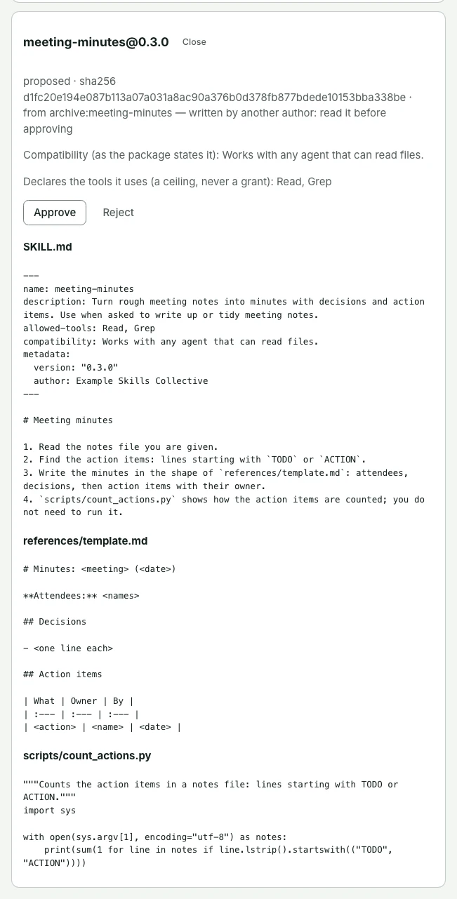 | [Import an Agent Skills package](import-agent-skills.md) Bring in a skill someone else wrote, in the Agent Skills format other agents use: read every file it carries, approve it, and see the limits Tavi holds it to. |
| 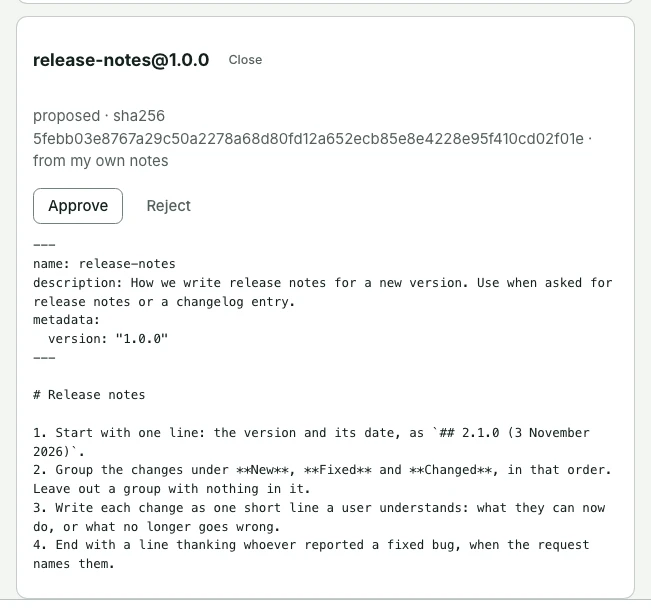 | [Add a skill from a SKILL.md folder](install-a-skill.md) Write down how you want a job done, once, as a skill: Tavi reads it whenever the job comes up, in every chat. |
| 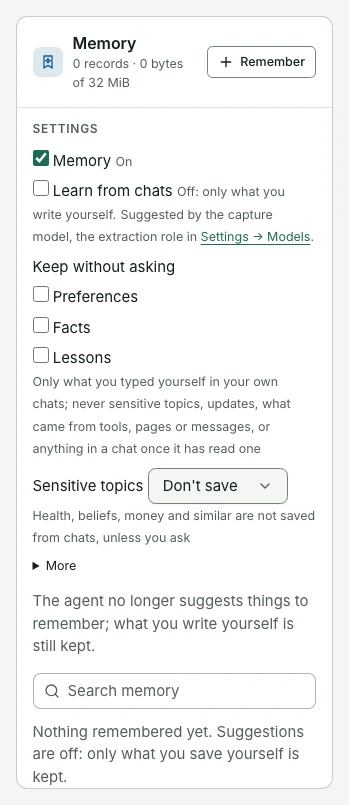 | [Pause memory or turn suggestions off](pause-memory.md) Choose how much Tavi learns: turn memory off in one chat, stop Tavi suggesting things to remember, or pause memory everywhere for a while. |
| 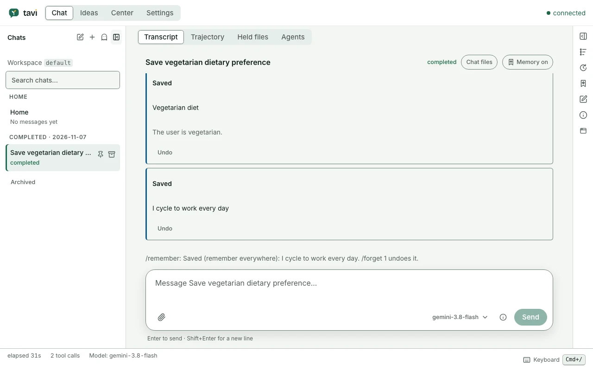 | [Teach Tavi a fact, and make it forget one](remember-and-forget.md) Tell Tavi something about you once and every later chat can use it; forget it just as easily, and it's erased for good. |
| 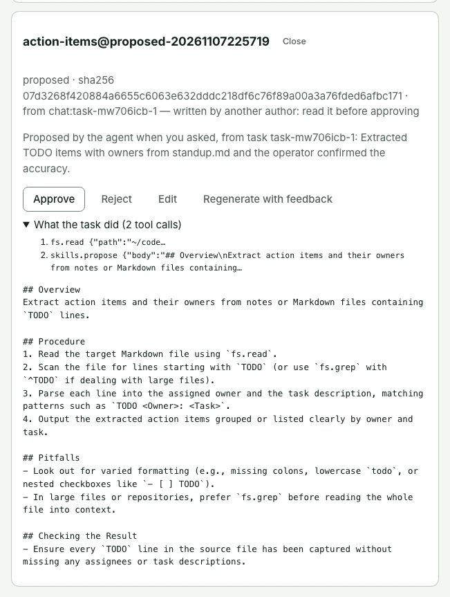 | [Review a skill Tavi proposed from a chat: edit, regenerate, approve](review-a-proposed-skill.md) When Tavi has done a job well, it can write down how, as a skill for next time. |
| 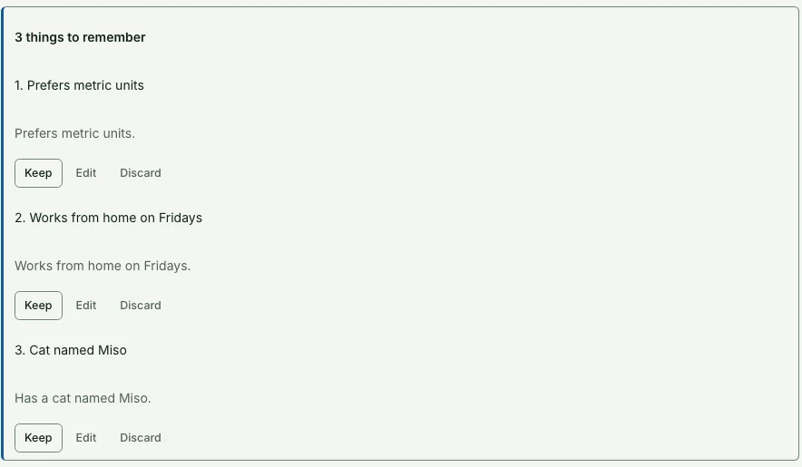 | [Review memories Tavi proposed](review-memories.md) Tavi suggests what to remember; you decide. |
| 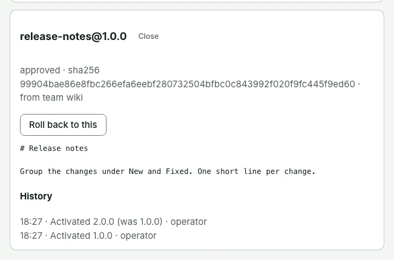 | [Roll out a new skill version safely](roll-out-a-skill-version.md) Try a new version of a skill in one chat before every chat gets it, then open it to all, or roll back to the old one. |
| 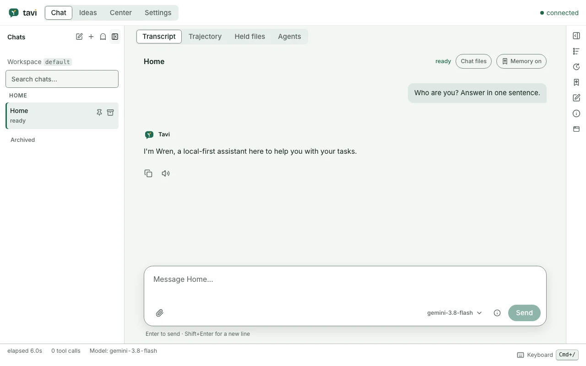 | [Give Tavi a name and a voice (Soul, base instructions)](soul-and-identity.md) Change the base instructions every chat runs under, so Tavi answers to a name you choose and writes the way you like, then give one chat a voice of its own. |
| 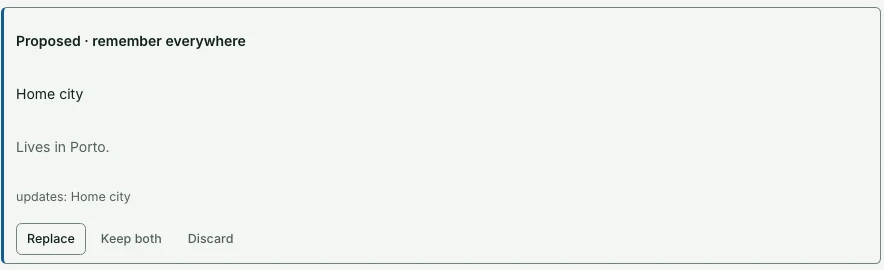 | [Update a fact Tavi knows: Replace, or Keep both](update-a-memory.md) When something about you changes, tell Tavi in a chat: its suggestion says which memory it updates, and you choose **Replace** or **Keep both**. |
| 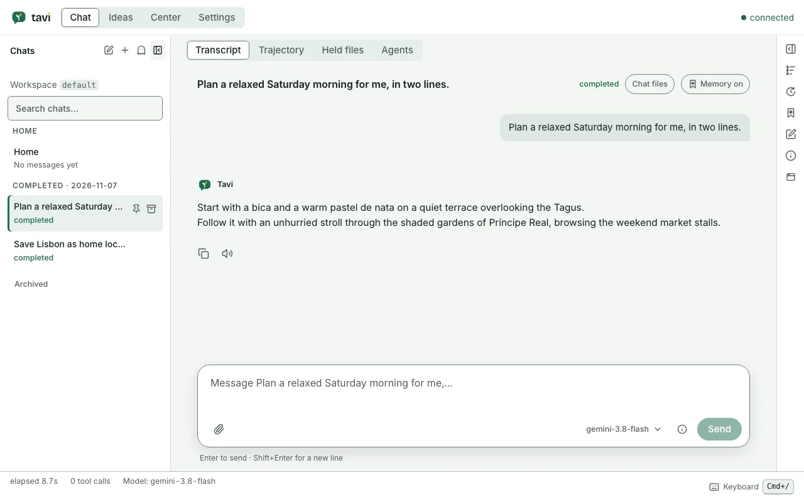 | [See what Tavi always knows about you (your profile)](what-tavi-always-knows.md) Most memories reach a chat when its words match them, or when you ask what Tavi knows. |
| 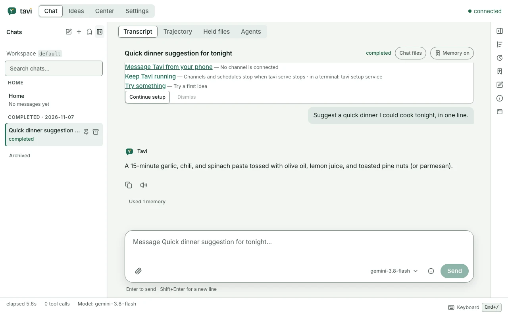 | [See which memories shaped a reply (`/why`)](why-that-answer.md) When an answer seems to know something about you, find out exactly which memories it was given, and fix or forget one on the spot. |

[All how-to guides](../README.md)
