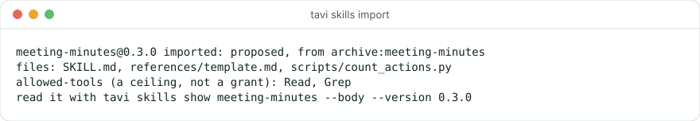
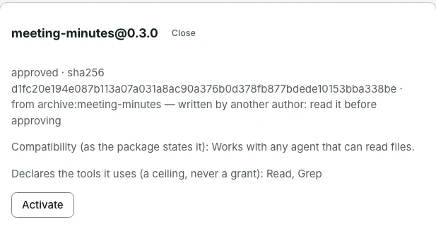
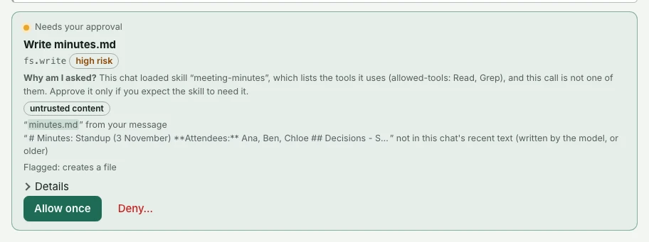
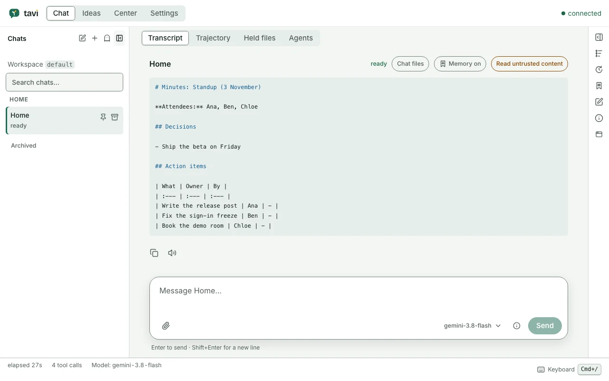

# Import an Agent Skills package

Bring in a skill someone else wrote, in the Agent Skills format other agents use: read every file it carries, approve it, and see the limits Tavi holds it to. About five minutes.

> **Uses:** skills (`tavi skills import ./meeting-minutes`, **Center → Soul & memory → Skills**) · loading a skill in a chat (`skills.read`) · approvals (the approval card)
> **Before you start:** a model connected ([Connect your first model](../get-started/first-model.md)) · Tavi running in the background with `tavi serve` ([Keep Tavi running in the background](../get-started/keep-tavi-running.md)) · the canvas open ([Open the web canvas and walk through Welcome](../get-started/web-canvas-tour.md)) · a package, as a folder with a `SKILL.md` or as a `.zip`

## 1. Import the package

Run `tavi skills import ./meeting-minutes`, naming the package's folder, its `SKILL.md` or the `.zip` itself. Tavi reads the id, description and version from `SKILL.md`'s header and keeps the other files with it (`references/`, `scripts/`), at most 32 files and 512 KiB. Without `--provenance`, it is marked as another author's: `archive:` and the name you gave.

<picture>
  <source media="(prefers-color-scheme: dark)" srcset="../../assets/use-cases/memory-and-skills/import-agent-skills/01-import-the-package-dark.svg">
  
</picture>

## 2. Read every file

Open **Center → Soul & memory**, scroll to **Skills** and choose **meeting-minutes@0.3.0** under **Waiting for review**. It says another author wrote it, shows what it says it is compatible with and the tools it declares, then every file, `SKILL.md` first. A script is shown as text: Tavi never runs it.

<!-- cover -->

## 3. Approve it, then activate it

If you trust what you read, choose **Approve**. Because another author wrote it, Tavi asks once more: choose **Yes, approve**. Then choose **Activate**. From a terminal, `tavi skills approve meeting-minutes --version 0.3.0` prints every file first and asks for `--yes`, because another author wrote it; `tavi skills activate meeting-minutes --version 0.3.0` then turns it on.

## 4. Ask for the job it does

In a chat, ask for something the skill covers that also needs a tool its list leaves out, such as saving a file: `Use the meeting-minutes skill to write up these notes as minutes, and save them as minutes.md in this chat's folder:` followed by your notes. Tavi loads the skill, and the save waits for you: **Why am I asked?** says the call is not one of the tools the skill lists, and the card offers only **Allow once** and **Deny…**.

## 5. Allow what you expect

Choose **Allow once** if you expected the skill to save its result, or **Deny…** if not. Each call outside the list asks again until your next message. The chat is marked **Read untrusted content**: another author's skill is read like a web page.

## What Tavi will and won't do

A package is text to read: Tavi installs nothing, runs no script and no hook, and a skill's `allowed-tools` never grants a tool, it only narrows what goes through without asking. A skill another author wrote is read as untrusted content, like a web page, so its words never count as yours. Names Tavi does not know (a tool another agent has) are shown as not enforceable here and let nothing through. See [SKILLS.md](../../SKILLS.md#skills).

## Related

- [Add a skill from a SKILL.md folder](install-a-skill.md)
- [Roll out a new skill version safely](roll-out-a-skill-version.md)
- [Approve, reject or always-allow a tool call](../chat/approve-tool-calls.md)
- Reference: [SKILLS.md](../../SKILLS.md), [TOOLS-AND-SKILLS.md](../../TOOLS-AND-SKILLS.md#skills-end-to-end), [CLI.md](../../CLI.md#tavi-skills)
