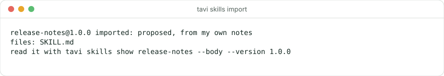
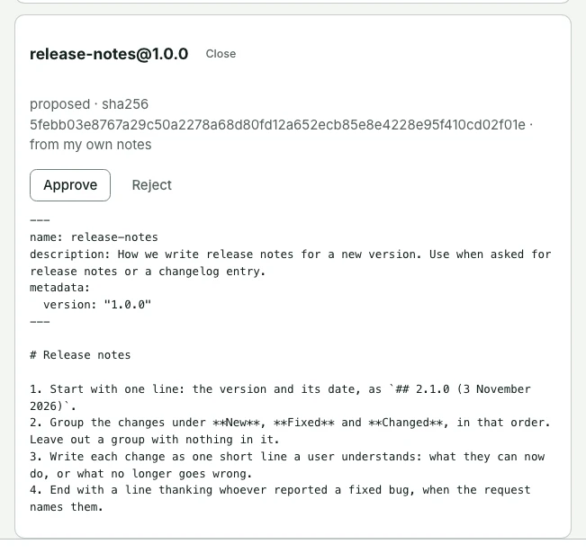
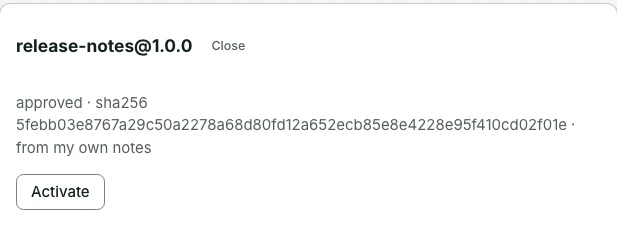
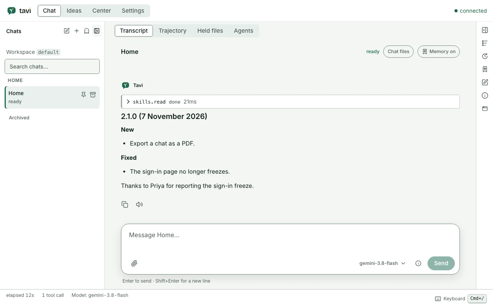
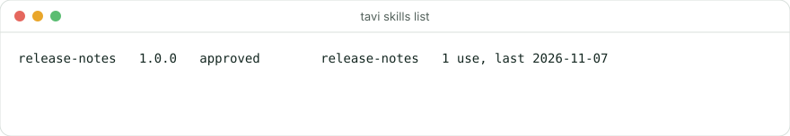
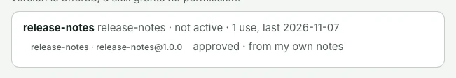

# Add a skill from a SKILL.md folder

Write down how you want a job done, once, as a skill: Tavi reads it whenever the job comes up, in every chat. About five minutes.

> **Uses:** skills (`tavi skills import ./release-notes`, **Center → Soul & memory → Skills**) · loading a skill in a chat (`skills.read`)
> **Before you start:** a model connected ([Connect your first model](../get-started/first-model.md)) · Tavi running in the background with `tavi serve` ([Keep Tavi running in the background](../get-started/keep-tavi-running.md)) · the canvas open ([Open the web canvas and walk through Welcome](../get-started/web-canvas-tour.md))

## 1. Write a SKILL.md and import it

Make a folder named for the skill, such as `release-notes`, with a `SKILL.md` in it: a short header giving its `name`, a `description` that says when it applies, and its version, then the steps in plain words. Run `tavi skills import ./release-notes --provenance "my own notes"`; the provenance says the skill is yours. It arrives **proposed**: nothing uses it yet.

```markdown
---
name: release-notes
description: How we write release notes for a new version. Use when asked for release notes or a changelog entry.
metadata:
  version: "1.0.0"
---

# Release notes

1. Start with one line: the version and its date, as `## 2.1.0 (3 November 2026)`.
2. Group the changes under **New**, **Fixed** and **Changed**, in that order. Leave out a group with nothing in it.
…
```

<picture>
  <source media="(prefers-color-scheme: dark)" srcset="../../assets/use-cases/memory-and-skills/install-a-skill/01-write-a-skill-md-and-import-it-dark.svg">
  
</picture>

## 2. Read it before you approve it

Open **Center → Soul & memory** and scroll to **Skills**. Under **Waiting for review**, choose **release-notes · release-notes@1.0.0**: the text Tavi will read, its hash and where it came from, with **Approve** and **Reject**.

<!-- cover -->


## 3. Approve it, then activate it

Choose **Approve**, then **Activate**. Only the active version is offered to your chats, and every chat in the workspace gets the same one.



## 4. Ask for the job it does

In a chat, ask for what the skill covers, for example `Write release notes for version 2.1.0: you can now export a chat as a PDF, and the sign-in page no longer freezes. Priya reported the freeze.` Tavi sees the skill's name and description, loads it with `skills.read`, and follows it.



## 5. See that it was used

Run `tavi skills list`. Each version shows its review state, its name, how often a chat loaded it and when last. An active skill no chat has used for 60 days is flagged, so you know which ones to turn off.

<picture>
  <source media="(prefers-color-scheme: dark)" srcset="../../assets/use-cases/memory-and-skills/install-a-skill/05-see-that-it-was-used-dark.svg">
  
</picture>

## 6. Turn it off

Back under **Skills**, choose **Disable** on the skill's row, or run `tavi skills disable release-notes`. No chat is offered it any more; its versions stay, and **Activate** brings it back.



## What Tavi will and won't do

A skill is text Tavi reads, never a program it runs, and it grants nothing: every call it describes is still decided by your rules and approvals. Tavi offers only the version you approved and activated, and checks its hash before each read. To change a skill, import a new version and approve it; a version never changes once imported. See [SKILLS.md](../../SKILLS.md#skills).

## Related

- [Import an Agent Skills package](import-agent-skills.md)
- [Roll out a new skill version safely](roll-out-a-skill-version.md)
- [Give Tavi a name and a voice (Soul, base instructions)](soul-and-identity.md)
- Reference: [SKILLS.md](../../SKILLS.md), [CLI.md](../../CLI.md#tavi-skills), [WEB-UI.md](../../WEB-UI.md#soul--memory)
