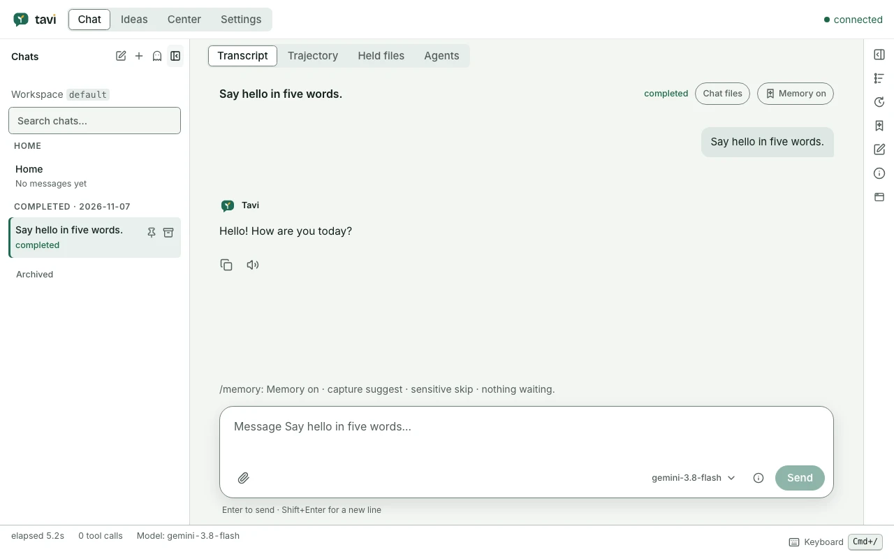
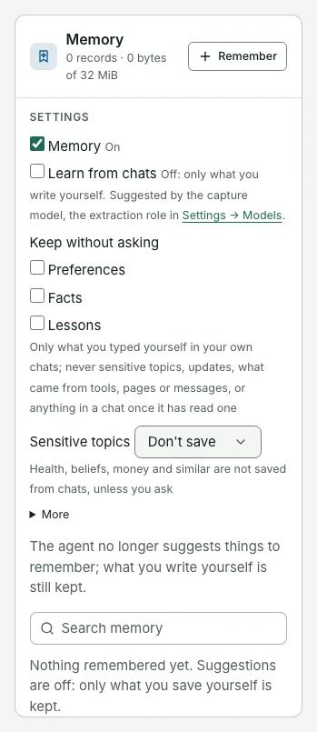
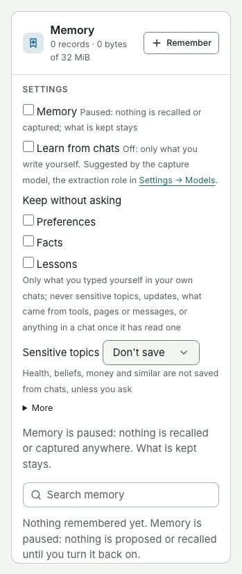
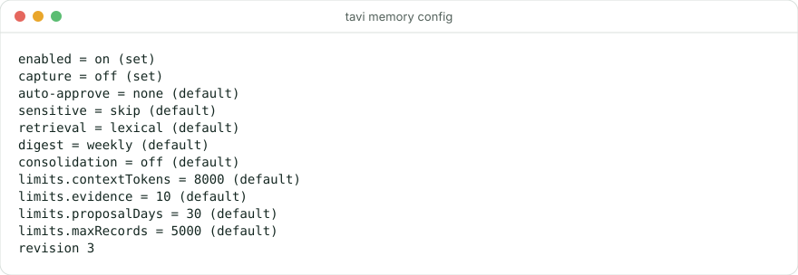

# Pause memory or turn suggestions off

Choose how much Tavi learns: turn memory off in one chat, stop Tavi suggesting things to remember, or pause memory everywhere for a while. Nothing you kept is deleted by any of these. About three minutes.

> **Uses:** memory settings (Command Center → **Soul & memory**, `tavi memory config`) · `/memory` in a chat · the chat header's **Memory on** button
> **Before you start:** a model connected ([Connect your first model](../get-started/first-model.md)) · Tavi running in the background with `tavi serve` ([Keep Tavi running in the background](../get-started/keep-tavi-running.md)) · the canvas open ([Open the web canvas and walk through Welcome](../get-started/web-canvas-tour.md))

## 1. See what memory is doing

In any chat, type `/memory`. The answer says whether memory is on, whether Tavi may suggest things to remember (**capture suggest**), what it does with sensitive topics, and how many suggestions wait for you.

## 2. Turn memory off in one chat

In the chat's header, choose **Memory on**. It turns to **Memory off**: from the next message nothing is recalled into this chat and nothing said in it is remembered. Choose it again to turn memory back on; `/memory off` and `/memory on` do the same.

## 3. Stop Tavi suggesting memories

Open **Center → Soul & memory** and, under **Settings**, turn off **Learn from chats**. Tavi stops proposing things to remember in every chat, but still uses what you kept, and what you save yourself is still kept.

<!-- cover -->

## 4. Pause memory everywhere

Turn off **Memory** at the top of the same card. While it's paused, no chat recalls or learns anything, and your kept memories wait unchanged. `/memory pause` in a chat does the same.

## 5. Turn it back on from the terminal

Run `tavi memory config enabled on`, then `tavi memory config capture suggest` for suggestions. `tavi memory config` lists every setting, each marked **(set)** or **(default)**.

<picture>
  <source media="(prefers-color-scheme: dark)" srcset="../../assets/use-cases/memory-and-skills/pause-memory/05-turn-it-back-on-from-the-terminal-dark.svg">
  
</picture>

## What Tavi will and won't do

None of these switches deletes a memory: they only change what Tavi reads and proposes from now on. What a chat says while memory is off or paused is never reviewed for memory later, even after you turn it back on. Only you, the workspace's owner, can pause memory; anyone can turn it off in their own chat. The details are in [MEMORY.md](../../MEMORY.md#b3-the-memory-settings-section).

## Related

- [Teach Tavi a fact, and make it forget one](remember-and-forget.md)
- [Review memories Tavi proposed](review-memories.md)
- [Chat without leaving a trace](../chat/private-chats.md)
- Reference: [MEMORY.md](../../MEMORY.md), [CLI.md](../../CLI.md#tavi-memory-config)
