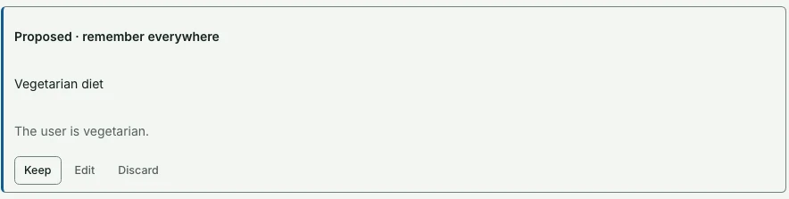
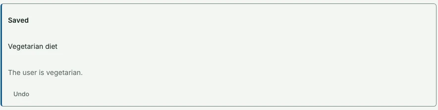
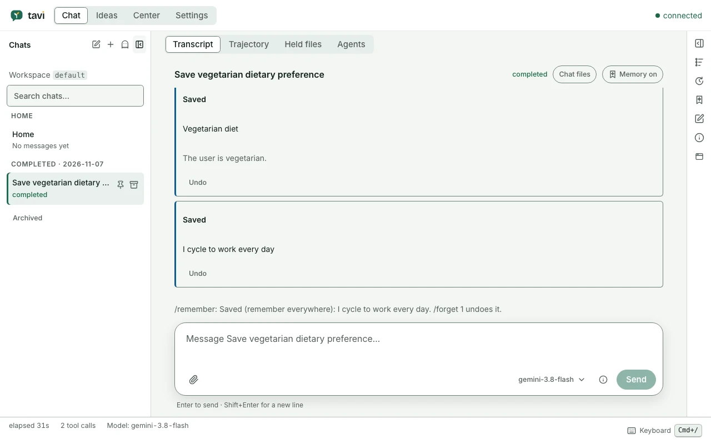
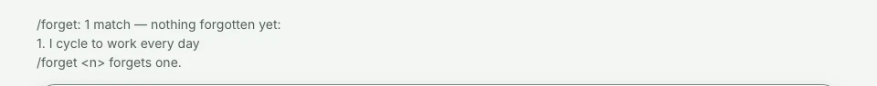
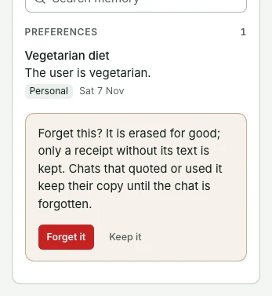

# Teach Tavi a fact, and make it forget one

Tell Tavi something about you once and every later chat can use it; forget it just as easily, and it's erased for good. About five minutes.

> **Uses:** memory (`memory.propose`, the memory card) · `/remember` and `/forget` in a chat · Command Center → **Soul & memory**
> **Before you start:** a model connected ([Connect your first model](../get-started/first-model.md)) · Tavi running in the background with `tavi serve` ([Keep Tavi running in the background](../get-started/keep-tavi-running.md)) · the canvas open ([Open the web canvas and walk through Welcome](../get-started/web-canvas-tour.md))

## 1. Ask Tavi to remember something

In a chat, say it plainly, for example `Remember that I'm vegetarian.` Tavi only proposes it: a memory card appears after the answer, **Proposed · remember everywhere**, with **Keep**, **Edit** and **Discard**.

## 2. Keep it

Choose **Keep**. The card turns to **Saved**, and from now on any chat whose question it fits is given it. **Undo** on the card forgets it again.

## 3. Save one in your own words

Type `/remember` and the fact, such as `/remember I cycle to work every day`. It's kept at once, exactly as you wrote it, with no model involved. Add `--chat` to keep it for this chat only.

<!-- cover -->

## 4. Find a memory to forget

Type `/forget` and a word from it, such as `/forget cycle`. Tavi lists the kept memories that match, numbered, and forgets nothing yet.

## 5. Forget it

Type `/forget 1`. The memory is erased; only a receipt without its words is kept. Chats that already quoted it keep their copy until you forget those chats.

## 6. Forget from the Command Center

Open **Center → Soul & memory**: every kept memory is listed under **Facts**, **Preferences** and **Lessons**. Choose **Forget** on one, then **Forget it**. From the terminal, `tavi memory forget <id> --reason "…"` does the same.

## What Tavi will and won't do

The model can only propose a memory; nothing is kept until you keep it, and a proposal you never decide expires after 30 days. What you keep is given to later chats as quoted data, never as instructions. A forget erases the memory's words from Tavi's database and its search index for good, and a backup restored later doesn't bring it back. The details are in [MEMORY.md](../../MEMORY.md#a4-retention-expiry-and-erasure).

## Related

- [Review memories Tavi proposed](review-memories.md)
- [See which memories shaped a reply (`/why`)](why-that-answer.md)
- [Update a fact Tavi knows: Replace, or Keep both](update-a-memory.md)
- Reference: [MEMORY.md](../../MEMORY.md), [CLI.md](../../CLI.md#tavi-memory)
