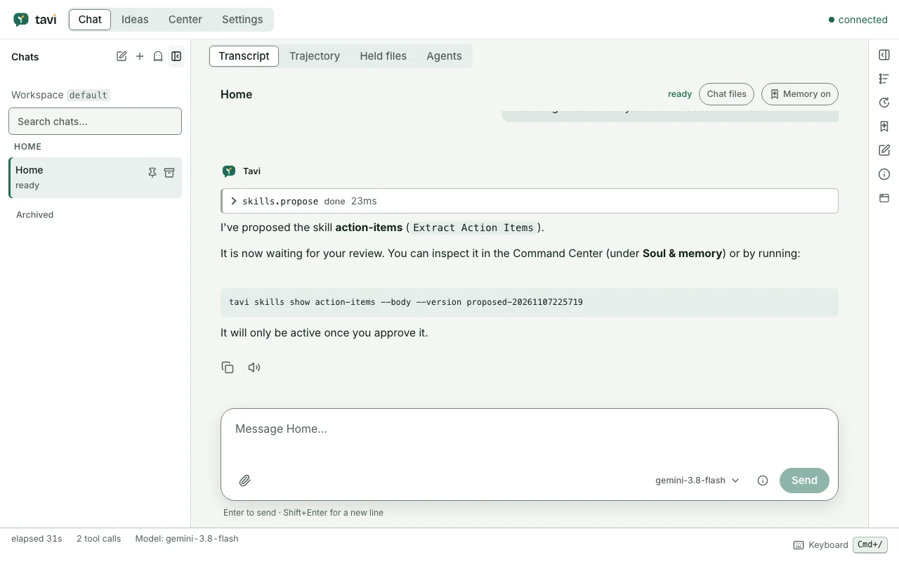
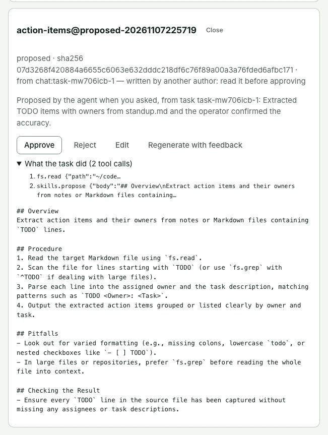
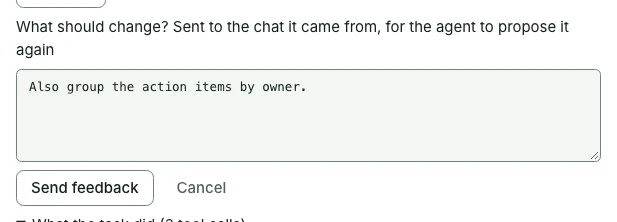
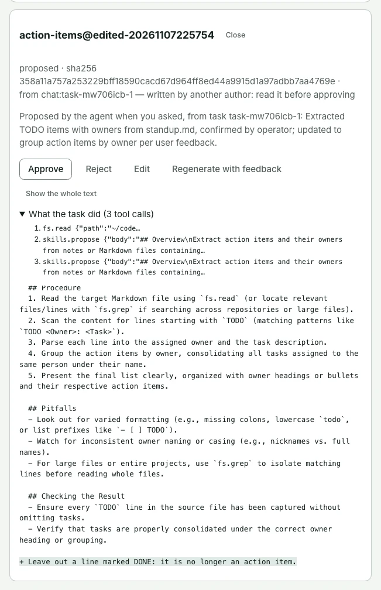
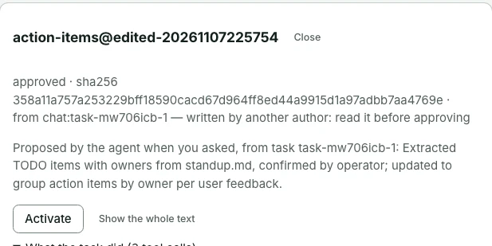

# Review a skill Tavi proposed from a chat: edit, regenerate, approve

When Tavi has done a job well, it can write down how, as a skill for next time. Nothing it proposes is used until you have read it: send it back with feedback, edit it yourself, then approve it. About ten minutes.

> **Uses:** skill proposals (`skills.propose`) · **Center → Soul & memory → Skills** (`tavi skills show <skill-id> --body`, `tavi skills edit <skill-id> --version <v> --package <file>`, `tavi skills regenerate <skill-id> --version <v> --feedback <text>`)
> **Before you start:** a model connected ([Connect your first model](../get-started/first-model.md)) · Tavi running in the background with `tavi serve` ([Keep Tavi running in the background](../get-started/keep-tavi-running.md)) · a folder Tavi may read ([Give Tavi a working folder](../files-and-code/attach-a-folder.md))

## 1. Ask Tavi to keep how it did a job

Have Tavi do something with a few steps, such as `Read standup.md in ~/code and list its action items (lines starting with TODO) with their owners.` When the result is right, say so and ask: `That's right. Save how you did that as a skill called action-items.` Tavi proposes the skill without asking first, since a proposal is only for your review, and says it waits for that review. After a clear success Tavi may also offer on its own: the chat then shows **Save how I did this as a skill?**, and **Review** opens the same place as the next step.

## 2. Open the proposal

Open **Center → Soul & memory**, scroll to **Skills** and choose the proposal under **Waiting for review**. It says which chat it came from and how the result was checked, lists **What the task did** (each tool call of that chat, on one line), and shows the text. If the chat had read anything Tavi does not trust, a warning says what.

<!-- cover -->

## 3. Send it back with feedback

Choose **Regenerate with feedback**, say what should change, such as `Also group the action items by owner.`, and choose **Send feedback**. It goes to the chat the proposal came from as your message, and Tavi proposes the skill again there; the first proposal keeps waiting until you reject it.

## 4. Edit the new proposal

Open the new proposal, choose **Edit**, change the text yourself (add a pitfall, cut a step), and choose **Save as a new version**. Your text is filed as a new proposed version, `edited-` and the time, that follows the proposal, and the review shows only what you changed.

## 5. Approve it, then activate it

Choose **Approve**, then **Yes, approve**: Tavi wrote it, not you, so it asks once, as `tavi skills approve <skill-id> --version <v> --yes` does. Then choose **Activate**: every chat can now load it when the job comes up. The first proposal still waits under **Waiting for review**: open it and choose **Reject**.

## What Tavi will and won't do

Proposing is not asked about (Settings → Permissions lists the rule `seeded-skills-propose`; remove it to be asked each time). A proposal is only text, at most 500 lines, with no scripts and no tool list, and it is never used before you approve and activate it, even when the same text was approved before. Tavi offers one on its own at most once a chat, never after reading untrusted content, never while five wait, and never on a topic you turned down with **Don't suggest this** in the last 30 days; **Skill suggestions** in Settings → General turns its own offers off. A skill from a chat is read as that chat's words, not yours. See [SKILLS.md](../../SKILLS.md#skills).

## Related

- [Add a skill from a SKILL.md folder](install-a-skill.md)
- [Roll out a new skill version safely](roll-out-a-skill-version.md)
- [Review memories Tavi proposed](review-memories.md)
- Reference: [SKILLS.md](../../SKILLS.md#skills), [CLI.md](../../CLI.md#tavi-skills), [WEB-UI.md](../../WEB-UI.md#soul--memory)
