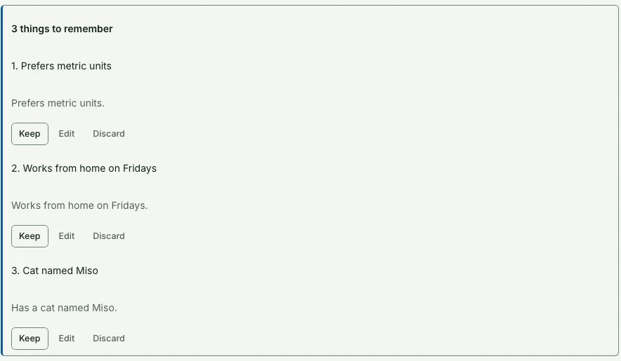
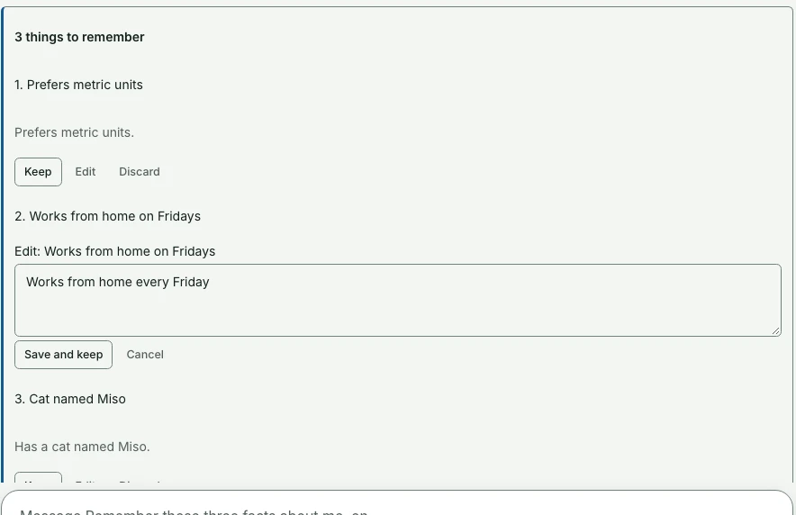
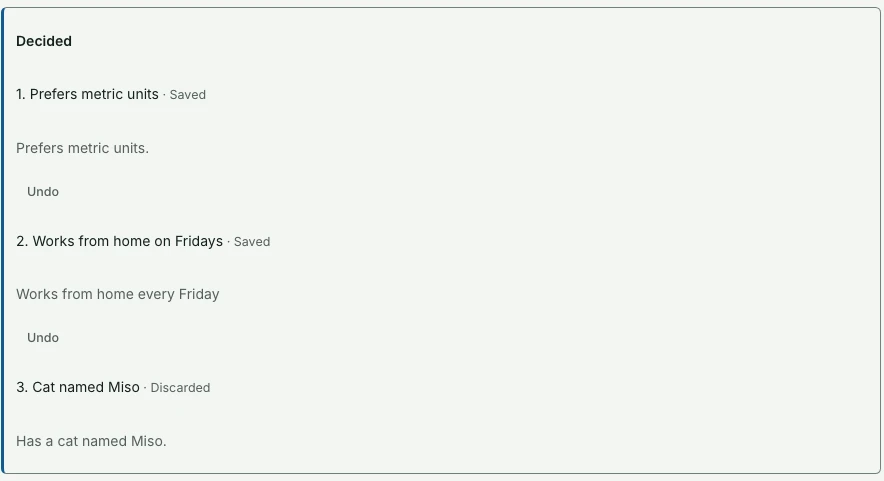
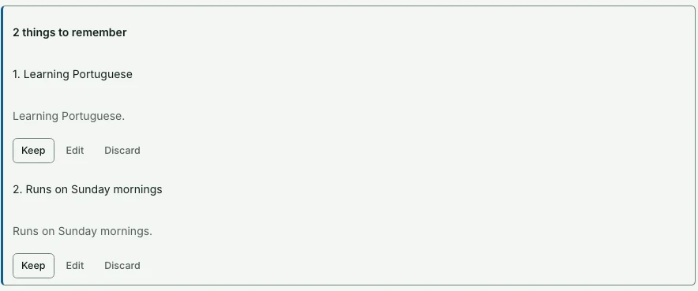
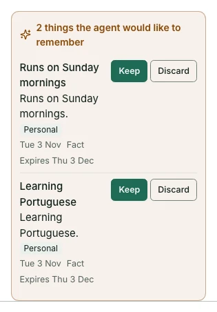
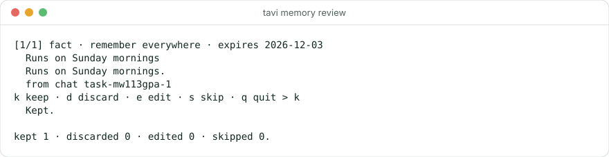

# Review memories Tavi proposed

Tavi suggests what to remember; you decide. Keep, edit or discard each suggestion on its card in the chat, or later, all together, in the Command Center or the terminal. About five minutes.

> **Uses:** memory proposals (`memory.propose`, the memory card) · Command Center → **Soul & memory** · `tavi memory review`
> **Before you start:** a model connected ([Connect your first model](../get-started/first-model.md)) · Tavi running in the background with `tavi serve` ([Keep Tavi running in the background](../get-started/keep-tavi-running.md)) · the canvas open ([Open the web canvas and walk through Welcome](../get-started/web-canvas-tour.md))

## 1. Tell Tavi a few things at once

In a chat, say several things worth remembering, such as `Remember these three facts about me, one memory each: I prefer metric units. I work from home on Fridays. My cat is called Miso.` One card lists everything the answer proposed, numbered: **3 things to remember**.

<!-- cover -->

## 2. Edit one before you keep it

Choose **Edit** on a suggestion to put it in your own words, then **Save and keep**. Tavi keeps your wording, not the model's.

## 3. Keep or discard the rest

Choose **Keep** on one you want and **Discard** on one you don't. Each line says what became of it: **Saved** or **Discarded**.

## 4. Leave some for later

You don't have to decide at once. Tell Tavi something more, for example `Also remember, one memory each: I'm learning Portuguese, and I run on Sunday mornings.`, and leave its card as it is. Nothing is kept until you say so, and a suggestion nobody decides expires after 30 days.

## 5. Review them in the Command Center

Open **Center → Soul & memory**. Everything still waiting, from every chat, is listed under the Memory settings with its kind and when it expires. Choose **Keep** or **Discard** on each; **Keep all** and **Discard all** below the list decide the lot.

## 6. Review the rest in the terminal

Run `tavi memory review`. It shows each waiting suggestion in turn, oldest first, with where it would apply and the chat it came from: press `k` to keep it, `d` to discard, `e` to edit and keep, `s` to skip or `q` to stop.

<picture>
  <source media="(prefers-color-scheme: dark)" srcset="../../assets/use-cases/memory-and-skills/review-memories/06-review-the-rest-in-the-terminal-dark.svg">
  
</picture>

## What Tavi will and won't do

A suggestion is never used until you keep it. **Keep all** keeps only plain suggestions: one that would change something you already keep, one on a sensitive topic, or one made after the chat read a web page or an email waits for you to look at it on its own. Once a week, a digest in Home lists what still waits, so nothing expires unseen. The details are in [MEMORY.md](../../MEMORY.md#b1-reviewing-proposals).

## Related

- [Teach Tavi a fact, and make it forget one](remember-and-forget.md)
- [Update a fact Tavi knows: Replace, or Keep both](update-a-memory.md)
- [Pause memory or turn suggestions off](pause-memory.md)
- Reference: [MEMORY.md](../../MEMORY.md), [CLI.md](../../CLI.md#tavi-memory)
