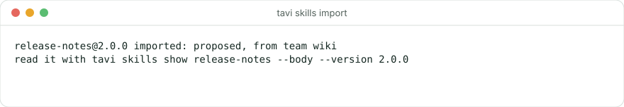
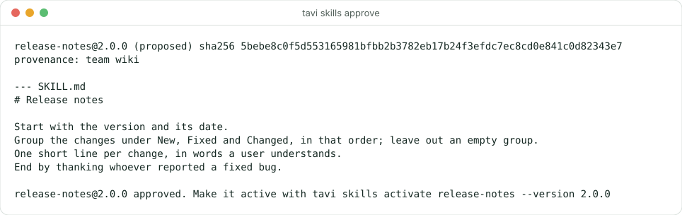
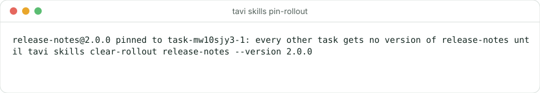
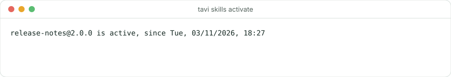
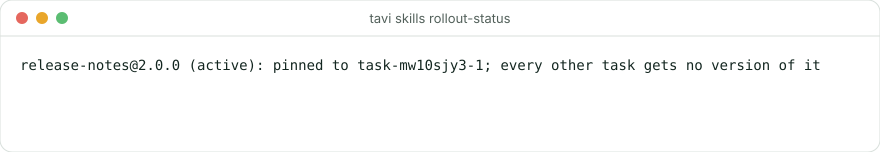
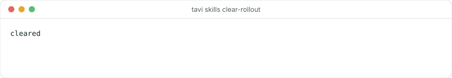
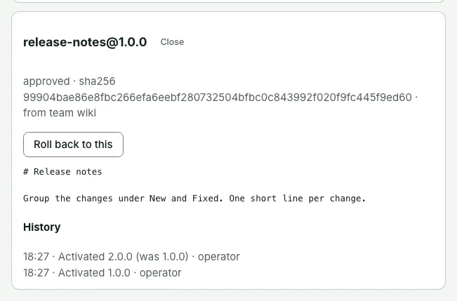

# Roll out a new skill version safely

Try a new version of a skill in one chat before every chat gets it, then open it to all, or roll back to the old one. About ten minutes.

> **Uses:** skills (`tavi skills pin-rollout <skill-id> --task <task-id>`, `rollout-status`, `clear-rollout`, `activate`) · **Center → Soul & memory → Skills**
> **Before you start:** Tavi running in the background with `tavi serve` ([Keep Tavi running in the background](../get-started/keep-tavi-running.md)) · a skill with a version active ([Add a skill from a SKILL.md folder](install-a-skill.md)) · a chat to try the new version in

## 1. Import the new version

Write the new text and import it under the same skill id with a new version, for example `tavi skills import release-notes --version 2.0.0 --package ./release-notes-2.md --name "Release notes" --provenance "team wiki"`. It arrives **proposed**; version 1.0.0 stays active meanwhile.

<picture>
  <source media="(prefers-color-scheme: dark)" srcset="../../assets/use-cases/memory-and-skills/roll-out-a-skill-version/01-import-the-new-version-dark.svg">
  
</picture>

## 2. Read it and approve it

Run `tavi skills approve release-notes --version 2.0.0`. It prints the version's hash and text before it approves, so you see exactly what you are saying yes to.

<picture>
  <source media="(prefers-color-scheme: dark)" srcset="../../assets/use-cases/memory-and-skills/roll-out-a-skill-version/02-read-it-and-approve-it-dark.svg">
  
</picture>

## 3. Hold it to one chat

Stop `tavi serve` first: the rollout commands work on the data directory while Tavi is stopped. Copy the chat's id from the chat panel's **Details** tab (or `tavi tasks`), and run `tavi skills pin-rollout release-notes --version 2.0.0 --task <task-id>`; repeat `--task` for more chats.

<picture>
  <source media="(prefers-color-scheme: dark)" srcset="../../assets/use-cases/memory-and-skills/roll-out-a-skill-version/03-hold-it-to-one-chat-dark.svg">
  
</picture>

## 4. Activate it

Run `tavi skills activate release-notes --version 2.0.0`. The chat on the list now gets 2.0.0, and every other chat gets no version of the skill at all, never the old one, until you open it up.

<picture>
  <source media="(prefers-color-scheme: dark)" srcset="../../assets/use-cases/memory-and-skills/roll-out-a-skill-version/04-activate-it-dark.svg">
  
</picture>

## 5. Check who gets it

Run `tavi skills rollout-status release-notes`: the active version, whether it is pinned, and the chats it is pinned to, then any other pinned version.

<picture>
  <source media="(prefers-color-scheme: dark)" srcset="../../assets/use-cases/memory-and-skills/roll-out-a-skill-version/05-check-who-gets-it-dark.svg">
  
</picture>

## 6. Open it to every chat

Once it works in the chat you chose, run `tavi skills clear-rollout release-notes --version 2.0.0` and start `tavi serve` again. Every chat in the workspace now gets 2.0.0.

<picture>
  <source media="(prefers-color-scheme: dark)" srcset="../../assets/use-cases/memory-and-skills/roll-out-a-skill-version/06-open-it-to-every-chat-dark.svg">
  
</picture>

## 7. Roll back if it goes wrong

Open **Center → Soul & memory**, scroll to **Skills** and choose **release-notes@1.0.0**, then **Roll back to this**; `tavi skills rollback release-notes --version 1.0.0` does the same. Only a version that was active before can be rolled back to, and the version's **History** lists every change.

<!-- cover -->

## What Tavi will and won't do

A version never changes once imported, and a chat reads only the active, approved one, checking its hash first. While a version is pinned, only the chats on its list get it, so a skill that misleads the model stays in the chats you chose. A routine is not affected by any of this: it keeps the exact version it pinned when you saved it. See [SKILLS.md](../../SKILLS.md#bounded-rollout).

## Related

- [Add a skill from a SKILL.md folder](install-a-skill.md)
- [Import an Agent Skills package](import-agent-skills.md)
- [Give Tavi a name and a voice (Soul, base instructions)](soul-and-identity.md)
- Reference: [SKILLS.md](../../SKILLS.md#bounded-rollout), [CLI.md](../../CLI.md#4-rolling-out-a-skill-version)
