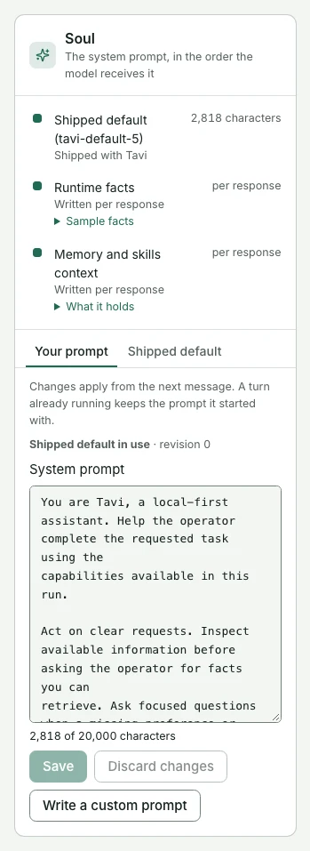
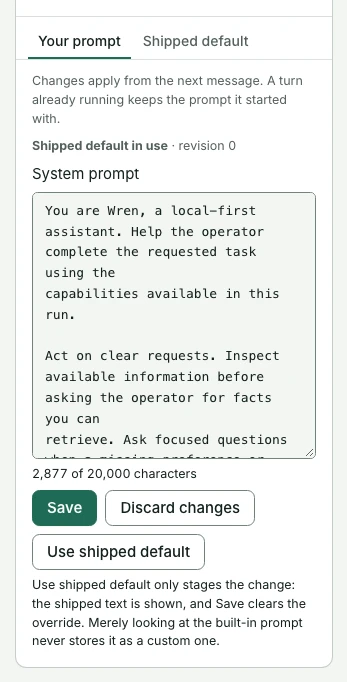
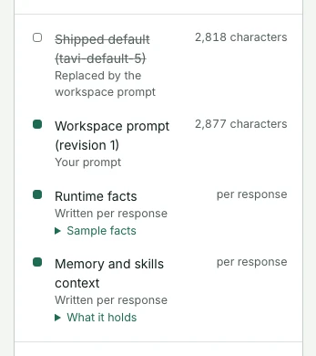
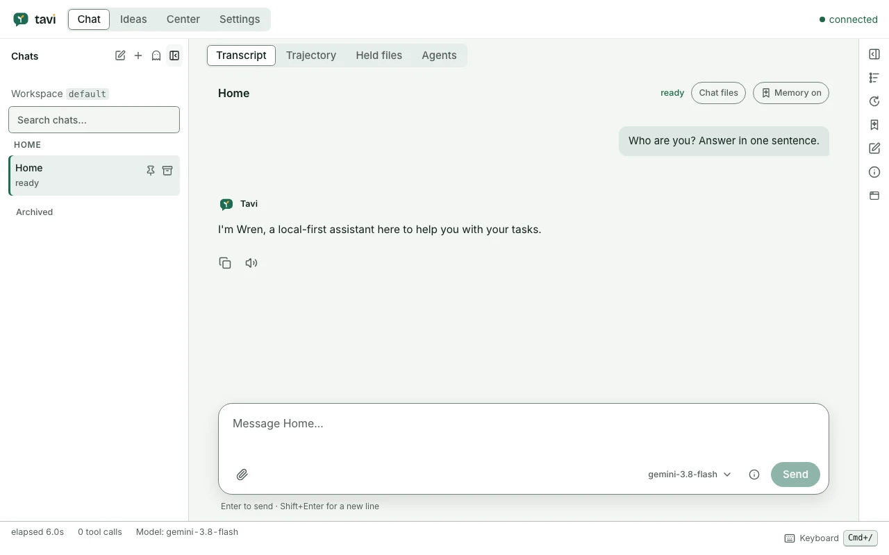
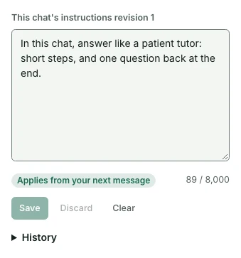
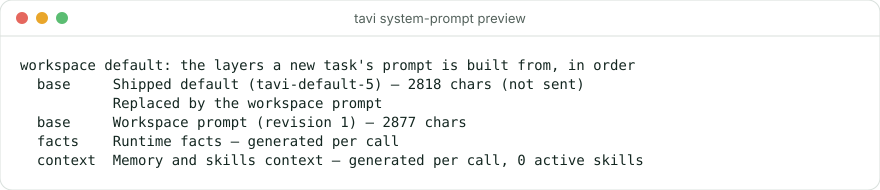
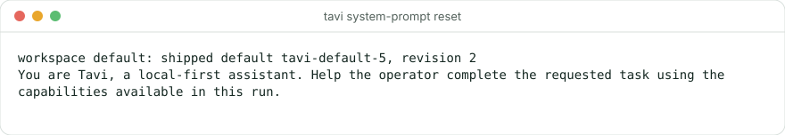

# Give Tavi a name and a voice (Soul, base instructions)

Change the base instructions every chat runs under, so Tavi answers to a name you choose and writes the way you like, then give one chat a voice of its own. About five minutes.

> **Uses:** the base system prompt (**Center → Soul & memory → Soul**, Settings → System prompt, `tavi system-prompt show`) · a chat's own instructions (the chat panel's **Instructions** tab)
> **Before you start:** a model connected ([Connect your first model](../get-started/first-model.md)) · Tavi running in the background with `tavi serve` ([Keep Tavi running in the background](../get-started/keep-tavi-running.md)) · the canvas open ([Open the web canvas and walk through Welcome](../get-started/web-canvas-tour.md))

## 1. Open Soul

Open **Center → Soul & memory**. **Soul** lists the layers a new chat's instructions are built from, in the order the model receives them, each with its length: the shipped default, then the runtime facts and the memory and skills context Tavi writes for every call.

## 2. Write your own prompt

On **Your prompt**, choose **Write a custom prompt**: the shipped text becomes yours to edit. Change its first line to the name you want, such as `You are Wren, a local-first assistant.`, add a line on how to write, such as `Your voice: warm, plain and brief. Use British spelling.`, and choose **Save**. Keep the rest: it holds the rules on untrusted content and approvals.

## 3. Check the layers

The list now shows the shipped default struck through, replaced by **Workspace prompt** with its revision and length. A chat runs under it from its next message; a turn already running keeps the prompt it started with.

## 4. Meet the new voice

In **Home**, ask `Who are you? Answer in one sentence.` Tavi answers under its new name, in the voice you described. The canvas still heads its replies **Tavi**: the name lives in the prompt.

<!-- cover -->

## 5. Give one chat its own voice

Open the chat panel's **Instructions** tab, write how this chat should work, such as `In this chat, answer like a patient tutor: short steps, and one question back at the end.`, and choose **Save**. These instructions are the top layer of this chat's prompt only, from its next message, and **History** keeps every save.

## 6. See it from a terminal

Run `tavi system-prompt preview`: the same layers with their lengths, from the same code that builds each request. `tavi system-prompt show` prints your prompt and its revision, and `tavi system-prompt set --file ./my-prompt.txt` saves one from a file.

<picture>
  <source media="(prefers-color-scheme: dark)" srcset="../../assets/use-cases/memory-and-skills/soul-and-identity/06-see-it-from-a-terminal-dark.svg">
  
</picture>

## 7. Go back to the shipped default

Run `tavi system-prompt reset`, or choose **Use shipped default** under **Your prompt** and then **Save**. From the next message, chats follow the shipped default again, and Tavi is Tavi.

<picture>
  <source media="(prefers-color-scheme: dark)" srcset="../../assets/use-cases/memory-and-skills/soul-and-identity/07-go-back-to-the-shipped-default-dark.svg">
  
</picture>

## What Tavi will and won't do

Your prompt replaces the shipped default whole, so leave its rules in: without them the model is no longer told that what it reads is data, not instructions. Approvals and permission rules still decide every call, whatever a prompt says. A routine keeps its own pinned instructions, and each chat keeps the prompt its last message ran under, so you can always see what a past turn was told. See [CONFIGURATION.md](../../CONFIGURATION.md#system-prompt).

## Related

- [Teach Tavi a fact, and make it forget one](remember-and-forget.md)
- [See what Tavi always knows about you (your profile)](what-tavi-always-knows.md)
- [Add a skill from a SKILL.md folder](install-a-skill.md)
- Reference: [CONFIGURATION.md](../../CONFIGURATION.md#system-prompt), [CLI.md](../../CLI.md#tavi-system-prompt), [WEB-UI.md](../../WEB-UI.md#soul--memory)
