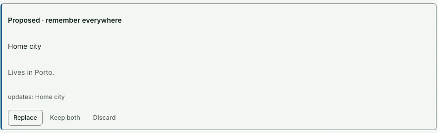
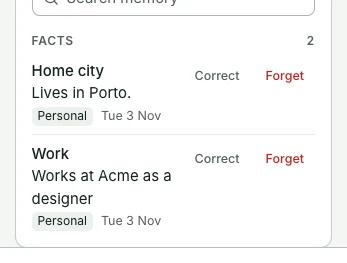
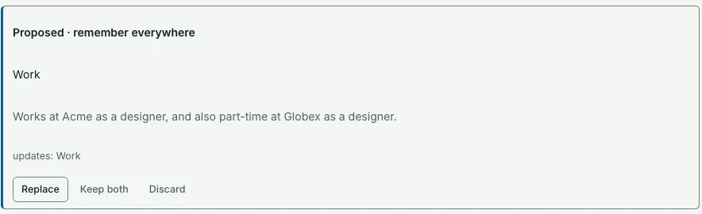
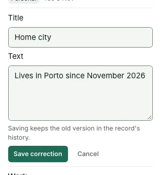
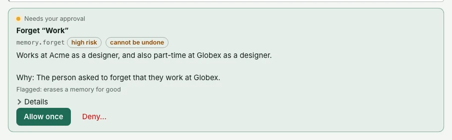

# Update a fact Tavi knows: Replace, or Keep both

When something about you changes, tell Tavi in a chat: its suggestion says which memory it updates, and you choose **Replace** or **Keep both**. You can also correct a memory in your own words, or have Tavi forget one when you ask. About five minutes.

> **Uses:** memory proposals that update a kept one (`memory.propose`) · the memory card's **Replace** and **Keep both** · Command Center → **Soul & memory** → **Correct** · `memory.forget`
> **Before you start:** a model connected ([Connect your first model](../get-started/first-model.md)) · Tavi running in the background with `tavi serve` ([Keep Tavi running in the background](../get-started/keep-tavi-running.md)) · facts kept in memory ([Teach Tavi a fact, and make it forget one](remember-and-forget.md))

## 1. Tell Tavi what changed

With **Home city: Lives in Lisbon** kept, say in a chat `Remember that I've moved to Porto; I no longer live in Lisbon.` The card names the memory it would change, **updates: Home city**, and offers **Replace** and **Keep both** instead of Keep.

<!-- cover -->

## 2. Replace the old fact

Choose **Replace**. The card now reads **Replaced**, and the kept memory itself now says the new thing: under **Facts** in **Center → Soul & memory**, **Home city** reads **Lives in Porto**, and its earlier wording stays in its history, so you never keep two answers to one question.

## 3. Keep both when both are true

Say something that adds to a kept memory, such as `Remember that I've also started working part-time at Globex as a designer.` beside a kept **Work: Works at Acme as a designer**. To keep the old one as it is beside the new one, choose **Keep both**. Both stay, and while they share a topic Tavi tells the model they are two values of it, so it checks with you before relying on either.

## 4. Correct one in your own words

Open **Center → Soul & memory**, find the memory under **Facts** and choose **Correct**. Change its words and save: Tavi writes a new revision and keeps the old one in its history. From the terminal, `tavi memory correct <id> --body "…"` does the same.

## 5. Ask Tavi to forget one

Say `Please forget that I work at Globex.` Tavi looks up the memory that says so, then asks before it erases anything: the card shows the memory's words, why it wants to forget it, and that it can't be undone. Choose **Allow once** to erase it.

## What Tavi will and won't do

A suggestion that would change a kept memory is never kept by **Keep all** or by *Keep without asking*: you choose **Replace** or **Keep both** yourself. A forget Tavi asks for always waits for your own **Allow once**, never a rule, and a chat can ask at most five times. The details are in [MEMORY.md](../../MEMORY.md#a2-how-memory-is-written-propose-is-not-approve).

## Related

- [Review memories Tavi proposed](review-memories.md)
- [Teach Tavi a fact, and make it forget one](remember-and-forget.md)
- [See which memories shaped a reply (`/why`)](why-that-answer.md)
- Reference: [MEMORY.md](../../MEMORY.md), [CLI.md](../../CLI.md#tavi-memory)
