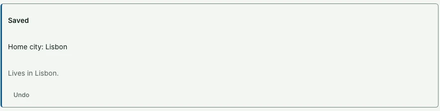
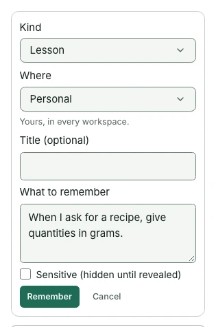
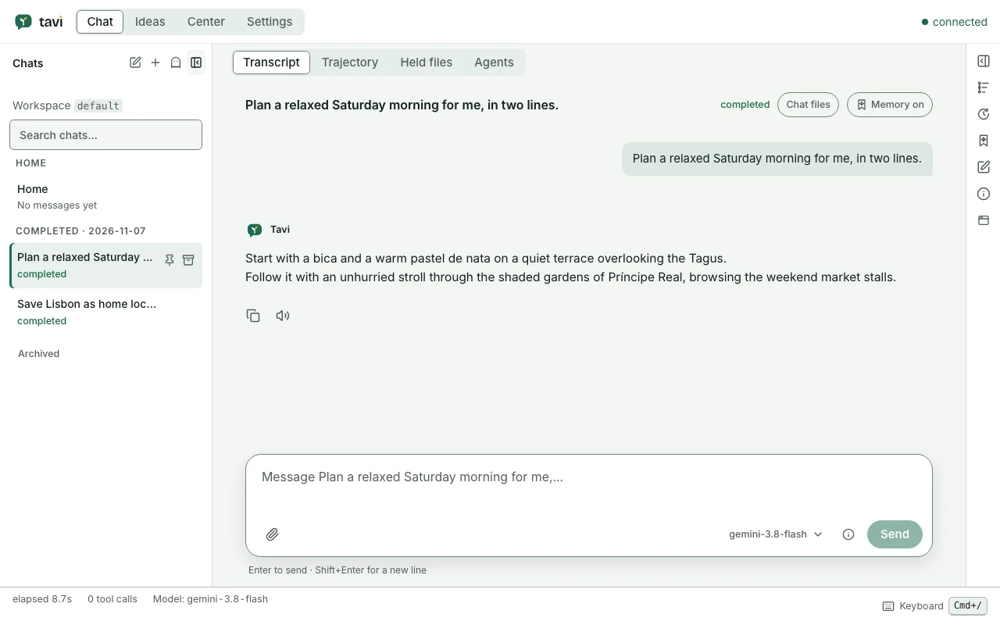
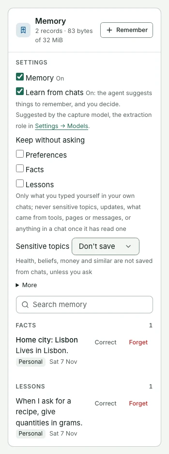

# See what Tavi always knows about you (your profile)

Most memories reach a chat when its words match them, or when you ask what Tavi knows. A few are given to every chat: your lessons (how you want help) and the core facts about you, such as where you live. Together they are your profile. Here's how to fill it and see what's in it. About five minutes.

> **Uses:** memory (`memory.propose`, the memory card) · Command Center → **Soul & memory** → **Remember** · the profile every chat is given ("About the person")
> **Before you start:** a model connected ([Connect your first model](../get-started/first-model.md)) · Tavi running in the background with `tavi serve` ([Keep Tavi running in the background](../get-started/keep-tavi-running.md)) · the canvas open ([Open the web canvas and walk through Welcome](../get-started/web-canvas-tour.md))

## 1. Tell Tavi where you live

In a chat, say `Remember that I live in Lisbon.` and choose **Keep** on the card. Tavi files a lasting fact about you under a topic of its own, such as your home city, your work or the languages you speak, and those core facts go into your profile.

## 2. Teach it a lesson

Open **Center → Soul & memory** and choose **Remember**. Set **Kind** to **Lesson**, write the rule in **What to remember**, for example `When I ask for a recipe, give quantities in grams.`, and choose **Remember**. Every lesson you keep is in your profile.

## 3. Ask something that doesn't mention it

Start a new chat and ask `Plan a relaxed Saturday morning for me, in two lines.` You never said where, yet the plan is for Lisbon: the profile came with your question. It is given to every chat, so the answer's **Used N memories** chip and `/why` don't list it; they list what a search found for this question.

<!-- cover -->

## 4. See what's in it

Back in **Center → Soul & memory**, your profile is the **Lessons** list and the facts about you under **Facts**. It holds up to 12 of them, the lessons used most first. To leave something out, **Forget** it; a memory marked sensitive is never in the profile.

## What Tavi will and won't do

The profile is given to the model as quoted data to apply where relevant, never as instructions, and only in your own chats: never in a group chat, a private chat or a chat with memory off, nor to a routine or a delegated worker. A memory proposed after a chat read a web page or an email is never put in the profile, even once you keep it; search can still find it. The details are in [MEMORY.md](../../MEMORY.md#a3-how-memory-is-read-one-turns-context).

## Related

- [Teach Tavi a fact, and make it forget one](remember-and-forget.md)
- [See which memories shaped a reply (`/why`)](why-that-answer.md)
- [Update a fact Tavi knows: Replace, or Keep both](update-a-memory.md)
- Reference: [MEMORY.md](../../MEMORY.md)
