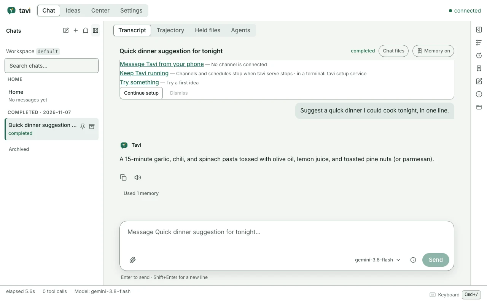
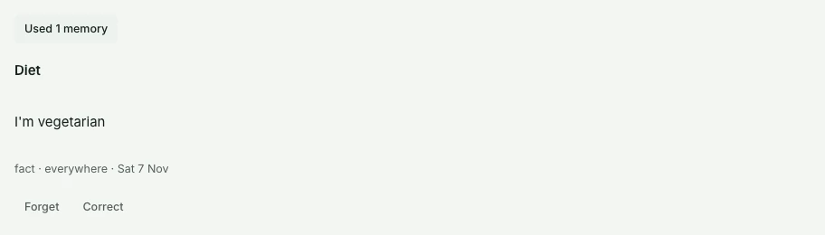
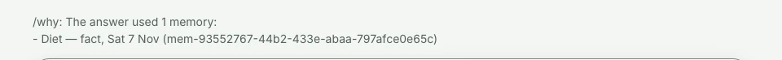
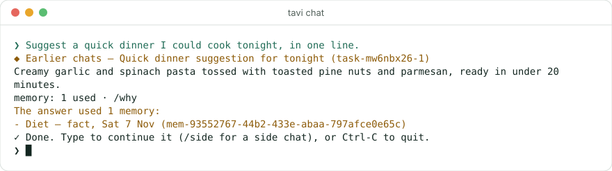

# See which memories shaped a reply (`/why`)

When an answer seems to know something about you, find out exactly which memories it was given, and fix or forget one on the spot. About three minutes.

> **Uses:** memory recall · the **Used N memories** or **Looked through N memories** chip under an answer · `/why` in a chat · `tavi memory why <chat-id>`
> **Before you start:** a model connected ([Connect your first model](../get-started/first-model.md)) · Tavi running in the background with `tavi serve` ([Keep Tavi running in the background](../get-started/keep-tavi-running.md)) · something kept in memory ([Teach Tavi a fact, and make it forget one](remember-and-forget.md))

## 1. Ask something your memory covers

With a fact such as **I'm vegetarian** kept, start a new chat and ask `Suggest a quick dinner I could cook tonight, in one line.` Tavi finds the kept fact by itself, and the answer has a quiet **Used 1 memory** chip under it.

<!-- cover -->

## 2. Open the chip

Choose **Used 1 memory**. Each memory the answer was given is listed by its title and what it says, with its kind, where it applies, its date and, when a chat taught it, that chat. **Correct** changes its words and **Forget** erases it, right there.

## 3. Ask with `/why`

Type `/why` in the chat. Tavi says the same in words: how many memories the last answer used, each with its date and id, and how many preferences applied.

## 4. Ask in the terminal

In `tavi chat`, an answer that used memory comes with a dim line, `memory: 1 used · /why`, and `/why` works there too. For any chat, `tavi memory why <chat-id>` answers for its newest answer, and `--turn <n>` for an earlier one.

<picture>
  <source media="(prefers-color-scheme: dark)" srcset="../../assets/use-cases/memory-and-skills/why-that-answer/04-ask-in-the-terminal-dark.svg">
  
</picture>

## What Tavi will and won't do

Each answer records only the ids of the memories it was given, never their words, so a memory you forget afterwards is counted as forgotten, never shown again. Preferences apply to every answer, so they are counted, not listed as used. Ask something with no words to match, such as `from what you know I like`, and the model reads everything you keep: the chip then says **Looked through 5 memories**, `tavi chat` says `memory: 5 looked through · /why`, and `/why` lists them under that heading, a preference among them if you keep one. That's what was in front of it, not what it used, and a memory it used too counts once, as used. Memories are given to the model as quoted data it may use where relevant, never as instructions to follow. The details are in [MEMORY.md](../../MEMORY.md#a3-how-memory-is-read-one-turns-context).

## Related

- [Teach Tavi a fact, and make it forget one](remember-and-forget.md)
- [Update a fact Tavi knows: Replace, or Keep both](update-a-memory.md)
- [See what Tavi always knows about you (your profile)](what-tavi-always-knows.md)
- Reference: [MEMORY.md](../../MEMORY.md), [TERMINAL-UI.md](../../TERMINAL-UI.md)
