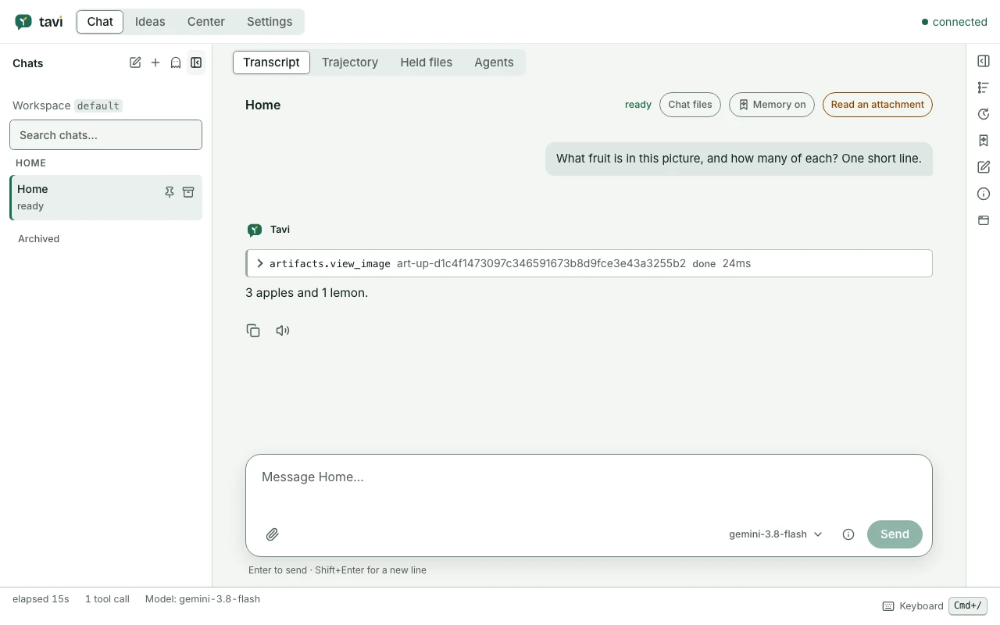
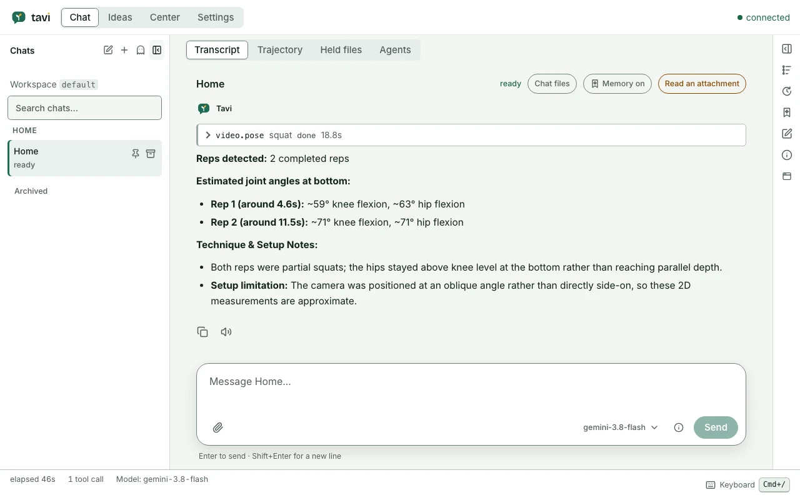
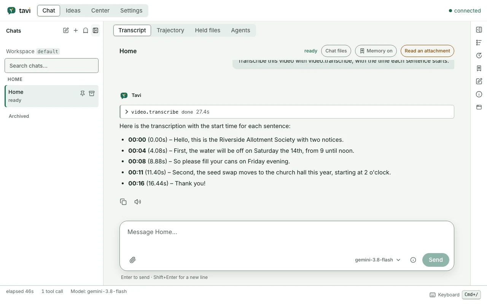

<!-- Generated by scripts/docs/guide-indexes.mjs from the guides: edit the guides, not this file. -->

# Photos and video

Questions about images, transcripts and movement coaching.

| | Guide |
| :--- | :--- |
|  | [Ask about a photo](ask-about-a-photo.md) Send Tavi a picture from the canvas and ask what is in it: a model that reads images looks at it and answers. |
|  | [Get coaching on your exercise form](check-exercise-form.md) Send Tavi a short clip of yourself doing squats and get your reps counted, your knee and hip angles measured at the bottom of each one, and what the setup puts in doubt. |
|  | [Transcribe a video locally](transcribe-a-video.md) Send Tavi a video and get what is said in it, with the times it is said: whisper.cpp listens on this computer, and only the words go to your model. |

[All how-to guides](../README.md)
