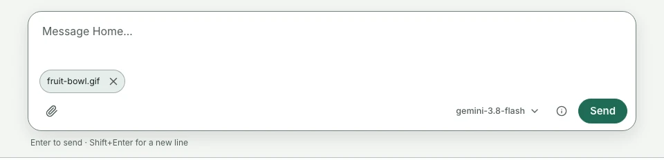
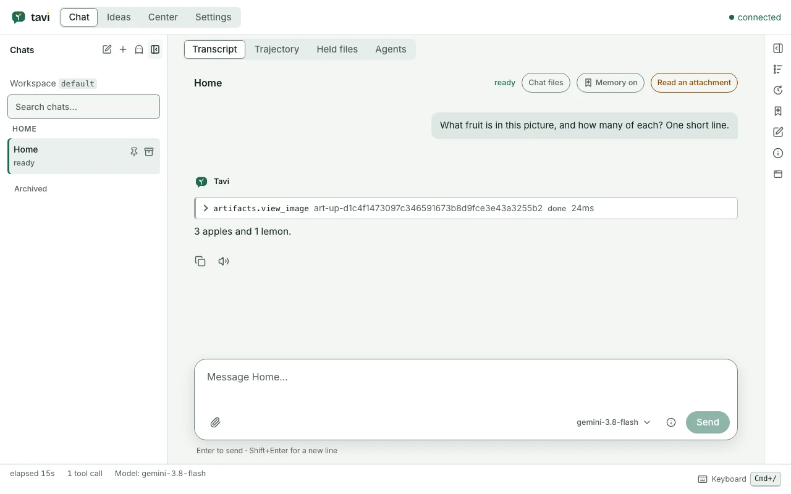
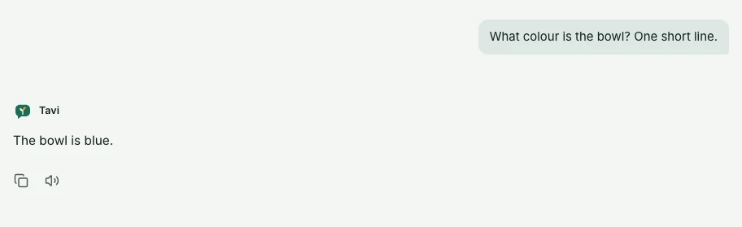
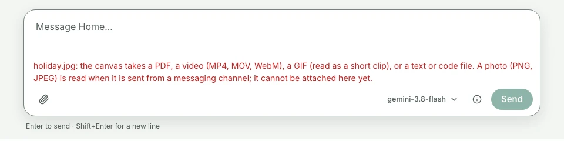

# Ask about a photo

Send Tavi a picture from the canvas and ask what is in it: a model that reads images looks at it and answers. About two minutes.

> **Uses:** the composer's attachments (`tavi ui`) · looking at an attached image (`artifacts.view_image`)
> **Before you start:** a model that reads images connected ([Connect your first model](../get-started/first-model.md)) · Tavi running in the background with `tavi serve` ([Keep Tavi running in the background](../get-started/keep-tavi-running.md))

## 1. Attach the picture

Run `tavi ui`, and in **Home**'s message box choose the paperclip (**Attach PDF, video, GIF, text and code files**), then pick the picture. The canvas takes a picture as a GIF, up to 50 MB; it shows as a chip under the box.

## 2. Ask about it

Type your question, such as *What fruit is in this picture, and how many of each?*, and press Enter. The picture is uploaded as you send, and Tavi opens it with `artifacts.view_image`.

<!-- cover -->

## 3. Ask a follow-up

Ask about the same picture again: *What colour is the bowl?* The picture stays in the chat, so you can keep asking about it without attaching it again.

## 4. Know which pictures go

A PNG or JPEG is refused in the canvas, with a note under the box saying what can be attached. Save the photo as a GIF, or put it in a PDF, to send it from the canvas; from a messaging channel such as Telegram, photos go as they are.

## What Tavi will and won't do

An uploaded picture is kept as an untrusted attachment of the chat: text in it is read as data, never as instructions, and the chat is marked **Read an attachment**. The picture goes to your model, so to its provider when the model runs there. It is erased with the chat; nothing is uploaded until you send.

## Related

- [Summarise a PDF and pull out tables](../documents/read-a-pdf.md)
- [Have your first conversation in the terminal](../get-started/first-chat.md)
- Reference: [WEB-UI.md](../../WEB-UI.md#attachments), [CONCEPTS.md](../../CONCEPTS.md)
