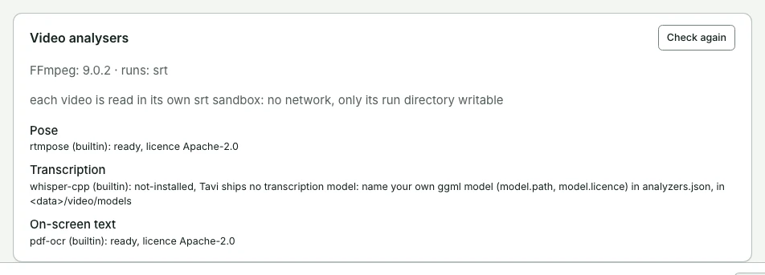
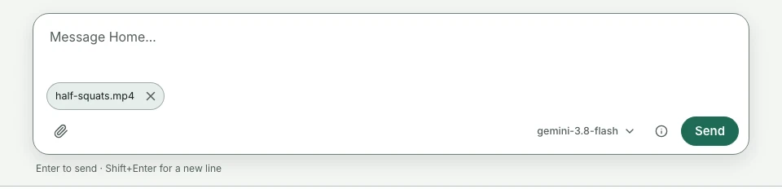
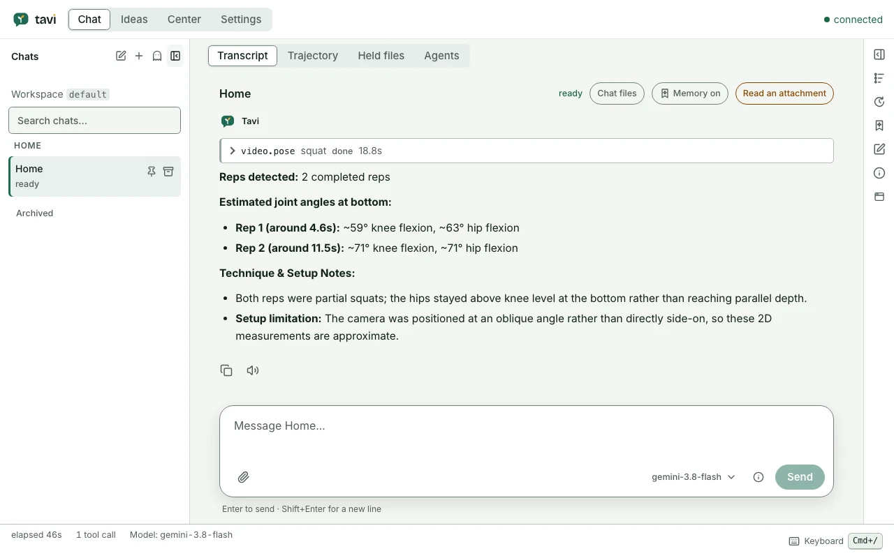
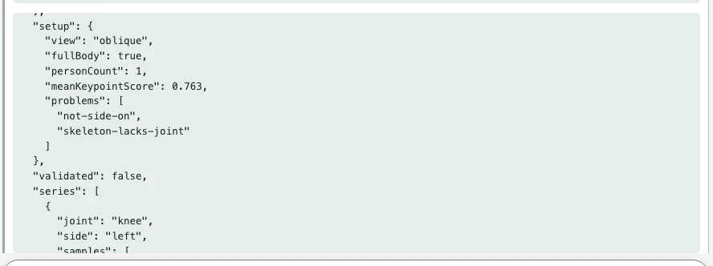

# Get coaching on your exercise form

Send Tavi a short clip of yourself doing squats and get your reps counted, your knee and hip angles measured at the bottom of each one, and what the setup puts in doubt. The movement is measured on this computer. About ten minutes, plus the model downloads.

> **Uses:** the composer's attachments (`tavi ui`) · measuring a movement (`video.pose`)
> **Before you start:** a model connected ([Connect your first model](../get-started/first-model.md)) · Tavi running in the background with `tavi serve` ([Keep Tavi running in the background](../get-started/keep-tavi-running.md)) · FFmpeg (`brew install ffmpeg`)

## 1. Set up the pose add-on

In your Tavi checkout, add the ONNX runtime beside the add-on: `pnpm --filter @tavi/video-pose add onnxruntime-node`. Put an RTMPose ONNX model (`rtmpose-s.onnx`) and, optionally, a person detector (`rtmdet-nano.onnx`) in `<data>/video/models`, under licences you hold, and name them in `<data>/video/analyzers.json` as `{ "pose": [{ "type": "builtin", "id": "rtmpose", "model": { "path": "rtmpose-s.onnx", "detectorPath": "rtmdet-nano.onnx", "licence": "Apache-2.0" } }] }`. Restart `tavi serve`; **Settings → Models → Video analysers → Check** lists it under **Pose**.

## 2. Attach your clip

Film side-on at hip height, with your whole body in frame and nobody else in it. In **Home**'s message box choose the paperclip and pick the clip; it shows as a chip under the box.

## 3. Ask about your form

Ask, for example, *Measure my squats in this clip: count the reps and tell me my knee and hip angles at the bottom.* Tavi runs `video.pose` with the squat template: it finds your joints in each frame, counts the reps, and measures each one at its deepest point.

<!-- cover -->

## 4. Read what the measures can't tell

Open the **Worked** line above the answer, then the `video.pose` call in it, to see its result. Under `setup` it says what it checked about the clip: the view (`side`, `oblique` or `front`), whether your whole body was in frame, other people, the light and a moving camera. `validated: false` means the squat template has not yet passed its recorded tests, so no fault is named, only the measures.

## What Tavi will and won't do

Your joints are found on this computer: the movement is measured here, and what the tools return goes to your model: the measures and the overlay and, if Tavi uses `video.frames`, stills from the clip. With a provider's model they go to that provider; with a local model they stay here. The angles are 2D, from one camera, so they are approximate. Tavi describes technique; it does not judge injury risk or diagnose, and if you mention pain it sends you to a physiotherapist or a coach. No tool identifies a person or describes their face.

## Related

- [Transcribe a video locally](transcribe-a-video.md)
- [Ask about a photo](ask-about-a-photo.md)
- Reference: [VIDEO.md](../../VIDEO.md#measuring-a-movement)
