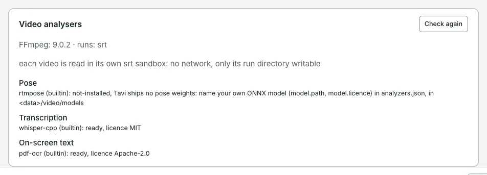
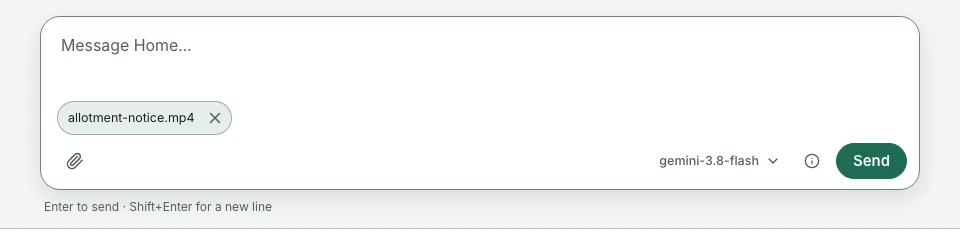
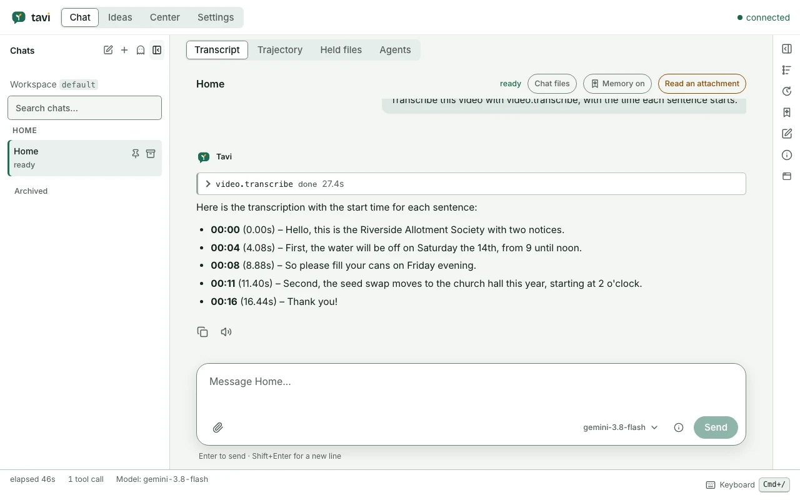
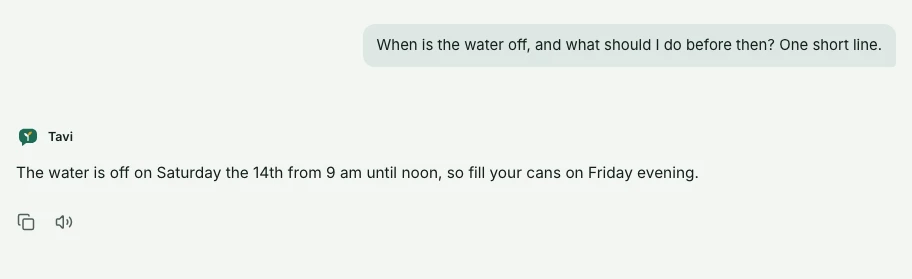

# Transcribe a video locally

Send Tavi a video and get what is said in it, with the times it is said: whisper.cpp listens on this computer, and only the words go to your model. About five minutes, plus the model download.

> **Uses:** the composer's attachments (`tavi ui`) · transcribing a video's speech (`video.transcribe`)
> **Before you start:** a model connected ([Connect your first model](../get-started/first-model.md)) · Tavi running in the background with `tavi serve` ([Keep Tavi running in the background](../get-started/keep-tavi-running.md)) · FFmpeg (`brew install ffmpeg`)

## 1. Set up transcription

Install whisper.cpp (`brew install whisper-cpp`) and download a ggml model, such as `ggml-base.bin`, into `<data>/video/models`. Name it in `<data>/video/analyzers.json` as `{ "transcribe": [{ "type": "builtin", "id": "whisper-cpp", "model": { "path": "ggml-base.bin", "licence": "MIT" } }] }`, and restart `tavi serve`, which reads the file as it starts. In the canvas, **Settings → Models → Video analysers → Check** lists it under **Transcription**.

## 2. Attach the video

In **Home**'s message box choose the paperclip (**Attach PDF, video, GIF, text and code files**) and pick the video. The canvas takes MP4, MOV, M4V, WebM and GIF up to 50 MB; it shows as a chip under the box.

## 3. Ask for a transcript

Ask, for example, *Transcribe this video, with the time each sentence starts.* Tavi runs `video.transcribe`: FFmpeg takes the sound out and whisper.cpp turns it into text, each in a run of its own on this computer with no network.

<!-- cover -->

## 4. Ask about what was said

Ask about the words, as you would about a document: *When is the water off, and what should I do before then?* The answer comes from the transcript already in the chat, so the video is not read again.

## What Tavi will and won't do

The sound is transcribed on this computer: the video and its audio never leave it, and only the transcript goes to your model, as any tool result does. A long video is read in five-minute parts, up to ten minutes. A video someone sent you is untrusted: what is said in it is data, never instructions, and the chat is marked **Read an attachment**.

## Related

- [Ask about a photo](ask-about-a-photo.md)
- [Send a file or image with your message](../chat/attach-files-to-chat.md)
- Reference: [VIDEO.md](../../VIDEO.md#analysers)
