<!-- Generated by scripts/docs/guide-indexes.mjs from the guides: edit the guides, not this file. -->

# Run and maintain

Models, credentials, permissions, backups and health.

| | Guide |
| :--- | :--- |
| 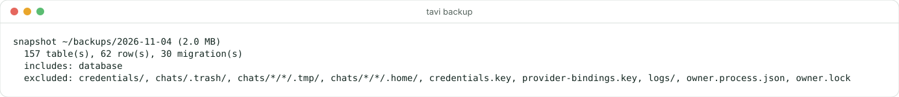 | [Back up, export and restore your data](back-up-and-restore.md) Take a snapshot of everything Tavi keeps, export it as plain files any tool can read, and bring a snapshot back when something goes wrong. |
| 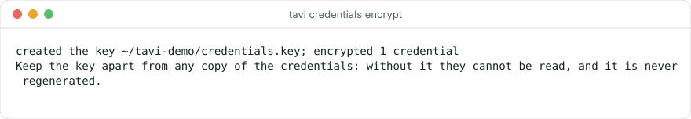 | [Store and rotate API keys](credentials.md) Keep a provider's key in Tavi's credential store, replace it when the provider issues a new one, and check that the store is encrypted, with its key in your OS keychain. |
| 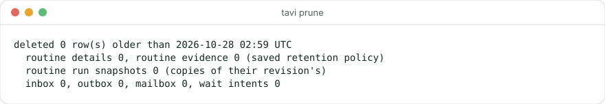 | [Keep storage small, or start over](free-up-space.md) Keep fewer full model requests, delete finished delivery records and old chat folders now rather than waiting for Tavi's own sweep, and, when you want a clean slate, reset everything. |
| 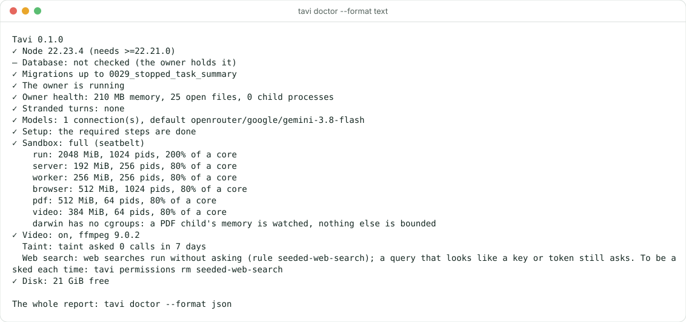 | [Check Tavi's health and free a stuck task](health-check.md) See at a glance whether Tavi is healthy, check its database in depth, stop a turn that runs too long, and free a task a crash left behind. |
| 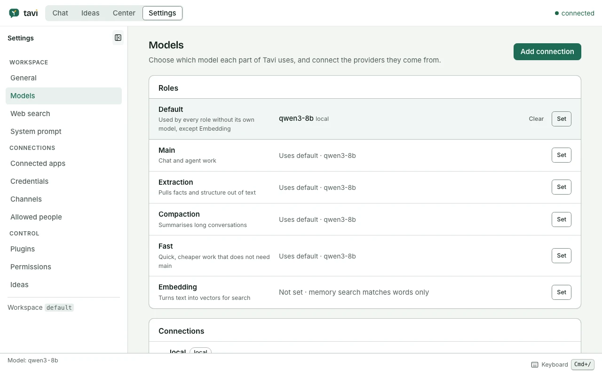 | [Run on a local model](local-models.md) Point Tavi at a model running on your own computer, so your chats, their summaries and the notes they leave never go to a cloud provider. |
| 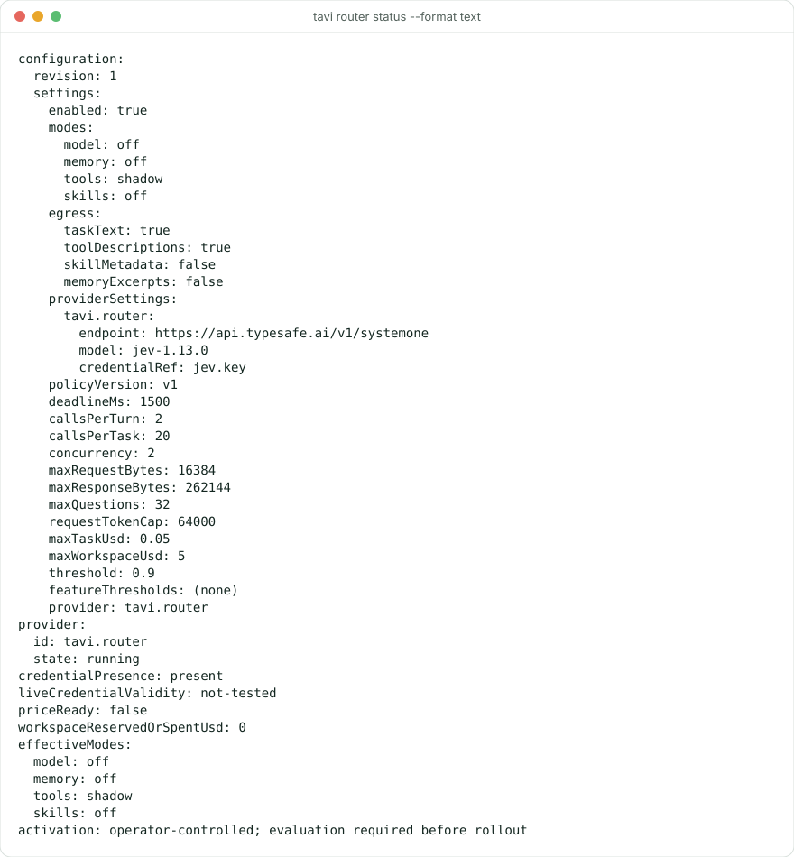 | [Turn on model routing](model-routing.md) Let a routing provider advise Tavi on which tools, memory, skills or model a chat needs, first in shadow, where its advice is only recorded, so you can measure it before it changes anything. |
| 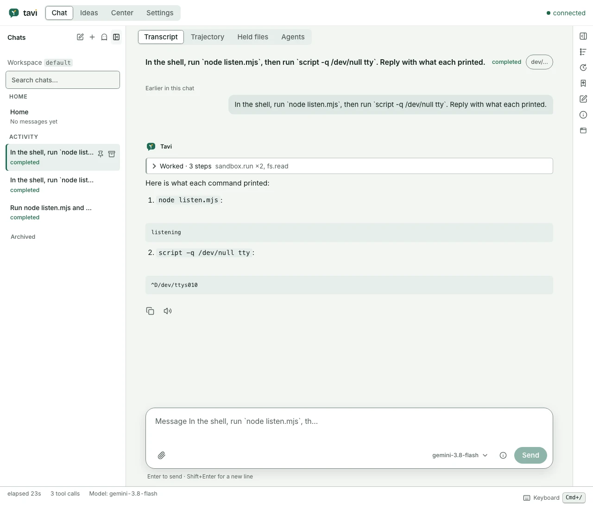 | [Sandbox options for operators: terminals, local listeners, TLS inspection](sandbox-operator-options.md) Loosen or tighten what the sandbox lets a shell command do, for the work you run on this machine: let a dev server listen and a test open a terminal on macOS, or have Tavi read every HTTPS connection a command makes. |
| 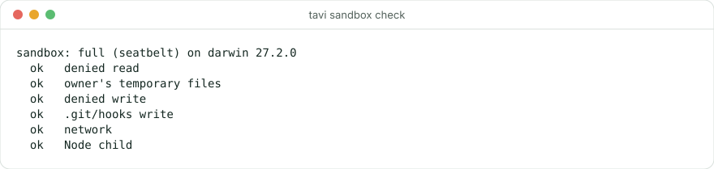 | [Check the sandbox (and set it up on Linux)](sandbox-setup.md) Make sure the commands Tavi runs for you are confined: check the sandbox, see what it bounds, and, on Linux, run the one-time setup it asks for. |
| 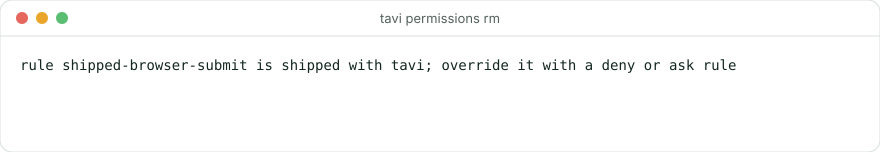 | [Review what Tavi is allowed to do](saved-permissions.md) See every rule that lets a tool run without asking you, take back what you allowed for a chat, and add a rule of your own. |
| 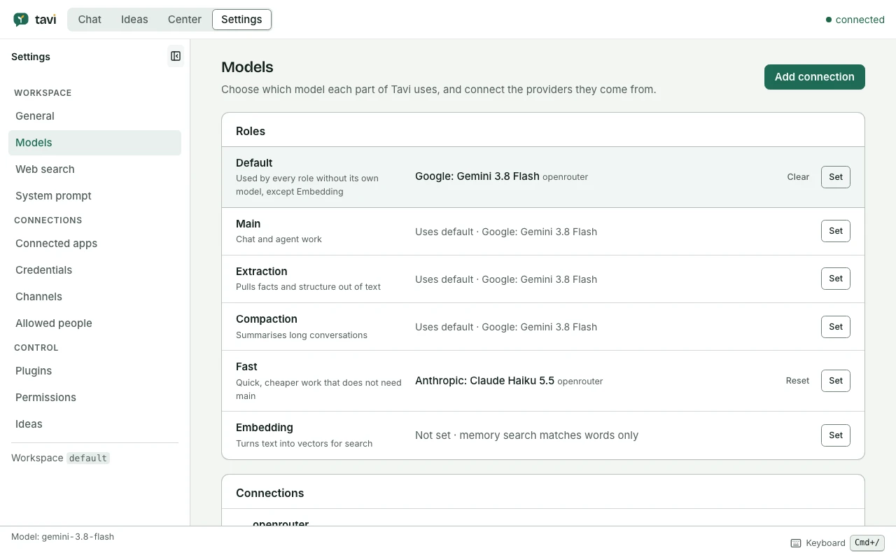 | [Add a provider and pick models per role](switch-models.md) Connect a model provider, make one of its models the default, give the quicker background jobs a cheaper model, and pick a model for a single chat. |
| 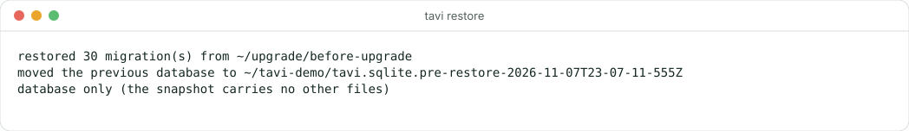 | [Upgrade Tavi and its shipped instructions](upgrade.md) Move to a new build of Tavi without losing anything: stop it, take a snapshot, install, and start it again, then decide whether your chats follow the new build's instructions. |
| 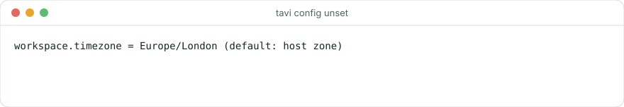 | [Change a workspace setting](workspace-settings.md) See every setting your workspace has, change one from the terminal or the web canvas, and put it back to its default. |

[All how-to guides](../README.md)
