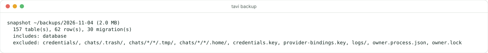
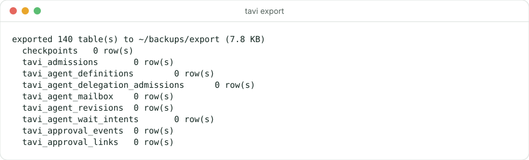
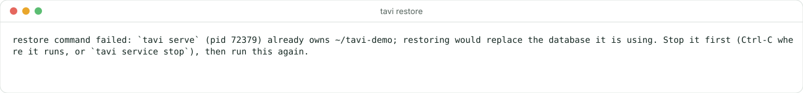
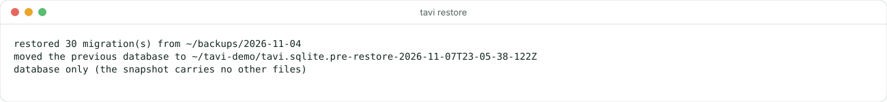
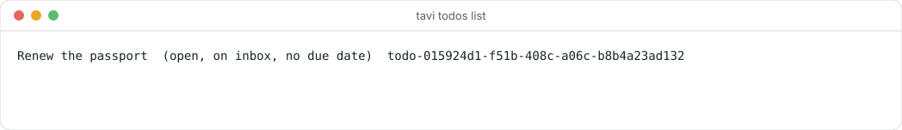

# Back up, export and restore your data

Take a snapshot of everything Tavi keeps, export it as plain files any tool can read, and bring a snapshot back when something goes wrong. About five minutes.

> **Uses:** snapshots (`tavi backup --out <folder>`) · a portable export (`tavi export --out <folder>`) · restoring (`tavi restore --from <folder>`)
> **Before you start:** Tavi running in the background with `tavi serve` ([Keep Tavi running in the background](../get-started/keep-tavi-running.md)) · some data worth keeping, such as a to-do ([Keep a to-do list, in Tavi or in your own task app](../automation/keep-a-todo-list.md))

## 1. Take a backup

Run `tavi backup --out <folder>`, naming an empty folder outside Tavi's data directory (one inside it is refused), ideally on another disk. It's safe while `tavi serve` runs: the database, artifacts, installed plugins and the chats' working folders are copied as they stand, with a `manifest.json` saying what the snapshot holds. Saved keys are copied only with `--include-credentials`.

<!-- cover -->
<picture>
  <source media="(prefers-color-scheme: dark)" srcset="../../assets/use-cases/run-and-maintain/back-up-and-restore/01-take-a-backup-dark.svg">
  
</picture>

## 2. Export to plain files

For a copy anything can read, run `tavi export --out <folder>`. Every table is written as its own `.ndjson` file, one record per line. An export can't be restored; keep it for reading, searching or moving your data elsewhere.

<picture>
  <source media="(prefers-color-scheme: dark)" srcset="../../assets/use-cases/run-and-maintain/back-up-and-restore/02-export-to-plain-files-dark.svg">
  
</picture>

## 3. Stop Tavi before you restore

Say you removed a to-do by mistake after the backup. A restore replaces the database, so it needs the data directory to itself: while `tavi serve` runs, a restore is refused. Stop `tavi serve` first (Ctrl-C in its terminal).

<picture>
  <source media="(prefers-color-scheme: dark)" srcset="../../assets/use-cases/run-and-maintain/back-up-and-restore/03-stop-tavi-before-you-restore-dark.svg">
  
</picture>

## 4. Restore the backup

Run `tavi restore --from <folder>`. The snapshot is checked before anything moves, and the database and folders it replaces are moved aside, not deleted, so a wrong restore can be undone. Memory you told Tavi to forget stays forgotten.

<picture>
  <source media="(prefers-color-scheme: dark)" srcset="../../assets/use-cases/run-and-maintain/back-up-and-restore/04-restore-the-backup-dark.svg">
  
</picture>

## 5. Start Tavi and check

Start `tavi serve` again, then look for what you lost: `tavi todos list` shows the to-do back on your list.

<picture>
  <source media="(prefers-color-scheme: dark)" srcset="../../assets/use-cases/run-and-maintain/back-up-and-restore/05-start-tavi-and-check-dark.svg">
  
</picture>

## What Tavi will and won't do

A backup never copies the key that unlocks your saved credentials (`credentials.key`), so keep it apart from the snapshot and put it back beside `credentials/` when you restore onto another machine. Logs, the agent browser's sign-ins and host folders a chat attached aren't backed up either: those folders are yours to back up. A restore refuses a snapshot from a newer version of Tavi and never writes over the data directory it's copying from. See [OPERATIONS.md](../../OPERATIONS.md#backups).

## Related

- [Keep storage small, or start over](free-up-space.md)
- [Store and rotate API keys](credentials.md)
- [Change a workspace setting](workspace-settings.md)
- Reference: [CLI.md](../../CLI.md#tavi-backup), [OPERATIONS.md](../../OPERATIONS.md#restore)
